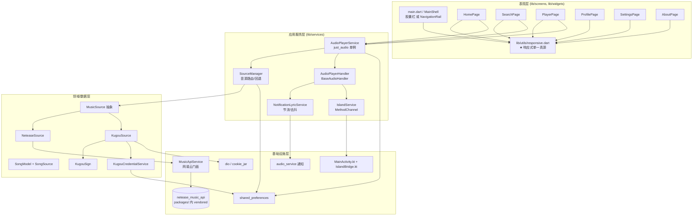
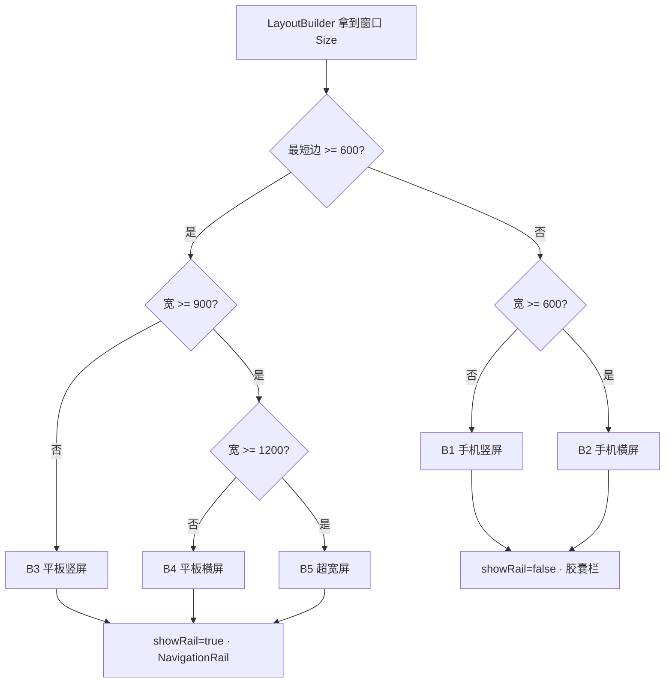
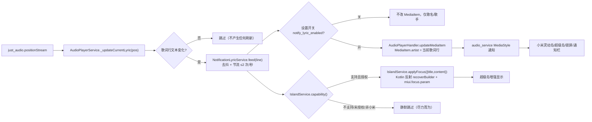
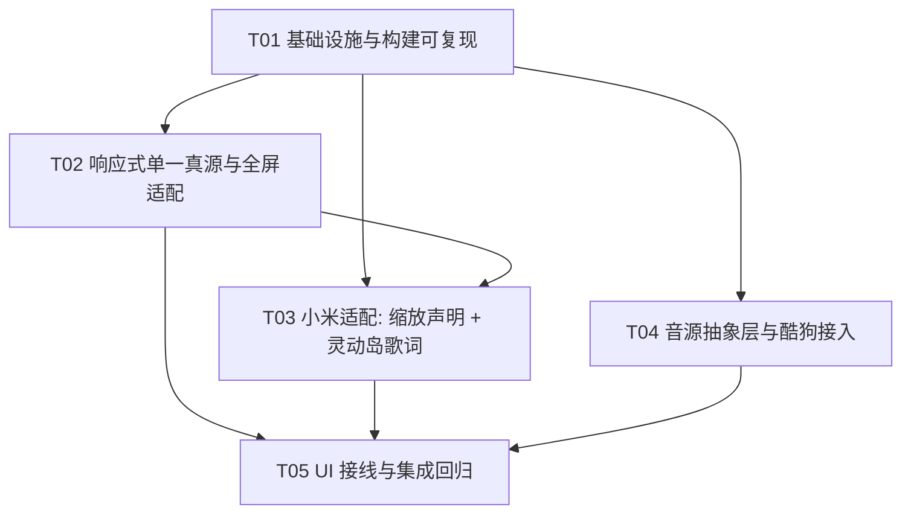

# SuchMusic 二改 · 系统架构设计 + 任务分解

| 项目 | 内容 |
|---|---|
| 文档 | `docs/ARCH-二改.md`（架构设计 + 任务分解，单一文档） |
| 版本 | v1.0 |
| 语言 | 简体中文 |
| 上游输入 | `docs/PRD-二改.md`（REQ-00~REQ-12，断点 B1~B5） |
| 代码基线 | `/workspace/suchmusic`（Flutter / Android / 19 个 Dart 文件 ≈ 7.9k 行） |
| 质量基线 | `flutter analyze lib test` → **No issues found**（vendored 包 + 补丁后已验证） |
| 主理人已拍板 | Q1=A、Q2=A、Q3=A、Q4=A、Q5=960dp、Q6=B、Q7=A、Q8=A |

> 阅读顺序：先看 **Part A**（§1–§8）理解怎么改，再看 **Part B**（§9–§13）看怎么分工与落地。
> 本文档**不含实现代码**，只给出可直接照做的接口签名、数据结构与约束。

---

# Part A · 系统设计

## 1. 实现方案总览

### 1.1 核心难点与技术选型

| 难点 | 说明 | 选型 / 决策 |
|---|---|---|
| 全量断点适配 | 现有 19 文件按 430×932 硬编码，全仓库无 `LayoutBuilder`/`OrientationBuilder` | 新增 `lib/utils/responsive.dart` 作**单一真源**，所有尺寸从它取；屏内用 `LayoutBuilder` 而非全局 `MediaQuery` 兜底 |
| 无极缩放不溢出 | 320→1920dp、`textScaler` 0.85–1.3 | `MediaQuery.withClampedTextScaling` 全局夹取 + 关键页 `SingleChildScrollView` 兜底 + 热区 ≥48dp |
| 小米灵动岛歌词 | 官方超级岛需上架+白名单，不可达 | 主方案走 `audio_service` 的 `MediaItem` **副标题**（全 Android 生效）；`miui.focus.param` 作**尽力而为**增强，能力检测失败即静默跳过 |
| 酷狗逆向接口 | 签名/参数易变，VIP 临时直链 | `MusicSource` 抽象 + 集中配置 + **失败回退网易云** + 请求**竞态序号**；MD5 自实现（`crypto` 包） |
| 构建可复现 | `pubspec.yaml:43` 硬编码 `D:/laji/...` | vendor 到仓库内 `packages/netease_music_api`，`path` 相对依赖 + 锁定 commit |
| 既有功能不回归 | 8500 行、多处隐式耦合 | 每个任务完成即 `flutter analyze` 归零；竖屏基线截图对比作强制门禁 |

### 1.2 分层架构图



### 1.3 改造策略（保形优先）

1. **不动视觉风格**：所有改造是「把硬编码换成响应式取值」，颜色/圆角/图标一律不变，保证 REQ-01 竖屏基线不回归。
2. **单一真源**：尺寸/断点/夹取全部收敛到 `responsive.dart`，屏内不再出现魔法数字。
3. **抽象后置兼容**：`SongModel` 新增字段一律带默认值，旧 `playlist.json` 反序列化默认 `netease`，**不破坏**已存用户数据。
4. **能力可降级**：小米/酷狗两处外部不确定依赖，一律「能则增强、不能则静默回退」，绝不阻断播放。

---

## 2. 响应式架构设计（REQ-01~REQ-05）

### 2.1 `lib/utils/responsive.dart`（新增 · 单一真源）

```dart
/// 断点枚举，与 PRD §4.1 B1~B5 一一对应
enum AppBreakpoint {
  b1PhonePortrait,   // 320–599dp 且 高>宽
  b2PhoneLandscape,  // 宽>=600 且 宽>高 且 最短边<600
  b3TabletPortrait,  // 最短边>=600 且 宽 600–899 且 竖
  b4TabletLandscape, // 最短边>=600 且 宽 900–1199 且 横
  b5UltraWide,       // 宽>=1200
}

class Responsive {
  Responsive._();

  // ── 常量（集中定义，全 App 唯一来源）───────────────────
  static const double contentMaxWidth   = 960;   // Q5 拍板：超宽屏内容上限
  static const double coverMaxSide      = 420;   // 封面边长上限
  static const double minTouchTarget    = 48;    // 最小热区
  static const double lyricFontMax      = 34;    // 歌词字号上限（原 30/24）
  static const double railMinWidth      = 72;
  static const double railMaxWidth      = 96;
  static const double designWidth       = 430;   // 原设计稿基准宽
  static const double textScaleMin      = 0.85;
  static const double textScaleMax      = 1.3;

  // ── 断点判定 ────────────────────────────────────────
  static bool isTablet(Size size) => size.shortestSide >= 600;   // 以最短边判形态
  static AppBreakpoint of(Size size);
  static AppBreakpoint ofContext(BuildContext c) => of(MediaQuery.sizeOf(c));

  // ── 尺寸取值（替换原魔法数字）───────────────────────
  static double contentWidth(Size s)  => math.min(s.width, contentMaxWidth);
  static double coverSize(Size s, AppBreakpoint bp);   // clamp(min(可用宽, 高预算), 200, coverMaxSide)
  static double bottomBarWidth(Size s);                // min(s.width*0.85-44, 560)
  static double uiScale(Size s);                       // clamp(min(s.width,contentMaxWidth)/430, 0.7, 1.15)
  static double dialogScale(Size s);                   // clamp(min(s.width,480)/430, 0.8, 1.0)
  static double clampLyricFont(double base);           // min(base, lyricFontMax)

  // ── 安全区 / 字体缩放 ───────────────────────────────
  static EdgeInsets safeArea(BuildContext c);                     // MediaQuery.padding + viewPadding
  static TextScaler clampTextScaler(BuildContext c);              // clamp(c, min:0.85, max:1.3)

  // ── 形态开关（各屏据此选择布局分支）────────────────
  static bool showRail(AppBreakpoint bp)   => bp != AppBreakpoint.b1PhonePortrait
                                           && bp != AppBreakpoint.b2PhoneLandscape;
  static bool isPlayerSplit(AppBreakpoint bp) => bp == AppBreakpoint.b2PhoneLandscape
                                              || bp == AppBreakpoint.b4TabletLandscape
                                              || bp == AppBreakpoint.b5UltraWide;
  static bool isGridHome(AppBreakpoint bp) => isTablet(...);
  static int homeGridColumns(Size s);   // 720dp 双列 / 900dp 三列
}

/// 内容居中容器：把任意页面内容夹到 contentMaxWidth 并水平居中
class ResponsiveContent extends StatelessWidget {
  const ResponsiveContent({required this.child, this.padding, super.key});
  final Widget child;
  final EdgeInsetsGeometry? padding;
  // build: Center -> ConstrainedBox(maxWidth: contentMaxWidth) -> Padding -> child
}
```

### 2.2 断点判定流程



### 2.3 各屏 5 断点布局形态

| 断点 | 底部导航 | 播放页 | 首页 | 搜索页 | 个人页 | 设置页 |
|---|---|---|---|---|---|---|
| **B1 手机竖屏** | 悬浮胶囊栏 `min(屏宽*0.85-44,560)` 居中 | 单列：封面→歌名→歌词→进度→控制（**基线不变**） | 单列列表 + 横向滑动卡片 | 单列；键盘弹出 `adjustResize` | 原样 + 顶部渐变 `clamp(高*0.533,...)` | 设计稿缩放 `uiScale` |
| **B2 手机横屏** | 胶囊栏（宽度同上，`bottom:10+safeBottom`） | **左右分栏**：左=封面+信息+控制，右=歌词（`isPlayerSplit`） | 内容居中 `ResponsiveContent`，单/双列 | 单列居中；输入框不被键盘遮挡 | 居中留白 | 居中留白 |
| **B3 平板竖屏** | **左侧 NavigationRail 72–96dp** | 列布局：上封面+信息+控制，下歌词 | **双列网格** | 居中留白 | 居中留白 | 居中留白 |
| **B4 平板横屏** | 左侧 NavigationRail | **左右两栏**（等比，间隙 24dp） | **三列网格** | 居中留白 | 居中留白 | 居中留白 |
| **B5 超宽屏** | 左侧 NavigationRail（固定宽） | 两栏，内容区 ≤960dp 居中；封面上限 420 | 三列网格，内容 ≤960 居中 | 内容 ≤960 居中 | 内容 ≤960 居中 | 内容 ≤960 居中 |

> 交互补充（Q6=B）：**分栏形态（B2/B4/B5）下封面固定显示，禁用「点击封面收起为大歌词」**；仅 B1/B3 保留收起交互。歌词字号 `clampLyricFont` 封顶，不随窗口宽度线性放大。

### 2.4 现有硬编码尺寸点逐项替换清单

| 文件:行 | 原表达式 | 替换为 | 说明 |
|---|---|---|---|
| `main.dart:159` | `screenWidth*0.85-44` | `Responsive.bottomBarWidth(size)` | 加 560 上限；平板下整条胶囊栏由 NavigationRail 取代 |
| `main.dart:161~165` | `coverSize/pillLeft/...` 按 320 基准比例 | 保持比例，但 `barWidth` 来源换成响应式值 | 比例不变→竖屏不回归 |
| `player_page.dart:289` | `coverSize = screenWidth-50` | `Responsive.coverSize(size, bp)` | 手机竖屏仍≈屏宽-50；平板/超宽封顶 420 |
| `player_page.dart:795` | `barWidth = screenWidth-50` | `Responsive.contentWidth(size)-50`（受 960 限制） | 进度条不超宽 |
| `player_page.dart:993/994` | 歌词 `_topPadding=200/_bottomPadding=500` | 保留，但按断点缩放（分栏下用视口高比例） | 分栏时用 `viewportDimension` 计算 |
| `settings_page.dart:51` | `s = width/430` | `Responsive.uiScale(size)` | clamp[0.7,1.15]；宽屏内容居中后按内容宽算 |
| `design_dialog.dart:17` | `s = width/430` | `Responsive.dialogScale(size)` | clamp[0.8,1.0]；弹窗卡片最大宽 400，避免超宽屏弹窗过宽 |
| `profile_page.dart:153` | `height*0.533` | `Responsive.gradientHeight(size)`=`clamp(h*0.533,240,520)` | 装饰渐变，避免大屏过高 |
| `home_page.dart:307/309` | `screenW` / `cardH=contentW*0.277+25` | `Responsive.contentWidth(size)` 派生 | 卡片高度设上限 |
| `home_page.dart:471` | `availableW = width-15` | `Responsive.contentWidth(size)-15` | PageView 宽度受内容上限约束 |
| `about_page.dart:143` | `cardMargin = width*29/430` | 基于 `Responsive.contentWidth` 计算 | 大屏卡片不贴边 |
| `about_page.dart:158` | logo `width*367/430*0.9` | `min(Responsive.contentWidth*367/430*0.9, 460)` | logo 设上限 |
| 全屏 `/430` 缩放 | `settings`+`design_dialog` 两处 | 统一走 `Responsive.uiScale/dialogScale` | 消除重复基准 |

### 2.5 不溢出保障（REQ-05）

- **全局字体夹取**：`MyApp.build` 用 `MediaQuery.withClampedTextScaling(minScaleFactor:0.85, maxScaleFactor:1.3, child: MaterialApp(...))`。
- **布局兜底**：首页/设置/关于正文外层 `SingleChildScrollView`；播放页控制条用 `Wrap`/`Flexible` 而非固定 `Row` 宽度。
- **固定比例元素**（开关/圆形按钮）用 `AspectRatio` 或同时受 `min/max` 约束，保证正圆/正方形。
- **热区**：所有 `GestureDetector`/`IconButton` 命中区 ≥48×48dp（不足时用 `SizedBox` 包裹）。
- **门禁**：Debug 模式跑 §2.1 六个宽度（320/480/600/840/1200/1600）+ `textScaler=1.3`，要求 0 条 `RenderFlex overflowed`。

---

## 3. 小米适配设计（REQ-05 · REQ-06）

### 3.1 无极缩放 / 自由窗口 —— 平台侧声明

| 位置 | 现状 | 目标改动 | 理由 |
|---|---|---|---|
| `AndroidManifest.xml` `<application>` | 未声明 `resizeableActivity`（默认 true） | **显式加 `android:resizeableActivity="true"`** | 显式声明自由窗口/多窗口可调整，避免个别 ROM 误判 |
| `AndroidManifest.xml` `<activity>` | `configChanges` 已含 `orientation\|screenSize\|screenLayout\|density\|smallestScreenSize` | **保持不动**（已满足旋转/缩放不重建 Activity → 播放不中断） | 关键：避免旋转重启 Activity 导致音频中断 |
| `<activity>` | 无 `android:screenOrientation` | **不添加**（保持自由旋转） | 添加会锁死方向，违反 REQ-02 |
| `<activity>` | 无 PiP 声明 | **不添加 `supportsPictureInPicture`**（默认 false） | 本版不需要画中画 |
| `android/local.properties` | 由 Flutter 生成 | **无需改动** | 只要 `flutter.sdk` 路径正确即可 |
| `android/app/build.gradle(.kts)` | `compileSdk/targetSdk` 走 `flutter.*` | **无需改动**（`minSdk` 已满足 `audio_service`/`getActiveNotifications` API23） | 自由窗口与 API 级别无关 |

> 结论：**平台侧只需 1 行 `resizeableActivity="true"`**，其余靠 Flutter 侧响应式布局保证任意尺寸不溢出。

### 3.2 灵动岛 / 通知歌词 —— 完整数据链路



### 3.3 开关与持久化

| 键（`shared_preferences`） | 类型 | 默认 | 说明 |
|---|---|---|---|
| `notify_lyric_enabled` | bool | **true** | 通知/灵动岛显示歌词总开关（REQ-06） |
| `miui_island_enabled` | bool | true | 小米超级岛增强（能力检测不通过仍静默禁用） |

- 切换开关**只改内存标志 + 写 prefs**，**不重连音频服务、不重启播放**（REQ-06 验收 5）。
- 设置页开关项读取时机：`initState` 异步加载，与现有 `allowMixWithOthers` 同款模式。

### 3.4 降级路径（全部「静默、不阻断播放」）

| 场景 | 行为 |
|---|---|
| 无歌词（纯音乐 / 接口失败） | 副标题回退 `歌手 - 专辑`；`_lyrics.isEmpty` 时不动 `MediaItem` |
| 歌词行含空行/纯时间戳 | `_parseLrc` 已过滤空文本；节流层遇空串沿用上一有效行 |
| `POST_NOTIFICATIONS` 被拒 | 设置页提示「需开启通知权限」，功能静默禁用，播放不受影响 |
| 非小米 / 旧系统 | `capability().supported=false` → 只走副标题，跳过 focus 增强，不报错 |
| MIUI 协议不匹配/接口变更 | `applyFocus` 返回 false → 记 warning 日志，跳过 |

### 3.5 Android 端 MethodChannel 接口定义

**Channel 名**：`com.lightningteam.suchmusic/island`

| 方法 | 入参 | 返回 | 说明 |
|---|---|---|---|
| `capability` | — | `Map` | `{isMiui:bool, supported:bool, canShowFocus:bool, reason:String}` |
| `applyFocus` | `{title:String, content:String, islandId:String}` | `bool` | 注入/更新超级岛参数，成功 true |
| `clearFocus` | — | `bool` | 清除超级岛参数（停止播放/关闭开关时调用） |

**能力检测实现要点（Kotlin）**：
1. `isMiui`：`Build.MANUFACTURER` 含 `xiaomi/redmi`，或 `SystemProperties.get("ro.miui.ui.version.name")` 非空（反射 `android.os.SystemProperties`）。
2. `supported`（是否支持超级岛）：`SystemProperties.get("persist.sys.feature.island") == "true"`。
3. `canShowFocus`（协议/授权）：读 `Settings.System.getInt(resolver,"notification_focus_protocol",0) >= 2`；并 `ContentResolver.query(Uri.parse("content://miui.statusbar.notification.public"), ...)` 取 `canShowFocus` 列。
4. 任一环节异常/无权限 → 返回 `supported=false` + `reason`，**不抛出**。

**`miui.focus.param` 注入要点（Kotlin）**：
1. 在 `MainActivity.configureFlutterEngine` 注册 `MethodChannel("com.lightningteam.suchmusic/island")`（`MainActivity` 继承 `AudioServiceActivity`，即 `FlutterActivity`，可覆写 `configureFlutterEngine`）。
2. `applyFocus`：用 `NotificationManager.getActiveNotifications()` 取本 App（audio_service 的 MediaStyle 通知）→ `Notification.Builder.recoverBuilder(ctx, notif)` → `bundle.putString("miui.focus.param", jsonString)` `addExtras(bundle)` → `nm.notify(tag, id, rebuilt)`。**id/tag 必须与 audio_service 一致**，避免产生重复通知。
3. `miui.focus.param` 为 JSON 字符串，最小结构：`{"param_v2":{"business":"such_music","protocol":2,"version":1,"islandId":"such_music_lyric","title":<歌名>,"content":<歌词>,"islandProperty":{"islandTitle":<歌名>,"islandContent":<歌词>}}}`。
4. 若 `recoverBuilder`/`getActiveNotifications` 抛错（低版本/ROM 裁剪）→ 捕获并返回 false。
5. `clearFocus`：以不含 focus extras 的通知重发一次同 id 通知。

> Dart 侧封装见 `lib/services/island_service.dart`：`IslandService.instance.capability()` 启动时调用一次并缓存；`applyFocus` 只在「开关开 + 能力支持 + 文本变化」时调用；任何异常 catch 后置 `_supported=false` 并停止后续调用。

---

## 4. 音源抽象设计（REQ-07~REQ-11）

### 4.1 类图

见 `docs/class-diagram.mermaid`（随本文件同步产出）。核心关系：`SourceManager` 管理 `MusicSource` 集合 → `NeteaseSource`/`KugouSource` 实现 → `KugouSource` 依赖 `KugouSign` 与 `KugouCredentialService`；`SongModel` 携带 `SongSource`；`MusicApiService` 作门面按 `song.source` 路由。

### 4.2 数据来源标识

```dart
enum SongSource {
  netease('netease', '网易云'),
  kugou('kugou', '酷狗概念版');

  const SongSource(this.code, this.label);
  final String code;   // 持久化用
  final String label;  // 顶栏/UI 展示用

  static SongSource fromCode(String? code) =>
      SongSource.values.firstWhere((e) => e.code == code, orElse: () => SongSource.netease);
}
```

### 4.3 `SongModel` 增加 source 字段（向后兼容）

```dart
class SongModel {
  final String id;
  final String name;
  final String artist;
  final String album;
  final String? coverUrl;
  final int? duration;
  final SongSource source;       // 新增，默认 netease
  final String? hash;            // 新增，酷狗 hash
  final String? albumId;         // 新增，酷狗 album_id
  final String? albumAudioId;    // 新增，酷狗 album_audio_id

  const SongModel({
    required this.id, required this.name, required this.artist, required this.album,
    this.coverUrl, this.duration,
    this.source = SongSource.netease,   // ★ 缺省即网易云 → 旧调用点零改动
    this.hash, this.albumId, this.albumAudioId,
  });

  factory SongModel.fromKugouJson(Map<String, dynamic> json);  // 新增

  Map<String, dynamic> toJson() => {
    'id': id, 'name': name, 'artist': artist, 'album': album,
    'coverUrl': coverUrl, 'duration': duration,
    'source': source.code, 'hash': hash, 'albumId': albumId, 'albumAudioId': albumAudioId,
  };

  factory SongModel.fromStorage(Map<String, dynamic> json) => SongModel(
    id: json['id'] as String,
    name: json['name'] as String? ?? '',
    artist: json['artist'] as String? ?? '',
    album: json['album'] as String? ?? '',
    coverUrl: json['coverUrl'] as String?,
    duration: json['duration'] as int?,
    source: SongSource.fromCode(json['source'] as String?),  // ★ 旧数据无该键 → netease
    hash: json['hash'] as String?, albumId: json['albumId'] as String?,
    albumAudioId: json['albumAudioId'] as String?,
  );

  SongModel copyWith({... SongSource? source, String? hash, ...});
}
```

> 兼容性：旧 `playlist.json` **无** `source` 键 → `fromCode(null)` 返回 `netease`，历史播放队列照常反序列化，无迁移脚本。

### 4.4 `MusicSource` 抽象与实现

```dart
abstract class MusicSource {
  String get id;                 // 'netease' / 'kugou'
  String get displayName;        // '网易云' / '酷狗概念版'
  SongSource get kind;
  bool get needsCredentials;     // Netease=false, Kugou=true
  bool get isConfigured;         // 酷狗需 token+userid

  Future<List<SongModel>> search(String keyword, {int limit = 30});
  Future<List<String>> hotSearch();
  Future<String?> getSongUrl(SongModel song);
  Future<String?> getLyrics(SongModel song);
  Future<SongModel?> getSongDetail(SongModel song);
  Future<List<PlaylistModel>> topList();
  Future<List<SongModel>> dailyRecommend() => Future.value(const []); // 仅网易云实现
}
```

- `NeteaseSource`：包装现有 `MusicApiService` 全部逻辑（登录/搜索/取 URL/歌词/歌单），行为与改造前**逐字节等价**。
- `KugouSource`：新增，见 §4.6。

### 4.5 路由 / 播放 / 歌词分派 / 回退 / 竞态

```dart
class SourceManager {
  static final SourceManager _i = SourceManager._();
  factory SourceManager() => _i;

  MusicSource get source;                       // 当前音源
  SongSource get currentSource;
  Stream<SongSource> get onSourceChanged;
  MusicSource sourceFor(SongSource kind);
  Future<void> init();                          // 读 prefs 恢复当前音源 + 校验凭证
  Future<void> switchTo(SongSource kind);       // 持久化 + 广播，不改播放队列
  bool get fallbackEnabled;                      // 'kugou_fallback_enabled'

  /// 统一回退：主音源失败且开启回退时切网易云重试
  Future<T> withFallback<T>(SongModel song, Future<T?> Function(MusicSource) run);
}
```

**播放 URL 分派**（`AudioPlayerService.play` 内）：
```dart
final seq = ++_playSeq;                                   // ① 竞态序号
final url = await SourceManager()
    .withFallback(song, (src) => src.getSongUrl(song));   // ② 按 song.source 路由 + 回退
if (seq != _playSeq) return false;                        // ③ 只认最后一次，丢弃过期结果
```

**歌词分派**（`AudioPlayerService._fetchLyrics(SongModel song)`，把入参从 `String id` 改为 `SongModel`）：
```dart
final lrc = await SourceManager().withFallback(song, (src) => src.getLyrics(song));
```

**回退策略（Q3=A）**：
1. 当前音源 = 酷狗 → 失败（空 URL / 非 200 / 凭证失效 / 超时）→ 若 `fallbackEnabled` 则用网易云取 URL，成功即以网易云数据继续播放；并在 UI 轻提示「已回退网易云」。
2. 当前音源 = 网易云 → 不跨音源回退（保持原 `getSongUrl` 的 `outer/url` 兜底逻辑）。
3. 歌词失败不回退音源，仅静默无歌词（与现有行为一致）。

**请求竞态保护**：
- 序号法：`AudioPlayerService._playSeq`；`play/playSong` 每次自增，异步结果应用前校验。
- 取消法（搜索/歌词）：`dio` 请求统一携带 `CancelToken`，新请求先 `cancel` 旧 token。

### 4.6 酷狗概念版接口实现规格（供工程师照做）

| 能力 | 主接口 | 兜底 | 关键参数 |
|---|---|---|---|
| 搜索 | `https://complexsearch.kugou.com/v2/search/song`（需 `signature`） | `https://mobilecdn.kugou.com/api/v3/search/song`（**免签名**） | `keyword / page / pagesize / mid / dfid / uuid / clientver / appid=1005` |
| 签名 | `signature = md5(SECRET + 按 key 字典序以 k=v 直接拼接（无分隔符） + SECRET)` | — | SECRET 配置化，默认 LDDC 值 `LnT6xpN3khm36zse0QzvmgTZ3waWdRSA` |
| 取播放地址 | `https://gateway.kugou.com/v3/url`，**Header `x-router: tracker.kugou.com`** | — | `hash/album_id/album_audio_id/cmd=26/behavior=play/mtype=2/area_code=1/appid=1005/clientver/mid/dfid/uuid/userid/token/vipType=6/key=md5(hash+pidVersionSecret+appid+mid+userid)` |
| 歌词 | `https://krcs.kugou.com/search?ver=1&man=yes&client=mobi&hash=` 取 `id/accesskey` | — | 再 `https://lyrics.kugou.com/download?ver=1&client=pc&id=&accesskey=&fmt=lrc&charset=utf8` → base64 → LRC（**不解 KRC**） |

- `pidVersionSecret = 57ae12eb6890223e355ccfcb74edf70d`，appkey = `OIlwieks28dk2k092lksi2UIkp`；全部**集中**在 `lib/services/sources/kugou_config.dart`（常量类），便于热修。
- MD5 用 `crypto` 包 `md5.convert(utf8.encode(s)).toString()`，**不依赖外部签名服务**。
- 凭据：`token`/`userid` 由用户手填（Q2=A），存 `shared_preferences`，日志/UI 一律脱敏（`前4****后4`）。
- 风险应对：任何字段结构变化 → 记日志 + 返回空结果，不崩溃；失败即触发 §4.5 回退。

---

## 5. 文件列表

### 5.1 新增文件

| 相对路径 | 用途 |
|---|---|
| `lib/utils/responsive.dart` | ★ 响应式单一真源：断点/常量/取值/夹取 + `ResponsiveContent` |
| `lib/utils/app_constants.dart` | 全局常量与 prefs key 集中定义（含脱敏工具） |
| `lib/widgets/responsive_scaffold.dart` | 通用外壳：NavigationRail/胶囊栏切换 + 内容居中（供各页复用） |
| `lib/services/sources/music_source.dart` | `MusicSource` 抽象 + `SongSource` 枚举（或枚举入 song_model） |
| `lib/services/sources/netease_source.dart` | 网易云实现（迁移现有 `MusicApiService` 能力） |
| `lib/services/sources/kugou_source.dart` | 酷狗实现（搜索/URL/歌词/详情） |
| `lib/services/sources/kugou_sign.dart` | MD5 签名与 key 计算 |
| `lib/services/sources/kugou_config.dart` | 酷狗常量（SECRET/pidVersion/appkey/hosts） |
| `lib/services/sources/source_manager.dart` | 音源路由 / 回退 / 切换 / 持久化 |
| `lib/services/kugou_credential_service.dart` | 酷狗凭证存取 + 脱敏 |
| `lib/services/island_service.dart` | MethodChannel 封装 + 能力检测缓存 |
| `lib/services/notification_lyric_service.dart` | 歌词去抖/节流 → 副标题文本流 |
| `lib/screens/kugou_credential_page.dart` | 酷狗凭证录入/清除页（REQ-11） |
| `android/app/src/main/kotlin/.../IslandBridge.kt` | 能力检测 + `miui.focus.param` 注入 |
| `docs/ARCH-二改.md`、`docs/class-diagram.mermaid`、`docs/sequence-diagram.mermaid` | 本文档产出 |

### 5.2 修改文件

| 相对路径 | 修改要点 |
|---|---|
| `pubspec.yaml` | `netease_music_api` 改 `path: packages/netease_music_api`；新增 `crypto` |
| `packages/netease_music_api/**` | vendor 入库；`lib/src/api/play/api.dart` 的 `playListDetail`/`playListDetailDioMetaData` 补 `int n = 1000` |
| `lib/main.dart` | 接入 `withClampedTextScaling`；`_buildTabBar` 尺寸走 `Responsive`；平板切换 `NavigationRail`（或包 `ResponsiveScaffold`） |
| `lib/screens/player_page.dart` | 封面/进度条响应式；新增分栏分支（`isPlayerSplit`）；分栏下禁用封面收起；歌词字号封顶 |
| `lib/screens/home_page.dart` | 卡片/PageView 宽度走 `contentWidth`；平板双/三列网格；顶栏音源标识 |
| `lib/screens/search_page.dart` | 内容居中；顶栏音源标识；键盘遮挡兜底 |
| `lib/screens/profile_page.dart` | 渐变高度 clamp；居中留白 |
| `lib/screens/settings_page.dart` | `uiScale`；新增「音源选择/酷狗凭证/通知歌词开关」分组 |
| `lib/screens/about_page.dart` | 卡片 margin/logo 上限；新增**免责声明**（Q8=A） |
| `lib/widgets/design_dialog.dart` | `s()` 改用 `Responsive.dialogScale` + 卡片宽上限 |
| `lib/models/song_model.dart` | 新增 `source/hash/albumId/albumAudioId` + `fromKugouJson` + 兼容序列化 |
| `lib/services/music_api_service.dart` | 新增 `getSongUrlForSong/getLyricsForSong`；旧方法保留指向网易云 |
| `lib/services/audio_player_service.dart` | `play/playSongs/_fetchLyrics` 改走 `SourceManager`；新增 `_playSeq` 竞态保护 |
| `lib/services/audio_player_handler.dart` | 监听歌词行 → 更新 `MediaItem.artist`（副标题）；联动 `IslandService` |
| `android/app/src/main/AndroidManifest.xml` | `<application>` 加 `android:resizeableActivity="true"` |
| `android/app/src/main/kotlin/.../MainActivity.kt` | 注册 Island MethodChannel（委托 `IslandBridge`） |

---

## 6. 数据结构与接口（关键签名）

```dart
// ── lib/utils/responsive.dart ────────────────────────────────
enum AppBreakpoint { b1PhonePortrait, b2PhoneLandscape, b3TabletPortrait, b4TabletLandscape, b5UltraWide }
class Responsive {
  static const double contentMaxWidth = 960, coverMaxSide = 420, minTouchTarget = 48;
  static const double lyricFontMax = 34, designWidth = 430, textScaleMin = 0.85, textScaleMax = 1.3;
  static bool isTablet(Size s);
  static AppBreakpoint of(Size s);
  static AppBreakpoint ofContext(BuildContext c);
  static double contentWidth(Size s);
  static double coverSize(Size s, AppBreakpoint bp);
  static double bottomBarWidth(Size s);
  static double uiScale(Size s);
  static double dialogScale(Size s);
  static double gradientHeight(Size s);
  static double clampLyricFont(double base);
  static EdgeInsets safeArea(BuildContext c);
  static TextScaler clampTextScaler(BuildContext c);
  static bool showRail(AppBreakpoint bp);
  static bool isPlayerSplit(AppBreakpoint bp);
  static int homeGridColumns(Size s);
}

// ── lib/services/island_service.dart ─────────────────────────
class IslandCapability {
  final bool isMiui, supported, canShowFocus;
  final String reason;
  const IslandCapability({required this.isMiui, required this.supported,
    required this.canShowFocus, required this.reason});
}
class IslandService {
  static final IslandService instance = IslandService._();
  Future<IslandCapability> capability();               // 缓存结果
  bool get supported;
  Future<bool> applyFocus({required String title, required String content, String islandId = 'such_music_lyric'});
  Future<bool> clearFocus();
}

// ── lib/services/notification_lyric_service.dart ─────────────
class NotificationLyricService {
  static final NotificationLyricService instance = NotificationLyricService._();
  Stream<String> get onSubtitleChanged;                 // 供 Handler 更新副标题
  void setEnabled(bool enabled);                        // 读写 notify_lyric_enabled
  bool get enabled;
  void feed(String line);                               // 输入原始歌词行（含去抖/节流/空行过滤）
  void reset();
}

// ── lib/services/sources/source_manager.dart ─────────────────
class SourceManager {
  static final SourceManager _i = SourceManager._(); factory SourceManager() => _i;
  MusicSource get source;
  SongSource get currentSource;
  Stream<SongSource> get onSourceChanged;
  MusicSource sourceFor(SongSource kind);
  Future<void> init();
  Future<void> switchTo(SongSource kind);
  bool get fallbackEnabled;
  Future<T> withFallback<T>(SongModel song, Future<T?> Function(MusicSource) run);
}

// ── lib/services/kugou_credential_service.dart ───────────────
class KugouCredentialService {
  static final KugouCredentialService instance = KugouCredentialService._();
  Future<void> init();
  bool get hasCredentials;
  String? get token; String? get userId;
  String? get maskedToken;                              // 前4****后4
  Future<bool> save(String token, String userId);      // 清洗空格/前缀
  Future<void> clear();
}
```

**prefs key 常量**（`lib/utils/app_constants.dart`）：
`allowMixWithOthers`(既有) / `notify_lyric_enabled` / `miui_island_enabled` / `music_source` / `kugou_fallback_enabled` / `kugou_token` / `kugou_userid` / `kugou_nickname`。

---

## 7. 程序调用流程

播放一首酷狗歌曲的完整时序图见 `docs/sequence-diagram.mermaid`（随本文件同步产出）。要点：
1. 搜索走 `KugouSource.search`（主接口 → 免签名兜底）；
2. 播放 `AudioPlayerService.play` 先自增 `_playSeq`，再 `withFallback` 取 URL，应用前校验序号；
3. 取 URL 带 `x-router: tracker.kugou.com`，失败按策略回退网易云；
4. 歌词走 `krcs`→`lyrics` 取 base64 LRC，复用现有 `_parseLrc`；
5. `positionStream` → 行变化 → `NotificationLyricService`（节流 ≤2/s）→ `MediaItem.artist`=歌词行 → audio_service 通知；
6. 小米增强：能力检测通过时 `IslandService.applyFocus`，否则静默跳过。

---

## 8. 回归与验收映射（REQ-12）

| 门禁 | 命令 / 方法 | 通过标准 |
|---|---|---|
| 静态分析 | `export PATH=/opt/flutter/bin:$PATH && flutter analyze lib test` | **0 issues**（不高于改造前基线） |
| 构建 | `flutter build apk --debug` | 成功产出 APK |
| 溢出 | Debug 跑 320/480/600/840/1200/1600dp + `textScaler=1.3` | 无 `RenderFlex overflowed` |
| 竖屏基线 | 360/393/430dp 逐屏截图 vs 改造前 | 结构一致（≤2dp） |
| 播放不中断 | 旋转/自由窗口拖拽中观察 | 进度不重置、无闪退 |
| 通知歌词 | MIUI 真机 + 普通 Android | 副标题逐行更新；开关可关；无权限降级 |
| 音源 | 切酷狗→搜索→播放→歌词 | 顶栏标识一致；VIP 可播；失败回退 |
| 内存 | 连切 30 首 | 无持续上涨 |

---

# Part B · 任务分解

## 9. 依赖包变更

```yaml
dependencies:
  # ① 修复：硬编码绝对路径 → 仓库内 vendored 包（相对路径，跨机器可解析）
  netease_music_api:
    path: packages/netease_music_api
  # ② 新增：酷狗签名 MD5（不依赖外部签名服务）
  crypto: ^3.0.3
  # 其余依赖保持不动（just_audio/audio_service/dio/cookie_jar/shared_preferences…）
```

- **vendored 包处理**：将上游 `flutter-netease-music-api-master` 复制到仓库 `packages/netease_music_api/` 并纳入版本管理；在 `packages/netease_music_api/README` 或包内注释记录**来源仓库 + commit**。
- **必打补丁**：`packages/netease_music_api/lib/src/api/play/api.dart` 的 `playListDetail` 与 `playListDetailDioMetaData` 增加参数 `int n = 1000`（上游缺失，本项目调用带 `n:`，否则编译报错）。
- **验证**：`flutter pub get` 0 error；`flutter analyze lib test` → No issues found。

## 10. 任务列表（有序 · 按实现顺序 · 含依赖）

> 粒度原则：按功能模块分组、每任务 ≥3 个相关文件；任务间尽量只依赖前序必要项，避免长链。

### T01 项目基础设施与构建可复现（P0 · 无依赖）
- **目标**：REQ-00 交付，建立质量基线。
- **涉及文件**：
  - `pubspec.yaml`（依赖改 `path: packages/netease_music_api`；加 `crypto`）
  - `packages/netease_music_api/**`（vendor 入库 + `play/api.dart` 补 `int n = 1000`）
  - `lib/utils/app_constants.dart`（新增：常量 + prefs key + 脱敏工具）
- **验收标准**：`flutter pub get` 成功；无 `D:/`、`C:/`、`/Users/` 绝对路径；`flutter analyze lib test` → **No issues found**；`flutter build apk --debug` 成功。
- **依赖**：无

### T02 响应式单一真源与全屏断点适配（P0 · 依赖 T01）
- **目标**：REQ-01~REQ-05 交付，5 断点全屏不溢出、竖屏基线不回归。
- **涉及文件**：
  - `lib/utils/responsive.dart`（新增 ★）
  - `lib/widgets/responsive_scaffold.dart`（新增：Rail/胶囊栏切换 + 内容居中）
  - `lib/main.dart`（`withClampedTextScaling` + 胶囊栏响应式 + 外壳切换）
  - `lib/screens/player_page.dart`（封面/进度/歌词上限 + 分栏分支 + 分栏禁用收起）
  - `lib/screens/home_page.dart`（内容宽度/网格列数）
  - `lib/screens/search_page.dart`、`lib/screens/profile_page.dart`
  - `lib/screens/settings_page.dart`、`lib/screens/about_page.dart`、`lib/widgets/design_dialog.dart`（`uiScale`/`dialogScale` 替换 `/430`）
- **验收标准**：B1~B5 无 `RenderFlex overflowed`；`textScaler=1.3` 关键文案不截断；热区 ≥48dp；360/393/430dp 竖屏截图与基线结构一致；旋转中播放不中断（进度不重置）。
- **依赖**：T01

### T03 小米适配：无极缩放声明 + 灵动岛/通知歌词（P0 · 依赖 T01, T02）
- **目标**：REQ-05/REQ-06 交付。
- **涉及文件**：
  - `android/app/src/main/AndroidManifest.xml`（加 `resizeableActivity="true"`）
  - `android/app/src/main/kotlin/.../MainActivity.kt`（注册 MethodChannel）
  - `android/app/src/main/kotlin/.../IslandBridge.kt`（新增：能力检测 + focus 注入）
  - `lib/services/island_service.dart`（新增：Channel 封装 + 能力缓存）
  - `lib/services/notification_lyric_service.dart`（新增：去抖/节流 ≤2/s）
  - `lib/services/audio_player_handler.dart`（副标题=歌词 + 联动 Island）
  - `lib/screens/settings_page.dart`（通知歌词开关 + 权限提示）
- **验收标准**：`notify_lyric_enabled` 持久化、重启保留；通知副标题随歌词逐行更新、切歌同步；切开关不打断播放；同 id 通知不重复；非小米/无权限/无歌词静默降级；节流 ≤2 次/秒。
- **依赖**：T01、T02

### T04 音源抽象层与酷狗概念版接入（P0 · 依赖 T01）
- **目标**：REQ-07~REQ-11 核心能力（音源/搜索/播放/歌词/凭证）。
- **涉及文件**：
  - `lib/services/sources/music_source.dart`、`netease_source.dart`、`kugou_source.dart`、`kugou_sign.dart`、`kugou_config.dart`、`source_manager.dart`（均新增）
  - `lib/services/kugou_credential_service.dart`（新增）
  - `lib/models/song_model.dart`（`source/hash` 等 + `fromKugouJson` + 兼容序列化）
  - `lib/services/music_api_service.dart`（`getSongUrlForSong/getLyricsForSong` 路由）
  - `lib/services/audio_player_service.dart`（播放/歌词走 `SourceManager` + `_playSeq` 竞态）
- **验收标准**：设置页可切音源且持久化、切源不清空播放队列；酷狗搜「周杰伦」≥10 条字段完整、可点播；VIP 凭证有效时灰色歌返回可播 URL（非 403）；酷狗歌词逐行滚动/点击跳转；凭证脱敏、清除后回退网易云；主音源失败自动回退且提示；快切歌只认最后一次结果。
- **依赖**：T01

### T05 UI 接线、设置聚合与集成回归（P0 · 依赖 T02, T03, T04）
- **目标**：REQ-08/REQ-11/REQ-12 收口 + Q8 免责声明，完成全链路走查。
- **涉及文件**：
  - `lib/screens/settings_page.dart`（音源选择 + 失败回退开关 + 凭证入口 + 歌词开关聚合）
  - `lib/screens/kugou_credential_page.dart`（新增：录入/清除/状态/VIP 展示）
  - `lib/screens/home_page.dart`、`lib/screens/search_page.dart`（顶栏音源标识）
  - `lib/screens/about_page.dart`（免责声明）
  - `lib/screens/player_page.dart`（音源相关提示/回退提示）
- **验收标准**：首页/搜索顶栏音源标识与实际生效一致；凭证页可录入/清除并展示昵称/VIP、与 `user_cache.json` 隔离；关于页含免责声明；按 §8 门禁跑通（分析 0 issues、构建成功、矩阵走查、冷启动 3 次、切 30 首内存平稳）。
- **依赖**：T02、T03、T04

## 11. 任务依赖图



## 12. 共享知识（跨文件约定）

| 类别 | 约定 |
|---|---|
| 命名 | 文件 `snake_case`；类 `PascalCase`；常量 `camelCase` 且集中于 `app_constants.dart`/`responsive.dart` |
| 常量位置 | 尺寸/断点 → `responsive.dart`；prefs key 与业务常量 → `app_constants.dart`；酷狗密钥 → `sources/kugou_config.dart` |
| 错误处理 | service 层**不外抛**，返回 `null`/空集合 + `debugPrint`；UI 层对空结果给明确文案（「未找到相关歌曲」「搜索失败，请重试」） |
| 日志规范 | 统一 `debugPrint`，沿用现有 emoji 前缀：`📂`读取 `💾`写入 `🔑`登录 `🎵`URL `❌`错误 `⚠️`降级 `🔄`恢复 `🧹`清理；**禁止打印完整 token**，用 `maskToken()` |
| 脱敏 | token/userid 一律 `前4****后4`；UI 与日志同规则 |
| 持久化 key | `snake_case`，见 §6；读取失败一律走默认值，不抛异常 |
| 单例范式 | 沿用 `static final _instance` + `factory X()`（`AudioPlayerService`/`MusicApiService` 同款），新增 service 保持一致 |
| 音源归属校验 | 播放前以 `song.source` 选中音源；若与当前音源不一致，按 `song.source` 解析（R-8 防错配） |
| 状态不打断 | 任何开关（混音/歌词/超级岛）切换**不得**重连音频服务或重启播放 |
| 平台降级 | 能力检测失败 → 置内存标志 `false` + 单条 warning 日志（不重复刷屏），功能静默禁用 |
| 分析门禁 | 每个任务完成必须 `flutter analyze lib test` 归零后才算完成 |

## 13. 待明确事项（含默认选择，不再抛回用户）

| 编号 | 不确定点 | 默认选择 |
|---|---|---|
| U-1 | `miui.focus.param` 精确 schema 随 HyperOS 版本变化 | 采用 §3.5 最小结构；注入失败返回 false 静默跳过；不阻塞副标题主方案 |
| U-2 | 酷狗签名 SECRET / 参数可能轮换 | 默认用 LDDC `LnT6xpN3khm36zse0QzvmgTZ3waWdRSA`；全部集中 `kugou_config.dart`，便于热修；搜索优先走免签名 `mobilecdn` 兜底 |
| U-3 | 超级岛能力检测的具体系统属性名 | 同时探测 `persist.sys.feature.island` + `Settings.System notification_focus_protocol` + `content://miui.statusbar.notification.public` 的 `canShowFocus`；任一不可用即判 `supported=false` |
| U-4 | 超宽屏 `textScaler` 上限 | 夹取区间固定 `[0.85, 1.3]`（Q5 语境）；超出部分忽略 |
| U-5 | 平板首页网格列数阈值 | 720dp 起双列、900dp 起三列；避免 600–840dp 跳三列（PRD REQ-03 边界） |
| U-6 | 分栏形态下封面收起交互 | Q6=B：分栏禁用；仅 B1/B3 保留 |
| U-7 | 酷狗歌词加密（KRC） | 本版 `fmt=lrc` 取明文 LRC，**不解 KRC**；解密失败降级为无歌词（不阻断播放） |
| U-8 | 酷狗 VIP `vipType` 取值 | 默认 `vipType=6`（概念版），失败回退普通 `mtype=2` 再回退网易云 |
| U-9 | 音源切换是否清空播放队列 | Q3/Q7 语境：**不清空**，仅影响后续请求；跨音源播放按 `song.source` 解析（R-8） |

---

## 附：需求 → 任务 追溯

| 需求 | 覆盖任务 |
|---|---|
| REQ-00 构建可复现 | T01 |
| REQ-01 竖屏基线 | T02 |
| REQ-02 手机横屏分栏 | T02 |
| REQ-03 平板布局 | T02 |
| REQ-04 超宽屏上限 | T02 |
| REQ-05 无极缩放不溢出 | T02、T03 |
| REQ-06 灵动岛/通知歌词 | T03 |
| REQ-07 音源切换 | T04、T05 |
| REQ-08 酷狗搜索 | T04、T05 |
| REQ-09 酷狗播放(含 VIP) | T04 |
| REQ-10 酷狗歌词 | T04 |
| REQ-11 酷狗凭证 | T04、T05 |
| REQ-12 回归验证 | T01（基线）+ T05（收口） |
