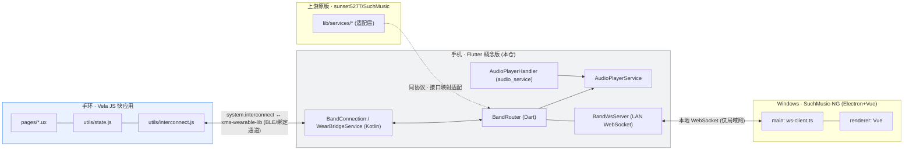
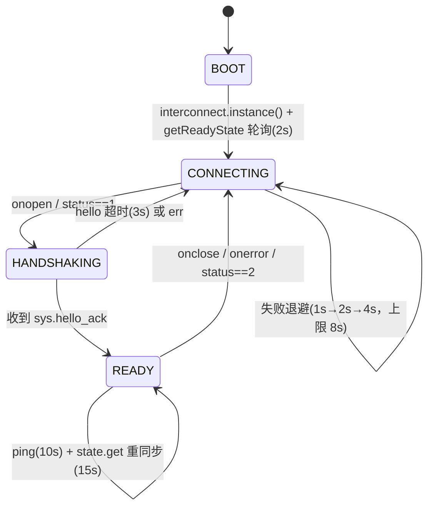
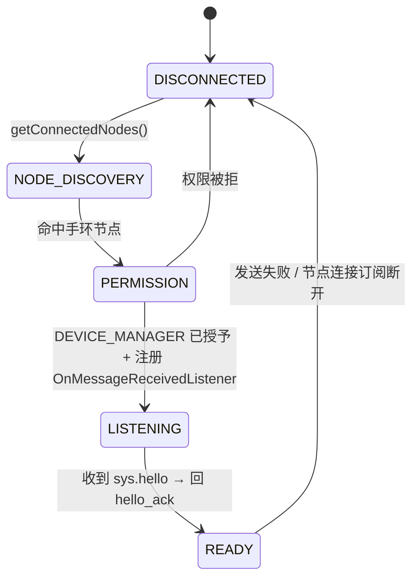
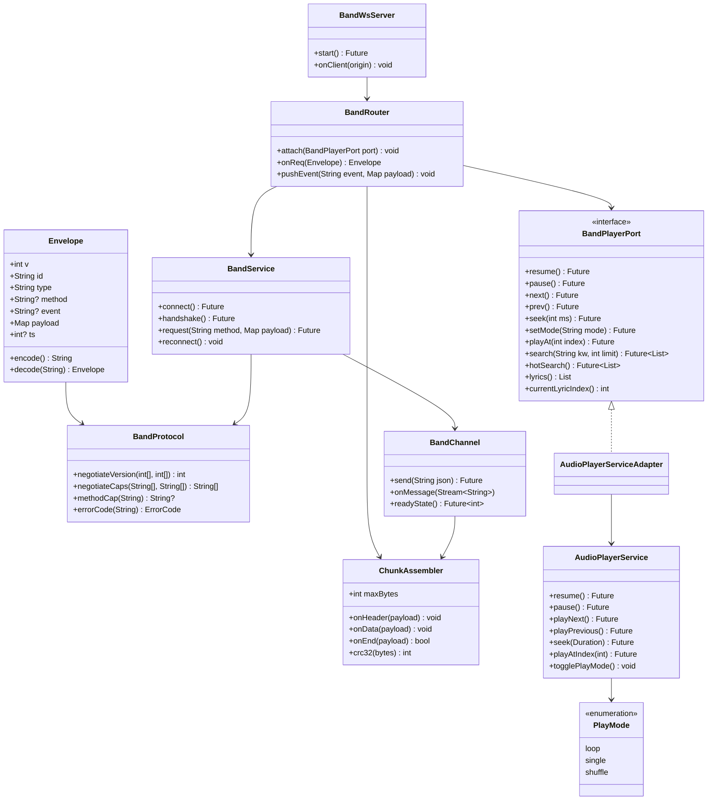

# SuchMusic · 手环通信 · 跨四端统一协议 + 模块划分

| 项目 | 内容 |
|---|---|
| 文档 | `docs/ARCH-手环通信.md`（设计文档，单一文档） |
| 版本 | v1.0 |
| 语言 | 简体中文 |
| 代码基线 | `/workspace/suchmusic`（Flutter / Dart `^3.12.2`，包名 `com.lightningteam.suchmusic`，版本 `0.11.0+1` / CHANGELOG 记 `0.12.0`） |
| 关联仓库 | 手环端 `Explore0416/SuchMusic-Band`（Vela JS 快应用，新建私密仓）· Windows 端 `Enzymeym/SuchMusic-NG`（Electron + Vue）· 上游原版 `sunset5277/SuchMusic`（Flutter） |
| 外部参照（已核实） | 官方《Device Communication Interconnect》、官方《小米穿戴第三方 APP 能力开放接口文档 v1.4》、`h1code2/AIStatusForMiBand10pro`、`A5245/WatchSDK` |
| 硬性约束 | 快应用**包名 + 签名必须与手机 App 完全一致**；个性化/播放数据**仅本机链路、不上传**；手环**存储/内存/CPU 极紧** |
| 本文档 | **不含实现代码**；只给出协议字段、消息清单、接口签名、模块职责、UI 规范与验证路径 |

> 阅读顺序：§1 约束核实 → §2 总体架构 → **§3 协议规范（核心）** → §4 模块划分 → §5 手环 UI 规范 → §6 交付与验证 → §7 待验证 → §8 风险 → 附录 A/B/C。
> 协议字段名 / 消息名 / 事件名**均为最终确定值**，可直接照做；凡未证实项一律标注「待验证」并给验证方法。

---

## 1. 背景与事实核实

### 1.1 已采信的技术事实（来自官方文档 / 同类开源实现）

| # | 事实 | 来源 | 影响 |
|---|---|---|---|
| F1 | 手环端与手机通信使用 `system.interconnect`：`interconnect.instance()` 返回单例连接对象 | 官方系统 API 文档 | 手环侧封装层核心 |
| F2 | 连接自动建立/断开，App 无需手动管理；用 `onopen/onclose/onerror/onmessage` 监听 | 官方文档 | 状态机设计依据 |
| F3 | `connect.getReadyState({success,fail})` → `status:1` 已连 / `2` 未连；`fail.code:1006` 已断开 | 官方文档 | **进入页面直接取状态常得到 DISCONNECTED，须轮询** |
| F4 | `connect.send({data})`：**`data` 为 Object**；`onmessage` 回调 `data.data`（文档标为 String） | 官方文档 | 载荷编解码有歧义 → **待验证 V1** |
| F5 | `connect.onopen({isReconnected})` 可区分首次连接 / 重连 | 官方文档 | 重连后须重新握手 + 状态重同步 |
| F6 | 手机端用小米官方 `xms-wearable-lib`（`com.xiaomi.xms.wearable`）：`Wearable.getNodeApi/getAuthApi/getMessageApi`；`NodeApi.getConnectedNodes()`、`sendMessage(nodeId, byte[])`、`OnMessageReceivedListener.onMessageReceived(nodeId, byte[])` | 官方 v1.4 文档 / 同类实现 | 手机桥接核心 API |
| F7 | 消息通信需 `Permission.DEVICE_MANAGER`（`AuthApi.checkPermission/requestPermission`） | 官方 v1.4 文档 | 首次使用须请求权限 |
| F8 | **跨设备图片传输示例使用 header→data→end 三段式分片协议（Base64 分片）** | 官方 samples | 分片协议直接采用 |
| F9 | **包名与签名必须一致**，否则通信被拒绝；证书从 `.jks` 导出：`keytool -importkeystore`（jks→p12）→ `openssl pkcs12 -nodes`（p12→pem），PEM 需含**私钥 + 证书** | 官方文档 / 论坛 | 本仓库已有 `android/keystore/suchmusic-release.jks` |
| F10 | 手环屏幕 212×520，`designWidth=106`；快应用无 Canvas；`<list-item>` 文本不换行 | 用户提供 + 论坛 | UI 规范与性能取舍 |
| F11 | Windows 无法直连手环：interconnect 仅对「与手环配对且同包名/签名的 Android App」开放，无 PC SDK、无第三方直连 BLE 通道 | F1/F9 推论 + 官方文档 | 必须经手机中转 |
| F12 | `AIStatusForMiBand10pro` 的工程结构：`quickapp/src/manifest.json`（package 与 Android 一致）+ `sign/`+「interconnect 封装 + JSON-RPC 客户端」，手机端 `WearBridgeService.kt` + `BridgeRouter.kt` + `xms-wearable-lib_1.4_release.aar` | GitHub | **本设计沿用其成熟结构** |

### 1.2 本仓库现状（已读代码核实）

| 组件 | 文件 | 事实 | 对接意义 |
|---|---|---|---|
| 播控服务 | `lib/services/audio_player_service.dart`（851 行） | 单例。**`enum PlayMode { loop, single, shuffle }`（第 27 行）**；`enum PlayerState { idle, loading, playing, paused, error }`（第 25 行） | 播放模式映射的**唯一真源** |
| 播控方法 | 同上 | `play()`、`pause()`、`resume()`、`togglePlayPause()`、`seek(Duration)`、`playNext()`、`playPrevious()`、`playAtIndex(int)`、`togglePlayMode()`、`clearPlaylist()`、`playAndAdd(SongModel)` | 命令落地目标 |
| 状态流 | 同上（第 366–373 行） | `onStateChanged`、`onPositionChanged`、`onDurationChanged`、`onLyricChanged`、`onLyricsChanged`、`onPlaylistChanged`、`onCurrentSongChanged`、`onPlayModeChanged` | 事件订阅源 |
| 歌词 | 同上（第 302–332 行） | `List<LyricLine> _lyrics`；`currentLyricIndex` getter；`onLyricChanged` **仅在文本变化时发射** | 歌词增量推送依据 |
| MediaSession | `lib/services/audio_player_handler.dart`（231 行） | `AudioPlayerHandler extends BaseAudioHandler`，订阅**同一个** `AudioPlayerService()` 单例；`play/pause/seek/skipToNext/skipToPrevious` 转发给 service | **桥接层应挂在 `AudioPlayerService` 同一层，勿挂在 handler 上（避免双份逻辑）** |
| 数据模型 | `lib/models/song_model.dart` | `SongModel{id,name,artist,album,coverUrl,duration(ms),source,hash,albumId,albumAudioId,localUri}`；`SongSource{netease,kugouStd,kugou,local}` | 歌曲信息协议的字段来源 |
| 搜索 | `lib/services/sources/music_source.dart` | `search(keyword,{limit})`、`hotSearch()`、`searchSuggest(keyword)`；经 `SourceManager().source` 调用 | 手环搜索落地目标 |
| 设计基因 | `lib/widgets/design_dialog.dart`、`lib/utils/responsive.dart`、各 screen | 主色 `#2F84FE`、页底 `#F1F2F4`、白卡片、圆角 8/10/16、副标题灰 `#838383`、字色 `#333333`、取消灰 `#8A8A8A`、字体 MiSans；设计稿基准宽 430 | §5 手环降级规范的来源 |
| 签名 | `android/keystore/suchmusic-release.jks` + `android/key.properties` | PKCS12 型 keystore，alias `suchmusic`；SHA-1 `8E:7C:55:ED:E0:65:6F:BF:36:03:AC:BB:96:CB:2C:8B:6E:06:1B:46`、SHA-256 `B8:A0:80:…:1D:0B`（本次已用 keytool 核实） | §6.2 证书导出 |

---

## 2. 总体架构

### 2.1 四端拓扑



### 2.2 关键拓扑结论

| 结论 | 依据 |
|---|---|
| **手环只与手机通话**，永不直连 Windows | F1/F9/F11 |
| **手机是唯一持有小米 Wearable SDK 的一端**，是手环链路的中枢 | F6 |
| **Windows ↔ 手机 ↔ 手环**：Windows 只能经手机中转；选用**局域网 WebSocket**（§4.3） | F11 |
| 四端共用**同一套信封 + 方法/事件清单**，差异仅在传输层与「谁持有真源」 | §3 |

---

## 3. 协议规范（核心）

### 3.1 传输层与 API 映射

| 链路 | 手环侧（Vela JS） | 手机侧（Kotlin / xms-wearable-lib） |
|---|---|---|
| 获取连接 | `const c = interconnect.instance()` | `NodeApi nodeApi = Wearable.getNodeApi(ctx)` → `nodeApi.getConnectedNodes()` |
| 权限 | — | `Wearable.getAuthApi(ctx).checkPermission(nodeId, Permission.DEVICE_MANAGER)`（无则 `requestPermission`） |
| 连接状态 | `c.getReadyState({success,fail})`（轮询，见 F3） | `NodeApi.subscribe(nodeId, DataItem.ITEM_CONNECTION, …)` |
| 连上 | `c.onopen = ({isReconnected}) => {}` | `OnServiceConnectionListener` / `getConnectedNodes` 成功 |
| 断开 | `c.onclose` / `c.onerror({code,data})` | 订阅回调 / `sendMessage` 失败 |
| 发送 | `c.send({data, success, fail})` | `Wearable.getMessageApi(ctx).sendMessage(nodeId, bytes)` |
| 接收 | `c.onmessage = (data) => {}` | `OnMessageReceivedListener.onMessageReceived(nodeId, bytes)` |
| 诊断 | `c.diagnosis({timeout=10000})`（`0 OK / 204 超时 / 1001 未安装 / 1000 其它`） | `NodeApi` 查询 + `isWearAppInstalled` / `launchWearApp` |

**载荷编码（最终约定）**：信封**序列化为 UTF-8 JSON 字符串**后传输。
- 手环→手机：`c.send({ data: JSON.stringify(env) })`（若 V1 验证发现 `data` 必须为 Object，则改为 `c.send({ data: env })` 直接传对象）。
- 手机→手环：`messageApi.sendMessage(nodeId, envJson.toByteArray(UTF_8))`；手环 `onmessage` 收到后 `JSON.parse(...)`。
- 手机接收：手环侧字符串 → `new String(bytes, UTF_8)` → `JSON.parse`。

### 3.2 连接状态机

**手环端**



**手机端（BandConnection）**



### 3.3 握手与版本 / 能力协商（含降级）

**握手序列**：手环收到 `onopen` 后主动发 `sys.hello`；手机回 `sys.hello_ack`；手环再 `state.get` 拉全量快照。

**版本协商规则**

| 情况 | 处理 |
|---|---|
| `band.proto ∩ phone.proto = P`，取 `max(P)` 为会话版本 `V` | 正常，之后所有消息 `v = V` |
| 交集为空 | 手机回 `err E_UNSUPPORTED {code:"E_PROTO", message:"no common protocol"}`，仅允许 `sys.*`；手环降级为「仅提示升级」只读态 |
| 将来 `V=2`、对端仍 `1` | 高版本端按 `v=1` 子集通信；高版本新增字段**不发送**给低版本端（发送前按对端 `v` 过滤） |

**能力协商（caps）**

能力令牌（最终值）：`playback` · `queue` · `search` · `lyric` · `playmode` · `volume` · `cover` · `transfer`。

- 生效能力 = `band.caps ∩ phone.caps`。
- 每个方法/事件声明其所需 `cap`（见 §3.5/§3.6）；缺失时：**手环不发**该请求；若手环误发，手机回 `err E_UNSUPPORTED {code:"E_CAP", missing:"volume"}`。
- 降级：`volume` 缺失 → 手环隐藏音量页；`cover` 缺失 → 用纯色占位；`lyric` 缺失 → 隐藏歌词页。

### 3.4 统一信封（冻结）

```json
{
  "v": 1,
  "id": "b-7fa1-0007",
  "type": "req",
  "method": "playback.next",
  "payload": {},
  "ts": 1730000000000
}
```

| 字段 | 类型 | 必填 | 说明 |
|---|---|---|---|
| `v` | int | 是 | 协议主版本，会话内固定为协商值 |
| `id` | string | req/res/err 必填 | 格式 `{origin}-{bootId}-{seq}`；`origin ∈ {b,p,w}`，`bootId` 为各端随机 4 位 hex，`seq` 递增 |
| `type` | string | 是 | `"req"` / `"res"` / `"evt"` / `"err"` |
| `method` | string | 仅 `req` | 方法名（§3.5） |
| `event` | string | 仅 `evt` | 事件名（§3.6） |
| `payload` | object | 是 | 恒存在，可为 `{}` |
| `ts` | int(ms) | 否 | 发送时间戳；**手机时钟为权威**，手环 `ts` 尽力而为 |

**响应** `{"v":1,"id":"b-7fa1-0007","type":"res","payload":{"ok":true}}`
**错误** `{"v":1,"id":"b-7fa1-0007","type":"err","payload":{"code":"E_TIMEOUT","message":"..."}}`
**事件** `{"v":1,"id":"p-3c0e-0012","type":"evt","event":"player.song","payload":{...}}`

> `evt` 不要求对端回执；`id` 仅用于日志/去重，可为 `null`。

### 3.5 方法清单（RPC：`req` → `res`/`err`）

> 「方向」= 谁发起。所有方法名/字段名为最终值。

| 方法 | 方向 | 能力 | 入参 | 出参 | 幂等 | 说明 |
|---|---|---|---|---|---|---|
| `sys.hello` | 手环/Windows→手机 | — | `{role, proto:[int], caps:[str], fw, model, rpk}` | — | 是 | 握手首帧 |
| `sys.ping` | 手环/Windows→手机 | — | `{}` | `{t:int}` | 是 | 保活，10s |
| `state.get` | 手环/Windows→手机 | — | `{}` | `StateSnapshot`(§3.5.1) | 是 | 全量重同步 |
| `playback.play` | →手机 | playback | `{}` | `{state}` | **是** | 播放/续播 |
| `playback.pause` | →手机 | playback | `{}` | `{state}` | **是** | 暂停 |
| `playback.toggle` | →手机 | playback | `{}` | `{state}` | 否(兜底) | 优先用显式 play/pause |
| `playback.next` | →手机 | playback | `{}` | `{song}` | **是**(去重) | 下一首 |
| `playback.prev` | →手机 | playback | `{}` | `{song}` | **是**(去重) | 上一首 |
| `playback.seek` | →手机 | playback | `{positionMs:int}` | `{positionMs:int}` | 是 | 进度跳转 |
| `playback.setMode` | →手机 | playmode | `{mode:"loop"\|"single"\|"shuffle"}` | `{mode}` | **是** | 与 `PlayMode` 一一对应 |
| `playback.setVolume` | →手机 | volume | `{volume:0..100}` | `{volume}` | 是 | **Phase 2**（见 §7 V8） |
| `queue.play` | →手机 | queue | `{index:int}` | `{song}` | 是 | = `playAtIndex(index)` |
| `queue.clear` | →手机 | queue | `{}` | `{ok:true}` | 是 | = `clearPlaylist()` |
| `search.song` | →手机 | search | `{keyword:str, limit:int=10}` | `SearchResult`(§3.5.2) | 是 | 可能分片 |
| `search.suggest` | →手机 | search | `{keyword:str, limit:int=6}` | `{items:[str]}` | 是 | 联想词 |
| `search.hot` | →手机 | search | `{}` | `{items:[str]}` | 是 | 热搜词（手环输入主路径） |
| `lyric.window` | →手机 | lyric | `{songId:str, index:int, before:int=3, after:int=8}` | `LyricWindow`(§3.5.3) | 是 | 局部歌词，可能分片 |
| `song.info` | →手机 | — | `{}` | `{song}` | 是 | 当前曲目 |
| `cover.get` | →手机 | cover | `{songId:str, size:int=96}` | 分片(`kind="cover"`) | 是 | 二进制分片 |
| `xfer.nack` | 手环→手机 | transfer | `{tid:str, seq:int}` | `{ok:true}` | 是 | 请求重发某分片 |

#### 3.5.1 `StateSnapshot`

```json
{
  "state": "playing",
  "playing": true,
  "song": { "id": "…", "name": "…", "artist": "…", "album": "…",
            "durationMs": 269000, "source": "kugou", "hasCover": true },
  "positionMs": 42000,
  "durationMs": 269000,
  "mode": "loop",
  "volume": 80,
  "queue": { "count": 24, "currentIndex": 3 },
  "lyric": { "has": true, "count": 82 },
  "ts": 1730000000000
}
```

`state ∈ {"idle","loading","playing","paused","error"}`（映射 `PlayerState`）；`mode ∈ {"loop","single","shuffle"}`（映射 `PlayMode`）；`source ∈ {"netease","kugou","kugou_std","local"}`（映射 `SongSource.code`）。

#### 3.5.2 `SearchResult`

```json
{
  "query": "晴天 周杰伦",
  "total": 30,
  "results": [
    { "id": "…", "name": "晴天", "artist": "周杰伦", "album": "叶惠美",
      "durationMs": 269000, "source": "kugou", "hasCover": true }
  ]
}
```
- **内联阈值**：序列化后 ≤ `chunkMaxBytes`（默认 900）→ `res.payload` 内联返回。
- **超阈值** → `res.payload = {"__chunked":true,"tid":"t-0007","total":N,"bytes":B,"crc32":"…"}`，实体经 `xfer.chunk` 事件分片下发（§3.8）。

#### 3.5.3 `LyricWindow`

```json
{ "songId": "…", "start": 5, "lines": [ {"t": 0, "text": "…"}, {"t": 3200, "text": "…"} ] }
```
`t` 为该行时间戳（ms）；`start` 为窗口首行在整曲歌词中的下标。超阈值同样走分片。

### 3.6 事件清单（`evt`，手机→手环 / 手机→Windows）

| 事件 | 能力 | payload | 触发源（手机侧） | 节流 |
|---|---|---|---|---|
| `sys.hello_ack` | — | `{proto, caps:[str], server:{app,ver}, clock:int}` | 收到 `sys.hello` | 一次 |
| `sys.error` | — | `{code, message}` | 任意内部错误 | — |
| `player.state` | playback | `{state, playing}` | `AudioPlayerService.onStateChanged` | 变化即发 |
| `player.song` | — | `{song}` | `onCurrentSongChanged` | 变化即发 |
| `player.progress` | playback | `{positionMs, durationMs, ts}` | `onPositionChanged` | **≤1 次/秒**（seek/切歌立即补发） |
| `player.mode` | playmode | `{mode}` | `onPlayModeChanged` | 变化即发 |
| `player.volume` | volume | `{volume}` | 音量变化 | 变化即发 |
| `player.queue` | queue | `{count, currentIndex}` | `onPlaylistChanged` | 变化即发 |
| `lyric.line` | lyric | `{songId, index, text, t}` | `onLyricChanged` + `currentLyricIndex` | 变化即发 |
| `lyric.meta` | lyric | `{songId, has, count}` | `onLyricsChanged` | 变化即发 |
| `search.result` | search | `SearchResult`（分片时仅 `{__chunked,tid,...}` 通知） | 手环 `search.song` 的补充推送（可选） | — |
| `search.preset` | search | `{keyword}` | **手机端搜索页「发送到手环」** | — |
| `xfer.chunk` | transfer | 分片帧（§3.8） | 大载荷下发 | — |
| `band.toast` | — | `{text}` | 手机主动提示手环 | — |

### 3.7 错误码（冻结）

| code | 含义 | 对端动作 |
|---|---|---|
| `E_BADREQ` | 信封/JSON schema 非法 | 丢弃 + 记录，不重试 |
| `E_UNSUPPORTED` | 版本/方法/能力不支持（附 `missing`） | 标记能力缺失，不再重试 |
| `E_TIMEOUT` | 处理超时 | 同 id 重试（§3.11） |
| `E_NOT_READY` | 播放器未就绪（无歌/加载中） | 稍后重试，UI 提示 |
| `E_EMPTY` | 队列为空（next/prev/queue.play） | UI 提示，不重试 |
| `E_NOT_FOUND` | 歌曲/歌词行不存在 | UI 提示 |
| `E_LINK` | 链路断开/发送失败 | 进入重连 |
| `E_TOOLARGE` | 分片总量超手环缓存上限 | 降级为增量模式 |
| `E_CRC` | 分片校验失败 | 触发 `xfer.nack` |
| `E_INTERNAL` | 其它内部错误 | UI 提示 |

### 3.8 分包 / 分片协议（header → data → end）

> 依据 F8（官方跨设备图片传输三段式），并扩展为**可校验、可重传、可限流**。

| 约束 | 值 | 说明 |
|---|---|---|
| 单包字节上限 `chunkMaxBytes` | **900** | 保守值；真实上限**待验证 V2**；可在两端配置常量 |
| 分片内容字段 | `txt`（文本）或 `b64`（二进制）**二选一** | 文本不额外 Base64（省 ~33% 带宽） |
| 校验 | 整包 `crc32`（IEEE，zlib 同款） | 手环 JS 侧可自实现 ~15 行 |
| 手环组装缓存上限 `assembleMaxBytes` | **8192** | 超限即 `E_TOOLARGE`，回落增量模式 |
| 分片超时 | 单 tid 无进展 5s | 触发 `xfer.nack` 或整体放弃 |
| 并发分片 | 同一链路**≤1 个** tid | 省内存、稳定 |

**帧格式（冻结）**

```jsonc
// 1) header
{"v":1,"id":"p-3c0e-0100","type":"evt","event":"xfer.chunk","payload":{
  "tid":"t-0007","phase":"header","kind":"lyric_window",
  "total":9,"bytes":2100,"crc32":"1a2b3c4d",
  "meta":{"songId":"…","start":5,"count":9}}}

// 2) data（i = 0..total-1）
{"v":1,"id":"p-3c0e-0101","type":"evt","event":"xfer.chunk","payload":{
  "tid":"t-0007","phase":"data","seq":0,
  "txt":"[00:00.00]…\n[00:03.20]…"}}     // 二进制用 "b64":"…"

// 3) end
{"v":1,"id":"p-3c0e-0109","type":"evt","event":"xfer.chunk","payload":{
  "tid":"t-0007","phase":"end","total":9,"crc32":"1a2b3c4d"}}
```

`kind ∈ {"lyric_window","search_result","cover"}`。

**手环组装流程**：header 记录 `total/bytes/crc32` → 逐 `data` 按 `seq` 落入数组 → `end` 时校验 `count==total && crc32(buf)==crc32` → 通过则 JSON 还原并派发；失败发 `xfer.nack{tid,seq}` 让手机**只重发缺失分片**。

### 3.9 歌词策略（手环存储/带宽双紧）

| 场景 | 策略 | 存储占用 |
|---|---|---|
| **常态播放** | 手机在 `onLyricChanged` 时推 `lyric.line`（仅当前行 + `index`） | 手环**只存当前一行**，≈0 |
| 打开歌词页 | 手环发 `lyric.window{index,before:3,after:8}`（≤12 行） | 内存窗口，**离开页面即释放**，不落盘 |
| 歌词元信息 | `lyric.meta{has,count}` 供进度条/占位 | 一个对象 |

**明确不做**：整曲 LRC 下发到、或持久化于手环（违反「不能占用太多存储」）。

### 3.10 搜索输入方案（手环输入困难）与取舍

| 方案 | 可行性 | 体验 | 结论 |
|---|---|---|---|
| A. **热搜词 + 手环历史**（点选即搜） | 高（`search.hot` + 本地存 ≤5 词） | 好，零输入 | **默认主路径** |
| B. **手机代打**：手机搜索框旁「发送到手环」→ `search.preset` | 高 | 好，需手机在手边 | **次路径（推荐）** |
| C. 手环软键盘 / T9 滚轮输入 | 低（212×520、无好键盘） | 差、易误触 | **不做** |
| D. 手环语音输入 | 未知（快应用麦克风能力待验证 V3） | 依赖硬件 | **暂不做**，留接口 |

**取舍说明**：以 A 为主、B 为辅，彻底回避手环打字。搜索历史仅存**最近 5 条关键词**（手环持久化），其余全部走在线请求、不落盘。

### 3.11 限流 / 超时 / 重试 / 幂等

| 机制 | 规则 |
|---|---|
| 请求超时 | 手环 `reqTimeoutMs = 3000`；超时视为失败 |
| 重试 | 超时/`E_LINK` 时**同 `id`** 重试 ≤2 次，退避 300ms / 900ms；`E_UNSUPPORTED`/`E_BADREQ` **不重试** |
| **幂等去重** | 手机端保留**最近 64 个已处理 `req.id` 的 LRU**；收到重复 `id` 直接回放缓存响应，**不重复执行**（**保证重复命令不会重复切歌**） |
| 进度节流 | `player.progress` 上限 **1 次/秒**；手环用 `ts` 本地插值，避免频繁刷新 |
| 歌词推送 | 仅文本变化时推（沿用 `onLyricChanged` 语义） |
| 分片限流 | 同链路并发分片 ≤1；data 帧间无人工延时（BLE 吞吐**待验证 V9**） |
| 保活 | `sys.ping` 每 10s；`state.get` 每 15s 兜底重同步 |
| 重连 | 手环轮询 `getReadyState`；`onopen(isReconnected=true)` 后**重新 `sys.hello` + `state.get`** |

### 3.12 安全与隐私（硬约束）

| 项 | 约定 |
|---|---|
| 通信范围 | **仅本机链路**：手环↔手机（BLE/绑定通道）；手机↔Windows **仅局域网** |
| 数据出网 | 播放/歌词/搜索**结果**只在设备间流转；搜索**请求**仍走各在线音源接口（既有行为），不新增任何上传 |
| Windows 接入 | 手机开 LAN WebSocket，需**配对码 + 会话令牌**；默认关闭，用户在设置中显式开启 |
| 不做远程控制 | 明确**不提供**公网 / 远程遥控能力；WS 不监听公网 |
| 权限 | 手机端仅申请官方要求的 `Permission.DEVICE_MANAGER` |
| 敏感信息 | 手环持久化**不含**任何账号/token（酷狗凭据仅存手机 `SharedPreferences`，不出手机） |

---

## 4. 模块划分与职责边界

### 4.1 手环快应用（`Explore0416/SuchMusic-Band`）

**文件结构**

```
suchmusic-band/
  src/
    manifest.json          # package=com.lightningteam.suchmusic, designWidth=106
    app.ux                 # 全局生命周期 + 冷启动即建连
    pages/
      index/index.ux       # 首页
      control/index.ux     # 控制页
      search/index.ux      # 搜索页
      mode/index.ux        # 播放模式页
      lyric/index.ux       # 歌词页
    utils/
      interconnect.js      # 连接封装（instance/onopen/onclose/onerror/onmessage + readyState 轮询）
      rpc.js               # 信封编解码 + 请求/响应/事件 + 超时重试 + 去重 (id 生成)
      transfer.js          # header/data/end 组装器（含 crc32）
      state.js             # 全局播放状态（current/playing/progress/mode/caps/proto）
      store.js             # 持久化存储（只存必要项）
      format.js            # 时间/文本截断工具
    common/style.css       # 设计令牌（§5）
    assets/                # 小图标 PNG
  sign/sign.pem            # 由 suchmusic-release.jks 导出（§6.2）
```

**职责边界**

| 层 | 职责 | 不负责 |
|---|---|---|
| `pages/*` | 展示 + 触发命令（调 `rpc`） | 不做编解码、不直连 interconnect |
| `utils/state.js` | 单一状态源（订阅 `rpc` 事件后更新） | 不发请求 |
| `utils/rpc.js` | 信封构造/解析、超时重试、去重、回调分发 | 不关心 UI |
| `utils/interconnect.js` | 连接生命周期 + 收发原始字符串 | 不解析业务语义 |
| `utils/transfer.js` | 分片组装 + 校验 + NACK | 不发起分片（仅接收） |
| `utils/store.js` | 持久化：`protoVer`、`serverCaps`、`searchHistory`(≤5)、`playMode` | **不存**歌词全文、封面、歌单 |

**存储策略（硬）**：手环持久化仅 4 类键，合计 < 2KB：
`sm_protoVer`(int)、`sm_serverCaps`(str[])、`sm_searchHistory`(str[≤5])、`sm_lastMode`(str)。

**生命周期**：`app.ux` `onCreate` → 建连 + 注册事件；页面 `onInit` 只读取 `state`。

### 4.2 手机桥接（本仓库新增，**不改既有业务文件**）

> 遵循「不改 `lib/`、`android/` 业务代码」：以下均为**新增文件**；仅列出的**集成点**需 1 处小改（由实现阶段单独完成）。

**新增 Kotlin 文件**（`android/app/src/main/kotlin/com/lightningteam/suchmusic/band/`）

| 文件 | 职责 |
|---|---|
| `BandConnection.kt` | `Wearable` 初始化、`getConnectedNodes`、`DEVICE_MANAGER` 权限、注册 `OnMessageReceivedListener`、`sendMessage` |
| `BandMessageRouter.kt` | 解析信封 → 分发到 Dart（经 MethodChannel `onReq`）；把 Dart 的响应/事件编码回手环 |
| `BandChunkCodec.kt` | header/data/end 切分 + Base64 + crc32（纯 Kotlin，可单测） |
| `BandChannelBridge.kt` | 注册 `MethodChannel("com.lightningteam.suchmusic/band")` 与 `EventChannel(".../band_events")` |
| `BandWsServer.kt` | （Phase 2）局域网 WebSocket 服务，供 Windows 接入 |
| `android/app/libs/xms-wearable-lib_1.4_release.aar` | 官方 SDK（随仓库 vendored） |

**新增 Dart 文件**（`lib/services/band/`）

| 文件 | 职责 | 可单测 |
|---|---|---|
| `band_protocol.dart` | 信封模型、`encode/decode`、错误码、版本/能力协商**纯函数** | ✅ |
| `band_chunk.dart` | 组装/拆解、crc32、NACK 逻辑 | ✅ |
| `band_channel.dart` | `MethodChannel`/`EventChannel` 封装（收发原始 JSON） | 部分 |
| `band_service.dart` | 连接门面（handshake、send、readyState、重连） | 部分 |
| `band_router.dart` | **方法 → `AudioPlayerService` 落地；`AudioPlayerService` 流 → 事件** | ✅(可 mock) |
| `band_ws_server.dart` | （Phase 2）WS 服务端 / Windows 中继 | 部分 |

**与既有服务对接点（已读代码结论）**

| 手环命令 | → `AudioPlayerService` 调用 | 依据 |
|---|---|---|
| `playback.play` | `resume()`（无歌时 `togglePlayPause()`） | 第 505 行 |
| `playback.pause` | `pause()` | 第 501 行 |
| `playback.toggle` | `togglePlayPause()` | 第 509 行 |
| `playback.next` | `playNext()` | 第 688 行 |
| `playback.prev` | `playPrevious()` | 第 710 行 |
| `playback.seek` | `seek(Duration(ms: positionMs))` | 第 519 行 |
| `playback.setMode` | 直接置 `PlayMode`（新增 `setPlayMode(mode)`，或循环 `togglePlayMode()` 到目标） | 第 643 行 |
| `queue.play` | `playAtIndex(index)` | 第 732 行 |
| `queue.clear` | `clearPlaylist()` | 第 766 行 |
| `search.song` | `SourceManager().source.search(keyword, limit:)` | `MusicSource` 第 22 行 |
| `search.hot` | `SourceManager().source.hotSearch()` | 第 24 行 |
| `search.suggest` | `SourceManager().source.searchSuggest()` | 第 30 行 |
| `lyric.window` | 读 `AudioPlayerService().lyrics` + `currentLyricIndex` 切片 | 第 325/326 行 |

| 状态订阅（`AudioPlayerService()` 单例流） | → 事件 |
|---|---|
| `onStateChanged` | `player.state` |
| `onCurrentSongChanged` | `player.song` |
| `onPositionChanged`/`onDurationChanged` | `player.progress`（节流 1/s） |
| `onPlayModeChanged` | `player.mode` |
| `onLyricChanged`（+`currentLyricIndex`） | `lyric.line` |
| `onLyricsChanged` | `lyric.meta` |
| `onPlaylistChanged` | `player.queue` |

> **关键决策**：桥接层订阅 `AudioPlayerService()` **单例**（与 `AudioPlayerHandler` 同源），**不**改 `AudioPlayerHandler`。理由：`AudioPlayerHandler` 只是系统 MediaSession 的表现层；命令与状态真源都在 service，双方各自订阅同一真源，互不耦合（见 §1.2）。

**需改动的集成点（1 处，实现阶段）**
- `MainActivity.configureFlutterEngine`：新增 `BandChannelBridge` 通道注册 + 启动 `WearBridgeService`（沿用现有 `IslandBridge/SoundEffectBridge` 的注册范式）。
- `android/app/build.gradle.kts`：加 `flatDir { dirs("libs") }` + `implementation(name:"xms-wearable-lib_1.4_release", ext:"aar")`。
- `main.dart` 启动：`BandRouter().attach()` 订阅 `AudioPlayerService()`。
- （可达性）`permission.DEVICE_MANAGER` 是否需要额外 `<service>`/`<uses-permission>` 声明 → **待验证 V2b**。

### 4.3 Windows 端（`Enzymeym/SuchMusic-NG`，Electron + Vue）

**传输选型：局域网 WebSocket（手机上做服务端）**

| 候选 | 评估 | 结论 |
|---|---|---|
| 本地 WebSocket（手机 LAN 服务端） | 跨平台、Electron 原生支持、双向推送简单 | ✅ 采用 |
| USB / ADB 桥 | 需数据线、adb 依赖、非面向终端用户 | ✗ |
| BLE 直连电脑 | 无 PC 端第三方 SDK / 通道（F11） | ✗ 不可行 |
| 云中转 | 违反「不上传/不做远程」约束 | ✗ |

**为何 Windows 不能直连手环（事实依据）**：interconnect 通道只对「与手环完成配对、且**包名 + 签名一致**的 Android 伴侣 App」开放（F9）；小米只提供 **Android** 版 `xms-wearable-lib`（F6），无 PC SDK，也没有面向第三方的「电脑直连手环」BLE 通道。故数据必须经手机中转。

**实现位置建议**

```
SuchMusic-NG/
  electron/band/
    protocol.ts      # 信封类型 + zod schema（与 §3 完全对齐；由 shared 单一真源生成）
    ws-client.ts     # 主进程：连 ws://<phone-ip>:8787/suchmusic，token 鉴权、心跳、重连
    band-bridge.ts   # 主进程：WS ↔ IPC 转发（ipcMain.handle / webContents.send）
    index.ts         # 注册上述模块
  src/renderer/composables/useBand.ts   # Vue 侧：订阅状态、派发命令
  preload/band-api.ts                     # contextBridge 暴露安全 API
```

**通路**：`Windows(Vue) → preload IPC → main ws-client → 手机 BandWsServer → BandMessageRouter → BandRouter → AudioPlayerService`，反向状态经同一路由回推。
**配对**：手机设置页显示 6 位配对码 → Windows 首次发 `sys.hello{role:"windows", pair:"123456"}` → 手机校验后绑定会话令牌。
**id 前缀**：Windows 端请求用 `w-` 前缀，避免与手环 `b-` 冲突。

### 4.4 上游原版（`sunset5277/SuchMusic`）适配

> 结论：**同源不同版**，接口存在差异。本设计对上游**只做接口映射**（不写实现）。
> 以下「上游列」中无法在本沙箱读取的项均标 **【待核对】**（V7）。

| # | 差异点 | 概念版（本仓，已核实） | 上游（待核对） | 适配策略 |
|---|---|---|---|---|
| D1 | 播放模式枚举 | `PlayMode{loop,single,shuffle}` @ `audio_player_service.dart:27` | 【待核对】命名/位置可能不同 | 建**映射表**：上游→`{loop,single,shuffle}`；未知值回退 `loop` 并记日志 |
| D2 | 播控方法名 | `pause/resume/togglePlayPause/playNext/playPrevious/playAtIndex/seek` | 【待核对】 | 适配器实现同签名的 `BandPlayerPort` 接口，内部转发上游方法 |
| D3 | 状态流命名 | `onStateChanged/onPositionChanged/onLyricChanged/onCurrentSongChanged/onPlayModeChanged/onPlaylistChanged` | 【待核对】 | 适配器把上游流重命名为本协议事件 |
| D4 | `SongModel` 字段 | `id,name,artist,album,coverUrl,duration(ms),source,…` | 【待核对】字段名/单位可能不同（如秒） | 统一到协议 `song` DTO；`durationMs` 强制毫秒 |
| D5 | 音源枚举 | `SongSource{netease,kugou,kugouStd,local}` | 【待核对】可能无酷狗 | `source` 未知值设为 `"netease"` 兜底 |
| D6 | 单例/依赖注入 | `AudioPlayerService()` 工厂单例 | 【待核对】 | 适配器屏蔽单例差异，暴露 `BandPlayerPort` |
| D7 | 歌词结构 | `List<LyricLine>{timestamp,text}`；`currentLyricIndex` | 【待核对】 | 协议只用 `{t,text}`，适配器做结构转换 |
| D8 | 搜索入口 | `SourceManager().source.search/hotSearch/searchSuggest` | 【待核对】 | 适配器聚合到 `search.song/hot/suggest` |

**统一抽象**（跨端一致）：定义 `BandPlayerPort`（Dart 抽象接口），概念版与上游各提供一份实现，`BandRouter` 只依赖该接口 → **同一协议、两种后端**。

---

## 5. 手环端 UI 设计规范（212×520，与手机版不割裂）

### 5.1 坐标系（关键）

| 项 | 值 |
|---|---|
| 物理分辨率 | 212 × 520 px |
| `designWidth` | 106 |
| **逻辑坐标 / 1 逻辑单位** | = 2 物理 px（212/106） |
| 作者坐标系 | **106 × 260** |
| 约定 | 本文线框与令牌用**物理 px**标注；CSS 中写「逻辑值 = 物理值 ÷ 2」 |

### 5.2 设计令牌（手机基因 → 手环降级）

| 令牌 | 手机版（来源） | 手环降级 | 说明 |
|---|---|---|---|
| 主色 | `#2F84FE`（24 处引用） | `#2F84FE` **保留** | 品牌一致性 |
| 页面底 | `#F1F2F4` | `#F1F2F4` **保留** | 深色 AMOLED 亦可，**本期用浅底**与手机一致 |
| 卡片 | 白底 | 白底 `#FFFFFF` | 无阴影（性能） |
| 圆角 | 8 / 10 / 16 | **8 / 10 / 16**（物理 16/20/32） | 卡片用 16，按钮用 10，小标签用 8 |
| 主字色 | `#333333` | `#333333` | — |
| 副标题灰 | `#838383` | `#838383` | — |
| 次级灰 | `#999999` | `#999999` | 时间/元信息 |
| 禁用/描边 | `#CCCCCC` | `#CCCCCC` | 1px 描边替代阴影 |
| 字体 | MiSans（400/500/700） | **系统默认（Xiaomi 设备即 MiSans）** | **不打包字体**（省存储） |

### 5.3 字号阶梯（物理 px）

| 层级 | 物理 | 逻辑(CSS) | 字重 | 用途 |
|---|---|---|---|---|
| H1 标题 | 34 | 17 | 600 | 页面标题 |
| H2 歌曲名 | 30 | 15 | 500 | 首页/控制页歌名 |
| Body 正文 | 26 | 13 | 400 | 列表主文本 |
| Caption 副标 | 24 | 12 | 400 | 艺人 · 专辑 |
| Meta 元信息 | 20 | 10 | 400 | 时间/序号/歌词副行 |

### 5.4 间距 / 触控 / 列表

| 项 | 物理 px | 逻辑 | 备注 |
|---|---|---|---|
| 页面左右留白 | 16 | 8 | 避开侧边按钮 |
| 间距刻度 | 8 / 16 / 24 / 32 | 4/8/12/16 | 4 的倍数 |
| 圆角 | 16 / 20 / 32 | 8/10/16 | 同手机 |
| 最小可点区域（次要） | ≥ 44 × 44 | 22 | 图标按钮 |
| 最小可点区域（主操作） | ≥ 72 × 72 | 36 | 播放/暂停圆形键 |
| 列表项高 | 88 | 44 | `<list-item>` |
| 分隔线 | 1px `#EEEEEE` | — | 不用阴影 |
| 进度条高 | 6 | 3 | 轨道 `#EEEEEE`，填充 `#2F84FE` |

### 5.5 页面线框（逻辑坐标 106×260；物理 = ×2）

**① 首页 `pages/index`**

```
┌──────────────────────────────┐ (0,0) 106×260
│ SuchMusic           ● 已连接  │ 顶部栏 h=32  标题 H1 + 连接点
├──────────────────────────────┤
│ ┌──────────┐  歌名 H2(截断)   │ 封面卡 88×88 圆角16 @(8,44)
│ │  封面    │  艺人 · 专辑 Cap │
│ │ (占位色) │                 │
│ └──────────┘                 │
│  ━━━━━━━●────────  进度 6     │ @(8,140) 宽90 轨道+填充
│  01:12                04:29   │ Meta 左右
│ ┌────┐        ┌──────┐        │
│ │ ▶/⏸ │  ⏮   ⏭ │ 搜索 │        │ 主操作行 y=170 圆键72 / 次键44
│ └────┘        └──────┘        │
├──────────────────────────────┤
│  [搜索]   [播放模式]   [歌词]  │ 底部入口 y=228 三宫格 88×44
└──────────────────────────────┘
```
- 点封面/歌名 → 控制页；点 ▶/⏸ → `playback.toggle`（手环据 `playing` 发显式 play/pause）。

**② 控制页 `pages/control`**

```
┌──────────────────────────────┐
│ ← 正在播放            模式图标 │ 顶部栏
├──────────────────────────────┤
│      歌名 H2（单行截断）       │
│      艺人 · 专辑 Caption       │
│  ━━━━━━●────────────  6        │ 可点进度条 → playback.seek
│  01:12                 04:29   │
│   ⏮        ▶/⏸        ⏭        │ 三个大键 44/72/44
│  单曲循环  顺序  乱序  （点=模式）│ 模式快捷切换
├──────────────────────────────┤
│   [播放列表 24 首 · 当前 4]     │ → 进入 mode 页列表
└──────────────────────────────┘
```

**③ 搜索页 `pages/search`**

```
┌──────────────────────────────┐
│ ← 搜索                        │
├──────────────────────────────┤
│  热搜                        │ 区块标题 Meta
│  ┌────────┐ ┌──────────┐    │ 词条 chip（点选即搜）
│  │ 晴天    │ │ 周杰伦     │    │ 高44 圆角8
│  └────────┘ └──────────┘    │
│  最近搜索                    │
│  ○ 中国风                    │ 手环历史(≤5)，右滑删除
│  ○ 林俊杰                    │
├──────────────────────────────┤
│  [结果列表 → ]               │ 点某条：playAndAdd → 回首页
└──────────────────────────────┘
```
- **无键盘输入**（§3.10）。结果列表项：`序号 + 歌名(单行) + 艺人`，项高 88。

**④ 播放模式页 `pages/mode`**

```
┌──────────────────────────────┐
│ ← 播放模式                    │
├──────────────────────────────┤
│  ● 顺序播放     List 图标     │ 单选行 88 高
│  ○ 单曲循环     Single 图标   │
│  ○ 乱序播放     Shuffle 图标  │
├──────────────────────────────┤
│  播放列表（24）               │
│  1  晴天 · 周杰伦            │ ← 当前高亮 主色文字+左侧竖条
│  2  稻香 · 周杰伦            │ → queue.play{index}
│  …                           │ 虚拟列表 list
└──────────────────────────────┘
```
- 单选写入 `playback.setMode`，回包 `player.mode` 生效；与手机 `PlayMode` **一一对应**。

**⑤ 歌词页 `pages/lyric`**

```
┌──────────────────────────────┐
│ ← 歌词              晴天/周杰伦 │
├──────────────────────────────┤
│      上一行  Meta 灰           │ 窗口歌词 start..start+N
│   ▶  当前行  Body  主色加粗     │ 当前行高亮，其余 #838383
│      下一行  Meta 灰           │ 单行不换行（截断）
│      …                       │ 只保留 ≤12 行
├──────────────────────────────┤
│  ━━━━━━●────────    01:12/04:29│
└──────────────────────────────┘
```
- 当前行由 `lyric.line.index` 定位；滚动窗口来自 `lyric.window`；**离开页面即丢弃**。

### 5.6 美观 vs 性能取舍（无 Canvas / 弱 CPU）

| 目标 | 做法 | 反例（禁用） |
|---|---|---|
| 精致 | 主色点缀 + 白卡 + 统一圆角 + 16/24 间距节奏 | 花哨渐变、多层阴影 |
| 流畅 | 进度条 = 两个 `<div>`（轨道/填充）改 `width%` | `<canvas>`、SVG 滤镜 |
| 省内存 | 封面用**小图（≤96px）或纯色占位**；列表虚拟化 | 大图、全量封面缓存 |
| 省 CPU | 进度 ≤1Hz（沿用节流）；仅更新变化文本节点 | 每帧重排、频繁 setState |
| 省存储 | **不落盘**歌词/封面/歌单；字体用系统 | 打包字体、缓存全文歌词 |
| 文本 | `<list-item>` 单行 + 省略号；必要时手动截断 | 依赖自动换行（不支持） |

---

## 6. 交付与验证路径

### 6.1 `.rpk` 本地构建与侧载（沙箱内不可执行，供用户本地执行）

> 事实：`.rpk` 需 **小米 AIoT-IDE**（专有工具链），本沙箱无该工具 → **无法自动构建**。

```text
前置：Node.js 18.x；小米 AIoT-IDE；已与手环配对的小米运动健康 App

1) 准备签名（见 §6.2），得到 sign/sign.pem（含私钥+证书）
2) 校验 manifest：package = com.lightningteam.suchmusic；designWidth=106；
   deviceTypeList=["watch"]；features 含 system.interconnect / system.file /
   system.storage / system.router
3) 工程：cd suchmusic-band && npm install
4) AIoT-IDE 打开工程 → Signing 配置指向 sign/sign.pem（口令用 key.properties 的）
5) Build → Release(.rpk) → 产物如 dist/com.lightningteam.suchmusic.debug.1.0.0.rpk
6) 侧载（二选一）：
   a) 「Notify for Xiaomi」→ 设备 → Third-party app → 上传 .rpk
   b) 小米运动健康 开发者模式 / adb（若开放）安装
7) 验证：手环应用列表出现「SuchMusic」→ 打开 → 首页显示当前播放（手机先放歌）
```

### 6.2 证书导出（本次已用 keytool 核实，可直接照做）

```bash
# 0) 事实核实：jks 实为 PKCS12 类型，alias=suchmusic
keytool -list -v -keystore android/keystore/suchmusic-release.jks \
        -storepass "$(grep storePassword android/key.properties | cut -d= -f2)" -alias suchmusic
#   SHA1: 8E:7C:55:ED:E0:65:6F:BF:36:03:AC:BB:96:CB:2C:8B:6E:06:1B:46

# 1) jks → p12
keytool -importkeystore \
  -srckeystore android/keystore/suchmusic-release.jks -srcstoretype pkcs12 \
  -destkeystore suchmusic.p12 -deststoretype pkcs12

# 2) p12 → pem（PEM 必须同时含私钥与证书）
openssl pkcs12 -nodes -in suchmusic.p12 -out suchmusic-band/sign/sign.pem

# 3) 校验 PEM 同时含 PRIVATE KEY 与 CERTIFICATE
grep -c "BEGIN" suchmusic-band/sign/sign.pem   # 期望 >= 2
```
> 口令取自 `android/key.properties`（`storePassword` / `keyPassword` = `keyAlias` = `suchmusic`）。
> ⚠️ 签名/包名错任一处 → 通信被**静默拒绝**（F9）。

### 6.3 人工验收清单（需手环 10 真机）

| # | 操作 | 预期结果 |
|---|---|---|
| A1 | 手机播放一首歌 → 打开手环 SuchMusic | 首页显示歌名/艺人/进度，与手机一致 |
| A2 | 手环点 ▶/⏸ | 手机同步播放/暂停；手环图标切换 |
| A3 | 手环点 ⏭ | 手机切下一首；手环**立即**刷新为新歌（无重复切歌） |
| A4 | 手环点 ⏮ | 手机切上一首 |
| A5 | 手环拖动进度条 | 手机 `seek` 到对应位置 |
| A6 | 手环搜索页点热搜词 | 返回结果列表；点某条 → 手机开始播放该曲 |
| A7 | 手机搜索页「发送到手环」 | 手环搜索页出现该关键词 chip |
| A8 | 手环播放模式页选「单曲循环」 | 手机 `PlayMode` 变为 `single`；曲终自动重播 |
| A9 | 打开手环歌词页 | 显示当前行高亮 + 上下 ±N 行；随播放滚动 |
| A10 | 断连（手机蓝牙关闭 3s 后恢复） | 手环显示「未连接」→ 自动重连 → 首页状态重同步 |
| A11 | 重复点击 ⏭ 快速 5 次 | 每次只切一首（幂等生效，不跳多首） |
| A12 | Windows 端经手机连接 | Windows 能控制播放并显示当前歌曲；断开手机则 Windows 失联 |
| A13 | 手环重启后查看 | 搜索历史仍在（≤5），其余无残留占位 |

### 6.4 本沙箱**可自动验证**的项

| 范围 | 手段 | 命令样例 |
|---|---|---|
| Dart 协议纯函数 | 单元测试 | `flutter test test/services/band/band_protocol_test.dart` |
| 分片往返/CRC | 单元测试 | `flutter test test/services/band/band_chunk_test.dart` |
| 路由映射 | 单测（mock `BandPlayerPort`） | `flutter test test/services/band/band_router_test.dart` |
| 编解码往返属性 | 属性测试（随机 JSON） | 同上，round-trip 断言 |
| Kotlin 分片编解码 | JVM 单测（无需设备） | `./gradlew :app:testDebugUnitTest` |
| Windows 类型检查 | `tsc --noEmit` | 在 SuchMusic-NG 内 |
| 文档结构 | Mermaid 渲染 | 渲染通过即合法 |
| 既有回归 | 静态分析 | `flutter analyze lib test` |

**沙箱内无法验证（必须真机/专有工具）**：`.rpk` 构建、interconnect 运行时、`xms-wearable-lib` 真机行为、分片在真实 BLE 的吞吐/上限。

---

## 7. 待验证项清单（不确定即如实标注）

| 编号 | 待验证项 | 影响面 | 验证方法 |
|---|---|---|---|
| **V1** | interconnect `send({data})` 的 `data` 究竟是 **Object 还是 String**；`onmessage` 收到的是对象还是字符串 | 编码方式（§3.1） | AIoT 模拟器/真机各发一次两种形式，打印两端类型；以实测为准 |
| **V2** | 单包字节上限 / `chunkMaxBytes` 真实值 | 分片大小 | 二分递增载荷至 `send` 失败或 `onmessage` 截断，记录边界；先按 900B 保守实现 |
| **V2b** | `Permission.DEVICE_MANAGER` / xms AAR 是否需额外 `<service>`/`<uses-permission>` 声明 | 手机端清单 | 官方 v1.4 文档 + adb logcat 实测启动 |
| V3 | 手环快应用是否有可用**麦克风/语音**能力 | 搜索输入 | IDE 能力清单 + 实机 `system.*` 探测 |
| V4 | 手环 `system.storage`/文件系统**可用配额** | 存储策略 | 实机写入递增文件直至失败 |
| V5 | 封面图在 212×520 的**解码性能与内存** | 是否下发封面 | 实机下发 96/120px 图并测帧率/内存 |
| V6 | 重连时 `onopen(isReconnected=true)` 是否**可靠触发** | 重连逻辑 | 反复断连/恢复，记录回调与 `getReadyState` |
| V7 | 上游 `sunset5277/SuchMusic` 的**接口差异**（§4.4 D1–D8） | 上游适配 | 克隆上游仓，对照 §4.4 映射表逐项核对 |
| V8 | 手机 `just_audio` 是否暴露音量控制、`AudioPlayerService` 有无 `setVolume` | `volume` 能力（Phase 2） | 读 `just_audio` API + 现有 service（当前**无** `setVolume`，需新增） |
| V9 | 分片在真实 BLE 的**吞吐**与是否需人工延时 | 分片限流 | 实机连续发送计时，观察丢包/超时 |
| V10 | AIoT-IDE 对 手环10 的 `minPlatformVersion` / `deviceTypeList` 要求 | 构建/侧载 | IDE 模板与官方文档核对 |

---

## 8. 风险评估（Top 3 + 其它）

| 等级 | 风险 | 说明 | 缓解 |
|---|---|---|---|
| **🔴 高 1** | **签名 / 包名不一致 → 完全无法通信** | 硬约束（F9）；错任一即 100% 失败且**静默**。PEM 还需**含私钥**、alias/口令必须与 jks 一致 | 固化 §6.2 导出步骤 + SHA1 指纹校验 + CI 断言 manifest 包名；两端各打印握手日志 |
| **🔴 高 2** | **单包上限未知 + 失败静默** | interconnect 文档未给上限（V2）；`fetch`/发送失败可能静默；歌词/搜索/封面易被截断 | 保守 900B 分片 + CRC + `xfer.nack` 重传 + 组装上限 8KB + 周期 `state.get` 重同步；先小载荷验证再放量 |
| **🔴 高 3** | **手环资源极紧 + 无 Canvas + 输入困难** | 弱 CPU/小内存/存储紧；无 Canvas；`<list-item>` 不换行；无可打字键盘 | 歌词**只存当前行**、窗口即时释放；封面小图/纯色占位；面板用 div 改 width；搜索走热搜/手机代打（§3.10/§5.6） |
| 🟠 中 | Windows 中转引入配对复杂度与新攻击面 | LAN WS 是新增入口 | 默认关闭 + 配对码 + 会话令牌 + 仅局域网；不做公网端口 |
| 🟠 中 | 手机是单点：手机不在/没开 → 手环与 Windows 全失效 | 拓扑必然 | UI 明确「未连接」态；`state.get` 兜底 |
| 🟡 低 | 上游接口差异导致适配偏差 | 同源不同版（D1–D8） | `BandPlayerPort` 抽象隔离；V7 逐项核对 |
| 🟡 低 | 分片与进度推送争带宽导致卡顿 | 无并存限制 | 并发分片 ≤1；进度 1Hz |

---

## 附录 A · 文件清单

| 仓库 | 路径 | 新增/改动 |
|---|---|---|
| SuchMusic-Band | `src/manifest.json`、`src/app.ux`、`src/pages/*/index.ux`（5 页）、`src/utils/{interconnect,rpc,transfer,state,store,format}.js`、`src/common/style.css`、`sign/sign.pem` | 新增 |
| 本仓库（Kotlin） | `android/app/src/main/kotlin/com/lightningteam/suchmusic/band/{BandConnection,BandMessageRouter,BandChunkCodec,BandChannelBridge,BandWsServer}.kt`、`android/app/libs/xms-wearable-lib_1.4_release.aar` | 新增 |
| 本仓库（Dart） | `lib/services/band/{band_protocol,band_chunk,band_channel,band_service,band_router,band_ws_server}.dart` | 新增 |
| 本仓库（测试） | `test/services/band/{band_protocol,band_chunk,band_router}_test.dart` | 新增 |
| 本仓库（集成点，1 处） | `MainActivity.kt`（通道注册）、`build.gradle.kts`（AAR）、`main.dart`（attach） | **小改**（实现阶段） |
| SuchMusic-NG | `electron/band/{protocol,ws-client,band-bridge,index}.ts`、`preload/band-api.ts`、`src/renderer/composables/useBand.ts` | 新增 |
| 上游原版 | `lib/services/band/band_player_port.dart`（适配器） | 新增 |

## 附录 B · 类图（协议与桥接）



## 附录 C · 消息时序图

见同目录 `docs/sequence-band.mermaid`（覆盖：连接建立 → 播放控制 → 歌词增量/窗口 → 搜索 → Windows 中转 → 断线重连）。

---

## 附录 D · 跨端共享约定（Shared Knowledge）

| 约定 | 内容 |
|---|---|
| 信封 | 四端统一 `{v,id,type,method|event,payload,ts}`；`id` 前缀 `b/p/w` |
| 编解码 | UTF-8 JSON 字符串；`res`/`err` 复用请求 `id` |
| 时间戳 | 全毫秒（ms）；手机时钟权威 |
| 歌曲时长 | 统一 `durationMs`（毫秒） |
| 播放模式 | 仅 `loop/single/shuffle`，与 `PlayMode` 一一对应 |
| 音源 code | `netease/kugou/kugou_std/local` |
| 大载荷 | 一律 header→data→end 分片 + CRC 校验 |
| 幂等 | 接收端对 `req.id` 做 LRU(64) 去重，重复不重执行 |
| 错误 | 统一 `{code,message}`，码表见 §3.7 |
| 安全 | 仅本机链路；不上传、不做远程 |
| 手环存储 | 仅 4 类键、<2KB；歌词/封面/歌单不落盘 |
