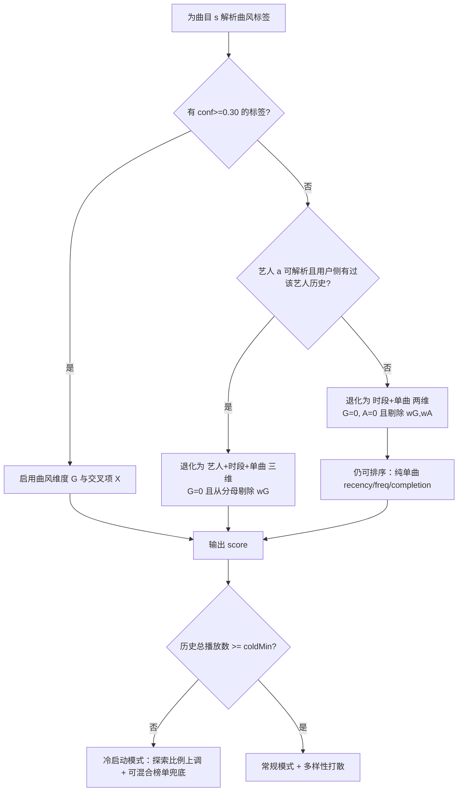
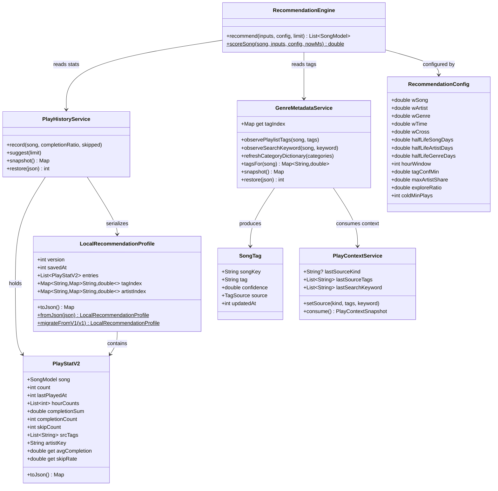
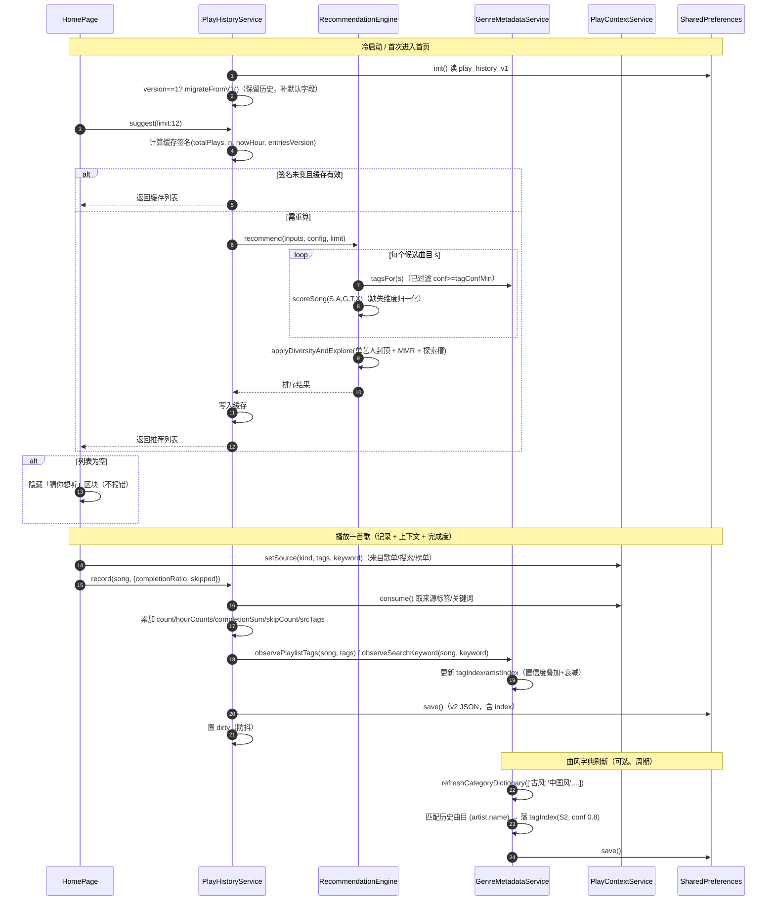

# SuchMusic 二改 · 增量设计 · 「猜你想听」多维度本地个性化推荐

| 项目 | 内容 |
|---|---|
| 文档 | `docs/ARCH-猜你想听.md`（设计文档，单一文档） |
| 版本 | v1.0 |
| 语言 | 简体中文 |
| 代码基线 | `/workspace/suchmusic`（Flutter / Dart 3.12，Android；包名 `com.lightningteam.suchmusic`） |
| 前置文档 | `docs/ARCH-二改.md`（§4 音源抽象 / §5 文件列表 / §12 共享约定）、`docs/ARCH-酷狗登录.md` |
| 现状实现 | `lib/services/play_history_service.dart`（`snapshotVersion=1`，单曲级 `suggest`）、`lib/screens/home_page.dart`（「猜你想听」区块） |
| 硬性约束 | **不引入新第三方依赖**；个性化数据**仅存本机、绝不上传** |
| 本文档 | **不含实现代码**，只给出数据结构、公式、接口签名、迁移规则与文案 |

> 阅读顺序：§1 目标 → §2 现状 → §3 **曲风元数据方案（本文核心）** → §4 数据模型 → §5 打分模型 → §6 交叉维度与多样性 → §7 持久化与迁移 → §8 集成点 → §9 隐私合规文案 → §10 测试策略 → §11 风险与待确认 → 附录（Mermaid / 文件清单 / 实施任务建议）。

---

## 1. 目标与非目标

### 1.1 目标（对齐用户原话）

| 编号 | 用户诉求 | 设计落点 |
|---|---|---|
| G1 | 「老放周杰伦 → 首页多推周杰伦」 | **艺人亲和度**（含时间衰减），§5.2 `A(s)` |
| G2 | 「东风破听得多 → 叠加后多推《红尘客栈》《兰亭序》」 | **曲风亲和度** `G(s)` + **艺人×曲风交叉项** `X`，§5.2/§6 |
| G3 | 「深夜爱 emo / 晚上爱周深那种激昂」 | **时段×条件概率** `T(s,h)`，§5.4 |
| G4 | 「不是单一歌手或单一类型，要多维度综合取最合适」 | **多维加权 + 归一化 + 多样性/探索打散**，§5.6 |
| G5 | 「CHANGELOG 和用户协议写明采集了什么、只保留在本地」 | §9 可直接粘贴文案 |
| G6 | 「极致效果」 | 新增**完成度/跳过**信号（§5.5）+ 交叉维度 + 探索槽，而非三项线性相加 |

### 1.2 非目标（明确不做）

| 不做项 | 原因 |
|---|---|
| 云端协同过滤 / 上传行为数据 | 与「仅存本机」隐私约束冲突，且无后台服务器 |
| 为拿曲风而新增第三方依赖 / 官方 SDK | 违反项目约束 |
| 依赖登录态的用户画像（网易云/酷狗账号画像） | 部分接口需登录且不稳定；离线可用性优先 |
| 引入 `song/wiki` 等新接口抓曲风 | 见 §3.1 调研结论，收益低、风险高（需登录、易风控、非结构化文本） |
| 修改 `lib/` 业务代码 | 本文档只做设计；实现由工程师按 §附录任务单执行 |

---

## 2. 现状分析（已核实）

| 组件 | 事实 | 对设计的影响 |
|---|---|---|
| `PlayHistoryService` | `maxEntries=300`；`_PlayStat{song,count,lastPlayedAt,hourCounts[24]}`；`snapshotVersion=1`；`suggest({limit=10})` 单曲级；顶层纯函数 `recommendationScore` = `recency*0.5+freq*0.3+hourAffinity*0.2` | 仅单曲维度、3 项线性；需扩展为多维并保留旧函数兼容 |
| `home_page.dart` | 第 35/52 行：完全基于本机播放历史；`_localPicks = suggest(limit:12)`；为空**不显示**区块（第 321 行 `if (_localPicks.isNotEmpty)`） | 集成点明确：保持「空则隐藏」行为，`suggest` 签名不破坏 |
| `SongModel` | 字段仅 `id,name,artist,album,coverUrl,duration,source,hash,albumId,albumAudioId,localUri`；**无 genre** | 曲风必须靠推断（§3） |
| 音源 | `SongSource{netease,kugouStandard,kugou,local}`；网易云封装在 `packages/netease_music_api`；酷狗/本地在 `lib/services/sources/` | 曲风推断需按音源分别处理（§3.2） |
| `SearchHistoryService` | 仅存最近 20 条关键词（`search_history.json`），`search_page` 在第 129 行 `add(query)`，第 173 行 `playAndAdd(song)` | **搜索→播放之间存在可挖掘的弱标签信号** |
| 播放记录挂载点 | `main.dart` 第 61-63 行：`onCurrentSongChanged.listen((song) => PlayHistoryService().record(song))` | 新增「完成度/跳过」采集的唯一自然挂载点（§5.5） |
| 历史播放上下文 | 播放历史**不记录歌曲来自哪个歌单/榜单/分类** | 需新增「播放来源上下文」采集，否则歌单标签推断不可用（§3.3） |

> 结论：现状可实现「艺人 + 时段 + 单曲」三维；曲风维度**在现有数据上完全缺失**，是本次设计最大难点。

---

## 3. 曲风元数据方案（核心）

### 3.1 调研结论：在线接口能否直接拿到曲风？

**逐接口核实结果**（`packages/netease_music_api/lib/src/api/*/bean.dart`、`lib/services/sources/kugou_source.dart`）：

| 音源 | 接口/对象 | 是否有曲风字段 | 核实结论 |
|---|---|---|---|
| 网易云 | `Song` / `Song2` / `PlayTrack` bean | ❌ 无 | 字段为 id/name/artists/album/duration/popularity 等，**无 genre/tag/style** |
| 网易云 | `songDetail(songIds)` → `/api/v3/song/detail` | ❌ 无 | 返回 `SongDetailWrap{songs: List<Song2>}`，`Song2` 无标签字段 |
| 网易云 | `Artists` bean / `artistDesc` | ❌ 无结构化曲风 | `ArtistDescWrap` 仅 `briefDesc` + `introduction`（**自由文本简介**，非标签） |
| 网易云 | `song/wiki`（歌曲百科） | ⚠️ 未封装 | vendored 包**未实现**该端点；即便补上也是**自由文本**，需登录、易风控，不可靠 |
| 网易云 | `Play` 歌单对象 | ✅ 有 `tag` / `tags` | 歌单级标签（如「古风」「华语」），**非单曲** |
| 网易云 | `playlistCatalogue` / `playlistHotTags` / `categorySongList(category:)` | ✅ 分类体系 | 官方分类含**风格/情感/场景/语种**（见 `uncategorized/README.md`：流行/摇滚/民谣/电子…；怀旧/浪漫/伤感/治愈；清晨/夜晚…） |
| 网易云 | `songSimiList` / `userSongSimiList` / `playmodeIntelligenceList` | ✅ 相似歌曲 | 返回相似 `Song`，可用于**共现/探索**，但曲目本身仍无标签 |
| 酷狗 | `complexsearch` / 歌单歌曲 | ❌ 未解析 | 请求已带 `withtag:1`、`extend_fields: abtags,...`，但 `_mapPlaylistSong`/搜索 mapper **只映射 name/artist/album/hash/duration/cover，丢弃了 tag 字段**（即便解析，`abtags` 为业务标签，语义非曲风） |
| 本地 | `SongModel.fromLocalUri` | ❌ 无 | 仅从文件名取歌名，`artist='本地音乐'`、`album='本地文件'`，**无任何元数据** |

> **结论：没有任何一个已封装的在线接口能"直接"、可靠地提供单曲曲风标签。**
> 曲风维度必须通过**本地推断**获得，且必须允许**完全缺省**（优雅降级）。

### 3.2 可落地替代方案：曲风标签推断（分层信号 + 置信度）

以下 5 条信号全部可在**不新增依赖**、**不外传数据**的前提下在本地计算。每条信号产出 `(songKey → tag, confidence)`，置信度随时间衰减并归一化。

| 编号 | 信号 | 数据来源 | 需要新增采集？ | 基础置信度 | 衰减半衰期 | 说明 |
|---|---|---|---|---|---|---|
| S1 | **歌单来源标签** | 用户从「古风」「中国风」等歌单播放 → 该歌单的 `Play.tags` | ✅ 需记录**播放来源上下文**（§3.3） | **1.0** | 180 天 | 最强信号：用户主动进入某分类歌单，标签意图明确 |
| S2 | **官方分类字典匹配** | `categorySongList('古风'|'中国风'|'流行'…)` → `playListDetail(id)` → 曲目集合，与历史曲目按 `(artist,name)` 匹配 | ❌ 纯在线拉取，结果本地落库 | **0.8** | 365 天 | 用官方分类歌单给「用户已听过的歌」打离线标签；可周期刷新、只缓存匹配结果（不缓存全量歌单） |
| S3 | **搜索关键词标签** | `SearchHistoryService` 关键词 + 「搜索后播放」关联 | ✅ 需记录「搜索词→播放」关联 | **0.4** | 30 天 | 弱标签：搜「中国风」后播放的歌，加权弱标签 |
| S4 | **艺人聚合代理** | 用户侧某艺人的曲风占比（该艺人已被 S1/S2 标过曲目的标签分布） | ❌ 本地聚合 | **0.5** | 365 天 | 「周杰伦本人在你这里中国风占比高」→ 推测其曲目偏好中国风 |
| S5 | **共现传播** | 同一「播放会话」（连续播放、无长间隔）内的曲目互相传播标签 | ✅ 需轻量会话切分（可纯本地，从时间戳推导） | **0.3** | 30 天 | 常与已知中国风歌曲同会话播放 → 传播标签 |

**置信度合成规则**：对某曲目 `s` 的同一标签 `t`，
```
conf(s, t) = 1 - Π_i (1 - c_i(s, t))        // 多信号独立叠加，取"至少一个成立"的联合概率
```
其中 `c_i(s,t) = baseConf_i × 0.5^(Δt_i / H_i)` 为该信号的衰减后置信度，`Δt_i` 为距该信号最后更新天数。
- 每曲**最多保留 top-3 标签**（`maxTagsPerSong=3`，以存储与噪声控制）。
- **有效阈值 `tagConfMin = 0.30`**：`conf < 0.30` 的标签视为不可信，**不参与打分**（避免噪声污染）。

### 3.3 新增采集项（推断 S1/S3/S5 的前置，均为本地、轻量）

| 采集项 | 内容 | 挂载点 | 存储 |
|---|---|---|---|
| 播放来源上下文 | 当前播放曲目来自「哪个歌单/榜单/分类/搜索」 | 各入口 `playAndAdd` 前写 `PlayContextService.setSource(...)`（`home_page`/`search_page`/`playlist_detail_page`/`kugou_playlist_page`） | 内存暂存 + 落 `PlayContextService`；`record()` 时消费并落历史条目 |
| 完成度 / 跳过 | 切歌时上一首的 `position/duration`、是否「提前切走」 | `AudioPlayerService` 切歌处读取 `position`/`duration`；或 `main.dart` 的 `onCurrentSongChanged` 记录**上一首** | 累积进 `_PlayStat`（§4.1） |
| 播放会话标记 | 相邻两曲间隔 ≤ `sessionGapMin`（默认 30 min）则视为同一会话 | 纯从 `lastPlayedAt` 推导，无需额外存 | 计算时临时推导 |

> 以上 3 项均为**可选增强**：任一缺失，对应信号自然置 0，打分模型按 §5.6 归一化后仍成立（**不报错、不空态**）。

### 3.4 优雅降级路径（强约束）



**降级铁律**：
1. 无任何标签 → 自动**剔除 `wG`（及 `wX` 交叉项）**，权重在剩余维度上重新归一化。
2. 无历史 → `suggest` 返回空列表 → 首页**隐藏区块**（沿用现状，不改 UI 行为）。
3. 任何推断/IO 失败 → `try/catch` 兜底为「无该标签」，**绝不抛异常、绝不使区块消失异常**。

### 3.5 标签的数据落地格式与备份

- **格式**：`songKey → {tag → confidence}`（§4.2 `tagIndex`）+ `artist → {tag → ratio}`（`artistIndex`）。
- **`songKey` 约定**：`"${source.code}:${song.id}"`，避免跨音源 id 冲突；本地曲目 `local:${uri}`。
- **是否随 snapshot 备份**：**是**（默认包含）。理由：曲风标签是用户本机长期积累、重算代价高的数据，换机恢复体验一致；不含任何账号/设备信息，无隐私外泄面。备份结构见 §7.3。
- **存储上限**：`tagIndex ≤ 1000` 曲、每曲 ≤ 3 标签；`artistIndex ≤ 500` 艺人；估算 JSON ≤ ~200 KB（§7.4）。

---

## 4. 数据模型

### 4.1 播放条目 `_PlayStat`（v2，扩展向后兼容）

| 字段 | 类型 | 含义 | v1→v2 |
|---|---|---|---|
| `song` | object | 曲目（含 `localUri`） | 不变 |
| `count` | int | 累计播放次数 | 不变 |
| `lastPlayedAt` | int(ms) | 最近播放时间 | 不变 |
| `hourCounts` | int[24] | 各小时段播放次数 | 不变 |
| `completionSum` | double | Σ 完成度比例 ∈[0,1] | **新增，默认 0** |
| `completionCount` | int | 有完成度样本的播放次数 | **新增，默认 0** |
| `skipCount` | int | 提前切走次数（completion < `skipThreshold`） | **新增，默认 0** |
| `srcTags` | string[] | 播放来源上下文带来的标签（S1） | **新增，默认 []** |
| `artistKey` | string | 主艺人规范化键（多艺人取首位） | **新增，派生** |

### 4.2 推荐档案持久化 JSON schema（`recommendation_profile_v2`）

```json
{
  "version": 2,
  "savedAt": 1760000000000,
  "entries": [
    {
      "song": {
        "id": "186016", "name": "晴天", "artist": "周杰伦", "album": "叶惠美",
        "coverUrl": "https://...","duration": 269000, "source": "netease",
        "hash": null, "albumId": null, "albumAudioId": null,
        "localUri": null
      },
      "count": 12,
      "lastPlayedAt": 1759990000000,
      "hourCounts": [0,0,0,0,0,0,0,0,1,2,0,0,0,1,0,0,0,0,0,3,2,2,1,0],
      "completionSum": 10.4,
      "completionCount": 11,
      "skipCount": 3,
      "srcTags": ["流行"],
      "artistKey": "周杰伦"
    }
  ],
  "tagIndex": {
    "netease:186016": { "中国风": 0.86, "流行": 0.62 }
  },
  "artistIndex": {
    "周杰伦": { "中国风": 0.58, "流行": 0.42 }
  }
}
```

### 4.3 类型定义（供实现，命名规范）



### 4.4 纯函数打分接口（可单测，不依赖时钟/IO）

```dart
// 顶层纯函数，全部输入显式传入（now 由调用方注入）
double scoreSong({required SongFeatures s, required ProfileInputs p,
                  required RecommendationConfig cfg});

double artistAffinity({required String artistKey, required ProfileInputs p,
                       required RecommendationConfig cfg});

double genreAffinity({required Map<String,double> tags, required ProfileInputs p,
                      required RecommendationConfig cfg});

double hourAffinity({required SongFeatures s, required int nowHour,
                     required ProfileInputs p, required RecommendationConfig cfg});

List<SongModel> applyDiversityAndExplore({required List<Scored> ranked,
        required int limit, required RecommendationConfig cfg});
```

---

## 5. 打分模型（显式数学表达）

### 5.1 符号与输入

- 候选曲目 `s`；当前小时 `h ∈ [0,23]`；`now` 为注入的毫秒时间戳。
- `decay(Δt_days, H) = 0.5 ^ (max(0, Δt_days) / H)`  （指数衰减，`H`=半衰期天数）。
- `logShare(x, total) = log(1+x) / log(1+total)`（对数抑制，`total ≤ 0` 时为 0）。
- 时间窗口 `W(h)`：以 `h` 为中心、半径 `hourWindow` 的**环形**小时集合（默认 `hourWindow=2` → `{h-2,…,h+2} mod 24`）。

### 5.2 五个维度分量（各归一化到 `[0,1]`）

**① 单曲自身 `S(s)`** —— 新鲜度 / 频次 / 完成度
```
recency(s)    = decay(Δs_days, H_song)                            // Δs = now - lastPlayedAt
freq(s)       = logShare(count(s), totalPlays)
completion(s) = completionCount>0 ? completionSum/completionCount : 0.5   // 无样本时中性 0.5
quality(s)    = completion(s) · (1 - skipRate(s))                 // 跳过惩罚
S(s) = 0.45·recency + 0.30·freq + 0.25·quality
```

**② 艺人亲和度 `A(s)`** —— 含时间衰减（G1）
```
A(s) = decay(Δartist_days, H_artist) · logShare(artistPlays(a), totalPlays)
     · hourBoost(a, h)
```
- `artistPlays(a)` = 该艺人全部曲目 `count` 之和；`Δartist_days` = 该艺人最近一次播放距今。
- `hourBoost = 1 + β·shareOfArtistInWindow(a,h)`（默认 `β=0.5`），把「这个艺人你只在这个时段听」的偏置注入。

**③ 曲风亲和度 `G(s)`** —— 多标签加权（G2）
```
G(s) = Σ_t [ conf(s,t) · decay(Δtag_days(t), H_genre) · logShare(tagPlays(t), totalPlays) ]
       / Σ_t conf(s,t)                                // conf(s,t) 已过滤 >= tagConfMin
```
- 无标签（分母 0）→ `G(s) = 0`，并触发 §3.4 权重归一化。

**④ 时段/情绪亲和度 `T(s,h)`** —— 条件概率，而非单曲（G3）
```
windowPlays(s,h) = Σ_{k∈W(h)} hourCounts(s)[k]
T_song(s,h) = windowPlays(s,h) / max(count(s),1)          // 这首歌的播放落在当前时段的比例
T_artist(a,h) = windowPlays(a,h) / max(artistPlays(a),1)  // 该艺人同上（聚合）
T_tag(t,h)    = windowPlays(t,h) / max(tagPlays(t),1)
T(s,h) = 0.4·T_song + 0.35·T_artist + 0.25·T_tag          // 缺项时在可用项间归一化
```
体现「深夜爱 emo」：深夜 0-5 点占比高的曲目/艺人/标签，得到高 `T`。

**⑤ 交叉维度 `X(s,h)`** —— 艺人×曲风×时段联合强度（G2 关键）
```
X(s,h) = A(s) · G(s) · T(s,h)
```
- **乘法**表达"三者同时高才强"：单独艺人高但曲风不搭 → 被 `G` 压低；单独曲风搭但非此刻 → 被 `T` 压低。
- 当 `G=0`（无标签）时 `X=0`，交叉项自动失效，不影响降级。

### 5.3 总分
```
Base(s,h) = ( wSong·S + wArtist·A + wGenre·G + wTime·T ) / Σ_activeWeights
Final(s,h) = Base(s,h) + wCross · X(s,h)
```
- `Σ_activeWeights` 只累加**当前可用维度**的权重（无标签则不计 `wGenre`；无艺人历史则不计 `wArtist`）→ **这就是 §3.4 降级归一化的实现**。
- `Final ∈ [0, 1 + wCross]`，量纲一致、可直接排序。

### 5.4 参数表（集中可配置，`RecommendationConfig`）

| 参数 | 符号 | 默认值 | 取值依据 |
|---|---|---|---|
| 单曲权重 | `wSong` | 0.30 | 单曲是基础，但用户要"多维综合"，故不占主导 |
| 艺人权重 | `wArtist` | 0.25 | G1 明确要"多推周杰伦"，权重次高 |
| 曲风权重 | `wGenre` | 0.20 | G2 核心维度，但依赖推断、置信度有限，故略低于艺人 |
| 时段权重 | `wTime` | 0.15 | G3 明确要求，作为条件修正项 |
| 交叉项权重 | `wCross` | 0.35 | 足够大以让"艺×风×时"全中者跃升（见 §5.6 算例） |
| 单曲半衰期 | `H_song` | 14 天 | 单曲兴趣衰减快（避免"上个月循环的一首"长期霸榜） |
| 艺人半衰期 | `H_artist` | 30 天 | 艺人偏好比单曲稳定 |
| 曲风半衰期 | `H_genre` | 60 天 | 口味最稳定（"我就是爱中国风"是长期特征） |
| 时段窗口 | `hourWindow` | 2（±2h） | 兼顾"整点抖动"与"不串到相邻时段" |
| 标签置信阈值 | `tagConfMin` | 0.30 | 低于此的推断噪声大于信号（§3.2） |
| 单艺人占比上限 | `maxArtistShare` | 0.33 | 用户反对"只推一个歌手"，但允许顶艺人占~1/3 |
| 探索比例 | `exploreRatio` | 0.15 | 保留探索槽，避免信息茧房 |
| 冷启动阈值 | `coldMinPlays` | 30 | 低于此次数视为样本不足 |
| 跳过阈值 | `skipThreshold` | 0.30 | 完成度 <30% 视为跳过 |
| 会话间隔 | `sessionGapMin` | 30 min | 共现/会话切分（S5） |
| 每曲标签上限 | `maxTagsPerSong` | 3 | 存储与噪声控制 |

> 所有参数集中在 `RecommendationConfig`（`const` 默认 + 可从 prefs 覆盖），**便于调参与单测注入**。

### 5.5 新增信号：完成度 / 跳过（G6「极致效果」）

- **是否需要新增采集**：**是**。现状仅记频次与时段，无法区分「完整听完」与「秒切」。
- **采集方式**（§3.3）：切歌时取 `position/duration` 计算完成度；`< skipThreshold` 记一次 `skipCount`。
- **降级**：无该信号（`completionCount=0`）时 `completion` 取中性 0.5，`skipRate=0`，模型仍成立。

### 5.6 算例：复现「周杰伦 × 中国风 × 深夜」（G2/G3 验收）

设定：深夜 `h=1`，用户历史中 周杰伦 权重高（`A(周杰伦)=0.8`）、`artistPlays(周杰伦)≫`，曲目《红尘客栈》《兰亭序》标签 `中国风(conf 0.86)` 且 `G=0.75`，深夜时段 `T=0.7`（这些歌深夜占比高）；普通流行歌 `G≈0.2` 且非深夜偏好 `T≈0.2`。

| 曲目 | S | A | G | T | Base=S·.3+A·.25+G·.2+T·.15 | X=A·G·T | Final=Base+0.35·X |
|---|---|---|---|---|---|---|---|
| 红尘客栈(周杰伦·中国风·深夜) | .60 | .80 | .75 | .70 | .18+.20+.15+.105=**.635** | .80·.75·.70=**.420** | .635+.147=**0.782** |
| 兰亭序(周杰伦·中国风·深夜) | .55 | .80 | .75 | .68 | .165+.20+.15+.102=**.617** | .408 | **0.760** |
| 某热门流行(非周杰伦·非中国风·非深夜) | .70 | .30 | .20 | .20 | .21+.075+.04+.03=**.355** | .012 | **0.359** |

→ 「周杰伦 × 中国风 × 深夜」的曲目显著跃升；普通流行歌虽单曲分数高（`.70`）也排在其后，体现**多维综合**而非单曲维度。

---

## 6. 交叉维度与多样性/探索机制

### 6.1 交叉维度组合方式（三选一，本设计采用 A+B）

| 方案 | 表达 | 取舍 |
|---|---|---|
| A. 相乘交互 | `X = A·G·T` | ✅ **采用**：语义清晰（三者须同时高），可单测 |
| B. 归一化线性 + 交叉 booster | `Base/Σw + wCross·X` | ✅ **采用**：解决降级时的权重缺失，保证量纲一致 |
| C. 条件概率链 | `P(听|a)·P(a|h)·P(t|a)` | 备选：需建模马尔可夫链、参数多、易过拟合，本版不用 |

### 6.2 多样性 / 探索（用户明确反对"只推某一歌手/某一类型"）

前置：`applyDiversityAndExplore(ranked, limit, cfg)`，分三步。

| 步骤 | 机制 | 参数 |
|---|---|---|
| 1. 去重 | 按 `song.id` 去重；再按 `(artistKey,name)` 去重（同曲不同源） | — |
| 2. 单艺人封顶 | 贪心选取时，同一 `artistKey` 累计数 **不超过** `ceil(maxArtistShare·limit)`（limit=12 → 4） | `maxArtistShare=0.33` |
| 3. MMR 打散 | 选取时对"与已选曲目同艺人/同标签"的候选施加 `score' = score - λ·sim(已选)`（`sim`=同艺人 1.0、同主标签 0.5） | `λ=0.4` |
| 4. 探索槽 | 强制保留 `max(1, round(exploreRatio·limit))`（12 → 2）个槽位给「高亲和艺人/标签中**低频或久未播放**的曲目」与「新艺人」 | `exploreRatio=0.15` |

> 结果：顶艺人（周杰伦）仍可占 ~4/12（满足 G1），但**不会挤满**；探索槽保证"多角度"。

### 6.3 冷启动行为

| 条件 | 模式 | 行为 |
|---|---|---|
| `totalPlays == 0` | empty | 返回 `[]` → 首页**隐藏区块**（沿用现状，§2） |
| `0 < totalPlays < coldMinPlays` 或 `distinctArtists < 2` | cold | 探索比例上调至 `0.30`；若有榜单/每日推荐结果，可与之**交替混合**（可选，UI 层决定） |
| `≥ coldMinPlays` | warm/normal | 走完整多维模型 + 多样性打散 |

---

## 7. 持久化与迁移

### 7.1 版本与存储键

| 项 | 值 |
|---|---|
| SharedPreferences key | 沿用 `play_history_v1`（**键名不变**，避免旧数据成孤儿） |
| 快照结构版本 | `snapshotVersion: 1 → 2` |
| 曲风档案 key | 新增 `recommendation_profile_v1`（仅存 `tagIndex`/`artistIndex`；也可并入同一 JSON，见下） |
| 版本判定 | 读盘时先看 `json['version']`：`1` → 迁移；`2` → 直用；缺失/未知 → 按 v1 容错解析 |

> 实现建议：**把 `tagIndex`/`artistIndex` 直接并入同一份 JSON**（`entries` + 两个 index），减少一个 prefs key 与一次读写；`recommendation_profile_v1` 仅作为"独立档案"的备选键名。

### 7.2 向后兼容迁移（v1 → v2，**不丢历史**）

```
migrateFromV1(v1Json):
  entries = v1Json.entries           // 原样保留 count/lastPlayedAt/hourCounts/song
  for each entry:
      completionSum   = 0            // 缺省
      completionCount = 0
      skipCount       = 0
      srcTags         = []
      artistKey       = normalize(firstArtist(entry.song.artist))
  tagIndex   = {}                    // 首启为空，靠后续推断填充
  artistIndex= {}
  version = 2
```
- **关键**：v1 的**全部播放历史条目**在迁移后逐字节保留（`count/lastPlayedAt/hourCounts/song` 不变），仅补默认字段。
- 迁移在 `init()` 内存中完成，**下一次 `record`/`save` 时落盘为 v2**；即便落盘前退出，下次仍可从 v1 再迁移（幂等）。
- `restore(json)`（备份导入）**同时接受 v1 与 v2**：v1 走 `migrateFromV1`，v2 直用。

### 7.3 备份（`SettingsBackupService`）变更

- 备份 JSON 的 `playHistory` 段：**new 字段随 v2 一起导出**；`tagIndex`/`artistIndex` 一并导出（§3.5 决策：随备份）。
- 导入：`PlayHistoryService().restore()` 内部兼容 v1/v2；`SettingsBackupService` 的 `formatVersion` 语义不变（外层备份格式仍为 1，内层 `playHistory.version` 自描述）。
- 保持既有约束：**绝不导出任何登录凭证**（白名单机制不变，§`SettingsBackupService` 注释）。

### 7.4 文件体积控制（用户在意存储）

| 数据 | 规模上限 | 估算字节 |
|---|---|---|
| `entries` | ≤ 300 条 | ~300 × 320B ≈ **96 KB** |
| `tagIndex` | ≤ 1000 曲 × ≤3 标签 | ~1000 × 45B ≈ **45 KB** |
| `artistIndex` | ≤ 500 艺人 × ≤3 标签 | ~500 × 55B ≈ **28 KB** |
| 合计 | — | **≲ 170 KB**（含 JSON 结构开销 ≈ 200 KB 上限） |

- 超限淘汰：`tagIndex` 按 `updatedAt` 最久未更新淘汰；`artistIndex` 同理；`entries` 维持现有「最久未播放」淘汰。

---

## 8. 集成点与接口签名

### 8.1 `suggest()` 签名演进（既有调用方**零改动**）

| 版本 | 签名 | 说明 |
|---|---|---|
| 现状 | `List<SongModel> suggest({int limit = 10})` | 单曲级，3 项线性 |
| **演进（兼容）** | `List<SongModel> suggest({int limit = 10, RecommendationMode? mode, String? ctxTag})` | **全部新增参数可选、有默认值**；`home_page.dart` 第 54 行 `suggest(limit: 12)` **无需改动** |
| 新入口（可选） | `RecommendationResult recommendDetailed({int limit})` | 返回带「推荐理由」的结构（用于 UI 展示 chip），非必须 |

- 保留旧顶层纯函数 `recommendationScore(...)` 作为 **deprecated 薄封装**（内部委托 `scoreSong`），保证既有 `play_history_service_test`/回归测试不红；新逻辑走 `scoreSong`。

### 8.2 计算时机与缓存（避免每次进首页重算）

| 时机 | 行为 |
|---|---|
| App 冷启动 | `PlayHistoryService.init()` 后，**首次进入 Home 时懒计算**一次 |
| 播放变化（`record`） | 置 **dirty 标记**（防抖，如 5s），下次 `suggest` 时重算 |
| 跨小时段 | 以 `nowHour` 参与缓存签名；小时变化 → 签名变化 → 重算 |
| 进入 Home | 命中缓存（签名一致）→ **直接返回**，不做重计算 |
| 设置项变更 / 备份导入 | 置 dirty |

**缓存签名** = `hash(totalPlays, entries.length, nowHour, entriesVersion, tagIndexVersion)`；仅当签名变化才重算。计算复杂度 `O(N·D)`（`N=候选曲目≤300`，`D`=维度数），单次 <1ms 量级，同步返回即可，无需 isolate。

### 8.3 首页展示（`home_page.dart`）

- 区块存在性：沿用 `if (_localPicks.isNotEmpty)`（第 321 行）——**空则隐藏**不变。
- 数据来源：`_loadLocalPicks()`（第 53 行）改调 `suggest(limit: 12)`；**可选**新增副标题/「为什么推它」chip（如"周杰伦 · 中国风 · 深夜"），由 `recommendDetailed` 提供，**默认不开启**以控制改动面。
- 标题、样式、翻页交互一律保持现状（零视觉回归）。

### 8.4 接口契约汇总（供工程师实现）

```dart
enum RecommendationMode { auto, cold, normal }

class SongFeatures {          // 单曲特征（纯函数入参）
  final String songId, artistKey, name;
  final int count, hourCountAtWindow;
  final int hoursSinceLastPlay;
  final Map<String,double> tags;   // 已过滤 conf>=tagConfMin
  final double completion, skipRate;
}

class ProfileInputs {         // 全局画像（纯函数入参）
  final int totalPlays;
  final Map<String,int> artistPlays;
  final Map<String,int> artistLastDays;
  final Map<String,int> tagPlays;
  final Map<String,int> tagLastDays;
  final Map<String,int> hourArtistPlays;  // 时段×艺人
  final Map<String,int> hourTagPlays;     // 时段×曲风
  final int nowHour;
}
```

---

## 9. 隐私合规文案（可直接粘贴）

### 9.1 `CHANGELOG.md` 新增版本段落（建议置于最新版本）

```markdown
## [0.12.0] - 2026-XX-XX

### 新增
- **「猜你想听」升级为多维度本地个性化推荐**：综合「艺人 · 曲风 · 时段/情绪 · 单曲」
  四个维度，并叠加「艺人 × 曲风 × 时段」交叉权重，让首页推荐更贴合你的收听习惯
  （例如常听周杰伦的中国风歌曲，首页会更多出现"周杰伦 × 中国风"的作品）。
- **本地曲风推断**：由于各在线音源接口均不提供歌曲的曲风/流派标签，本功能通过
  「歌单来源标签 · 官方分类匹配 · 搜索关键词 · 艺人聚合 · 共现传播」五种**本地**
  信号推断曲风，并给出置信度；推断不出时自动退化为「艺人 + 时段 + 单曲」维度，
  不影响使用。
- **更细腻的偏好信号**：新增记录每首歌的**播放完成度**与**是否跳过**，用于提升推荐质量。
- **多样性保护**：同一歌手的推荐占比设有上限，并保留一定比例的「探索」位置，
  避免推荐结果过于单一。

### 隐私（重要）
- 上述所有个性化数据（播放历史、时段分布、完成度/跳过、曲风标签推断结果）
  **仅保存在你的设备本地**，用于在本机离线计算推荐；
  **不会上传到任何服务器、不随账号登录同步、不参与任何网络请求**。
- 你可以在「设置」中随时清除这些本地数据；卸载应用即彻底删除。
- 详见《用户协议》第四章（用户数据与隐私）。
```

### 9.2 `lib/screens/agreement_page.dart` §四「用户数据与隐私」新增条款

> 在现有 `_Section('四、用户数据与隐私', [...])` 内**追加**（不改动 4.1–4.3）：

```dart
_Para('4.4 本地个性化推荐（「猜你想听」）说明：为实现首页个性化推荐，本软件会在您的设备本地记录并计算以下数据：① 歌曲播放历史（含播放次数、最近播放时间）；② 各时段（0–23 时）的收听分布；③ 每次播放的完成度与是否提前跳过；④ 由本机行为推断出的曲风/风格标签。上述数据全部仅保存在您的设备本地，仅用于在本机离线计算推荐结果，不会上传、不会与任何账号或第三方共享、不参与任何网络请求。'),
_Para('4.5 曲风标签说明：因第三方音乐平台接口不提供歌曲的曲风/流派字段，本软件的曲风标签系由本机行为（如播放来源歌单、搜索记录、收听共现）在本机推断得出，可能存在偏差，仅供个性化展示参考，不构成对歌曲正式分类的声明。'),
_Para('4.6 您可以在“设置”中随时清除本地推荐数据；卸载本软件即彻底删除全部上述本地数据。'),
```

（可选）同步在协议首屏要点框（`agreement_page.dart` 第 355-367 行的要点列表）追加一条：
```
'· 「猜你想听」推荐完全在本机离线计算，播放历史与偏好数据不上传、不同步；',
```

---

## 10. 测试策略

### 10.1 纯函数单测（确定性：注入 `now`，无 IO、无时钟）

| 目标 | 用例 |
|---|---|
| `decay()` | 边界 `Δt<0→0`；`Δt=H` 时恰为 0.5；单调递减 |
| `logShare()` | `total=0` → 0；`x=0` → 0；单调性 |
| `scoreSong()` | 全维度齐备 vs 缺维度（权重归一化后仍在 `[0,1+wCross]`） |
| `artistAffinity()` | 近期 vs 久远同频次 → 近期更高（衰减生效） |
| `genreAffinity()` | 多标签加权；`conf<tagConfMin` 被忽略；无标签 → 0 |
| `hourAffinity()` | 环形窗口跨 0 点（`h=0`, `W={22,23,0,1,2}`）；不同小时差异化 |
| **交叉项复现** | §5.6 算例：`红尘客栈 > 某热门流行` 且数值与表一致（黄金值断言） |
| `applyDiversityAndExplore()` | 单艺人封顶、MMR 打散、探索槽被填充 |
| `migrateFromV1()` | v1 JSON → v2：`count/lastPlayedAt/hourCounts` **逐字段保持不变**；新字段默认值正确；幂等（再迁移不变） |
| 解码健壮性 | 单条脏数据跳过而非整体失败；`hourCounts` 长度 <24 补零；未知 `version` 容错 |

### 10.2 边界用例清单

| 场景 | 期望 |
|---|---|
| 无历史 | `suggest` 返回 `[]`；首页隐藏区块；不抛异常 |
| 单一艺人 | 单艺人封顶生效，结果仍含其他艺人（探索槽/榜单兜底） |
| 跨时段 | 深夜历史多 → 深夜调用时该类曲目 `T` 高、排序上移 |
| 标签缺失 | 全库无标签 → 自动剔除 `G`/`X`，退化为三/二维，结果非空 |
| 旧数据迁移 | v1 → v2 平滑；播放历史条数与次数零丢失 |
| 备份往返 | v2 `snapshot()` → `restore()` 后 `tagIndex`/`entries` 一致 |
| 超限淘汰 | `entries>300`、`tagIndex>1000` 时按策略淘汰且不崩 |

### 10.3 回归门禁

- `flutter analyze lib test` → `0 issues`。
- `flutter test` → 全绿（≥ 既有 105 项 + 本次新增）。
- 既有 `play_history_service` 相关测试保持通过（旧 `recommendationScore` 行为不回归）。

---

## 11. 风险与待确认事项

| 编号 | 风险 / 待确认 | 影响 | 建议 / 备选 |
|---|---|---|---|
| R1 | **曲风推断整体置信度有限**（无权威来源，靠行为推断） | G2 效果上限受限 | 已设计 S1 歌单来源为最强信号；建议**优先保证 S1 上下文采集**到位；如实告知用户"推断可能有偏差"（§9.2 4.5） |
| R2 | 「播放来源上下文」需在**多个入口**改造（首页/搜索/歌单/榜单） | 改动面扩大 | 统一走 `PlayContextService.setSource(...)`；漏改入口只是**少一个标签**，不报错（优雅降级） |
| R3 | 完成度/跳过需读 `position/duration`，切歌时机竞态 | 采集可能不准 | 以 `onCurrentSongChanged` 记录**上一首**；`completionCount=0` 时取中性值，不影响主流程 |
| R4 | 官方分类歌单（S2）需**在线拉取**，可能失败/限流 | 字典为空 | 失败即跳过 S2，退化为 S1/S3/S4/S5；下拉周期放宽（如 7 天一次） |
| R5 | 参数默认值（权重/半衰期/阈值）为**经验值**，未必最优 | 效果调优 | 全部集中在 `RecommendationConfig`，便于灰度调参与 A/B（本地） |
| R6 | 音乐/图片版权无关，但**曲风标签**若被误解为"官方分类" | 合规表述 | 协议 4.5 已声明"非官方分类声明" |
| R7 | 存储增长（用户在意） | 体积 | 已设上限 ~200KB（§7.4）+ 淘汰策略 |
| **Q1** | **曲风标签是否随设置备份导出？** 本设计**默认随备份**（§3.5） | 换机体验 | 若用户更在意"不落盘任何偏好推断"，可改为**不导出**；**请确认** |
| **Q2** | 首页是否需要**展示"推荐理由"**（如"周杰伦 · 中国风 · 深夜"）？本设计**默认不展示** | UI 改动面 | **请确认**是否要 chip 副标题 |
| **Q3** | 是否接受**冷启动时与榜单/每日推荐混合**兜底？本设计**仅建议、不强制** | 首页观感 | **请确认** |
| **Q4** | `maxArtistShare=0.33`（顶艺人最多占 ~1/3）是否符合"要多推周杰伦"的预期？ | G1 强度 | 可在 0.25–0.40 间取值；**请确认**期望强度 |

---

## 附录 A · 文件清单（新增 / 修改）

| 文件 | 类型 | 责任 |
|---|---|---|
| `lib/models/recommendation_profile.dart` | 新增 | `PlayStatV2 / SongTag / RecommendationConfig / ProfileInputs / SongFeatures` 等数据结构 |
| `lib/services/recommendation_engine.dart` | 新增 | 纯函数打分（`scoreSong/artistAffinity/genreAffinity/hourAffinity`）+ `applyDiversityAndExplore` + `recommend` |
| `lib/services/genre_metadata_service.dart` | 新增 | 曲风推断（S1–S5）、`tagIndex/artistIndex` 维护与快照 |
| `lib/services/play_context_service.dart` | 新增 | 播放来源上下文（歌单/分类/搜索词）暂存与消费 |
| `lib/services/play_history_service.dart` | 修改 | schema v2、迁移、完成度/跳过记录、`suggest` 委托引擎 |
| `lib/services/settings_backup_service.dart` | 修改 | 备份包含 `tagIndex/artistIndex`（随 snapshot） |
| `lib/screens/home_page.dart` | 修改 | 最小改动：`_loadLocalPicks` 调 `suggest(limit:12)` |
| `lib/services/audio_player_service.dart` | 修改（可选） | 暴露切歌时的完成度信息（`position/duration`） |
| `lib/utils/app_constants.dart` | 修改 | 新增 prefs key（`recommendation_profile_v1`、参数覆盖 key） |
| `lib/screens/agreement_page.dart` | 修改 | §四新增 4.4/4.5/4.6 条款 |
| `CHANGELOG.md` | 修改 | 新增版本段落（§9.1） |
| `test/recommendation_engine_test.dart` | 新增 | 纯函数 + 交叉项黄金值 + 边界 |
| `test/genre_metadata_test.dart` | 新增 | 推断/置信度/降级 |
| `test/play_history_migration_test.dart` | 新增 | v1→v2 迁移零丢失、备份往返 |

## 附录 B · 实施任务建议（供主理人拆分，≤5 任务）

| 任务 | 内容 | 依赖 |
|---|---|---|
| T01 | 数据层：`recommendation_profile.dart` + `play_history_service.dart` v2 迁移 + `app_constants` + 迁移测试 | — |
| T02 | 打分引擎：`recommendation_engine.dart` 纯函数 + 多样性 + 引擎单测（含 §5.6 黄金值） | T01 |
| T03 | 曲风推断：`genre_metadata_service.dart` + `play_context_service.dart` + 采集挂载（各入口）+ 推断测试 | T01 |
| T04 | 集成：`suggest` 委托 + `home_page` 最小改动 + `audio_player_service` 完成度（可选） + `settings_backup_service` | T02,T03 |
| T05 | 合规与收尾：协议文案 + CHANGELOG + `flutter analyze/test` 归零 | T04 |

## 附录 C · 程序调用流（Mermaid sequenceDiagram）



## 附录 D · 类图（Mermaid classDiagram，独立文件同源）

见 §4.3；同源导出至 `docs/class-diagram-recommend.mermaid`。

