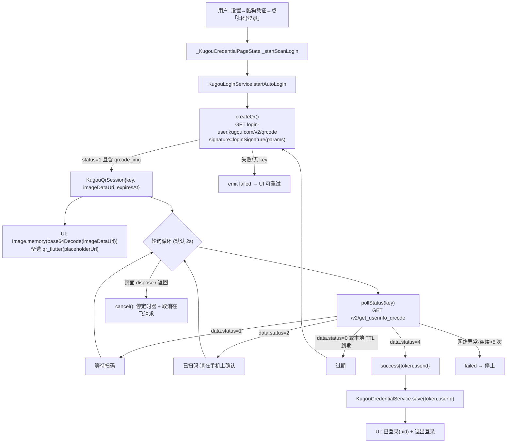

# SuchMusic 二改·增量设计 · 酷狗概念版扫码登录 + 两处缺陷修复

| 项目 | 内容 |
|---|---|
| 文档 | `docs/ARCH-酷狗登录.md`（增量功能设计 + 任务分解，单一文档） |
| 版本 | v1.0（增量） |
| 语言 | 简体中文 |
| 前置文档 | `docs/ARCH-二改.md`（既有架构，尤其 §4 音源抽象 / §5 文件列表 / §12 共享约定）、`README-二改.md` |
| 代码基线 | `/workspace/suchmusic`（Flutter 3.47.7 / Dart 3.13，Android） |
| 质量门禁 | `flutter analyze lib test` → **0 issues**；`flutter test` → **全绿（≥ 既有 105 项）** |
| 上游依据 | 主理人**协议实测**结论（扫码端到端通过、短信失败、跳转 APP 不可行；complexsearch 主路径失效等） |

> 阅读顺序：§1 方案总览 → §2 服务层 → §3 签名复用 → §4 UI → §5 文件列表 → §6 任务 → §7 测试 → §8 风险。
> 本文档**不含实现代码**，只给出可直接照做的接口签名、状态机、黄金值与约束。

---

## 0. 本次增量范围与硬性约束

### 0.1 范围（三项，缺一不可）

| 编号 | 类型 | 内容 | 依据 |
|---|---|---|---|
| **REQ-L1** | 新增功能 | 酷狗概念版**扫码登录**（取码 → 轮询 → 拿 token/userid → 写入凭证） | 实测端到端通过 |
| **REQ-L2** | 缺陷修复 | 酷狗搜索**主路径**由不可达的 `mobilecdn` 改为 `complexsearch`，并补全签名参数集 | 实测 `mobilecdn` HTTP 000 / `complexsearch` 200 |
| **REQ-L3** | 缺陷修复 | 取播放地址 `key` 的**盐值按平台区分**（概念版 lite 盐 ≠ 标准版盐），并提供回退 | 参考实现常量比对 |

### 0.2 明确**不做**（但需在文档说明原因）

| 不做项 | 原因（主理人实测） | 后续可能性 |
|---|---|---|
| 短信验证码登录 | `POST login.user.kugou.com/v7/send_mobile_code` 持续返回 `error_code=20006`（签名错），且参考实现依赖**设备注册上下文**；真实校验必须**真实手机号**，本环境不可验证 | 若后续拿到稳定的签名+设备注册链路，可作为**第二登录方式**接入（服务层已预留枚举位） |
| 跳转 APP 授权登录（OAuth） | 需**酷狗开放平台**开发者资质（appid/secret + 回调），个人二改无法获得；即便拿到也**取不到概念版播放凭证** | 无（本版不规划） |

### 0.3 硬性约束（本版必须遵守）

1. **不改动已通过验证的既有行为**：竖屏 430×932 基线、既有 105 项测试全绿；**实现层黄金值测试**允许“新增用例 + 既有用例语义等价迁移”，但最终套件数量不得下降且必须全绿。
2. **服务层不外抛**：所有网络/解析异常一律 `catch` → 返回 `null` / 空 / `failed` 态 + `debugPrint`。
3. **日志沿用 emoji 前缀**：`📂`读取 `💾`写入 `🔑`登录 `🎵`URL `❌`错误 `⚠️`降级 `🔄`恢复 `🧹`清理 `📱`设备。
4. **凭证脱敏**：token/userid 一律 `AppConstants.maskToken()`（`前4****后4`），UI 与日志同规则。
5. **单例范式**：与 `AudioPlayerService` / `KugouCredentialService` 一致（`static final instance`），但**为测试可注入**起见，登录服务提供**带参构造**（注入 `Dio` / 假时钟 / 轮询参数）。

---

## 1. 方案总览

### 1.1 分层归属（沿用既有分层，不新增层）

```mermaid
flowchart TB
    subgraph UI["表现层"]
        CP[kugou_credential_page.dart<br/>凭证页·扫码区]
        QP[kugou_qr_panel.dart<br/>★ 新增 二维码/状态组件]
        RS[responsive.dart<br/>断点/夹取·复用]
    end
    subgraph SVC["应用服务层"]
        LOGIN[kugou_login_service.dart<br/>★ 新增 扫码登录]
        CRED[kugou_credential_service.dart<br/>既有·凭证存取]
    end
    subgraph DOMAIN["领域/数据层"]
        CFG[kugou_config.dart<br/>★ 改 双盐/登录常量]
        SIGN[kugou_sign.dart<br/>★ 改 signature(salt)/loginSignature]
        DEV[kugou_device.dart<br/>★ 新增 统一 mid/uuid/dfid]
        KS[kugou_source.dart<br/>★ 改 搜索主路径/平台盐]
    end
    subgraph INFRA["基础设施"]
        DIO[dio]
        SP[shared_preferences]
        QRF[qr_flutter]
    end
    CP --> QP
    CP --> LOGIN
    CP --> CRED
    CP & QP --> RS
    LOGIN --> SIGN & CFG & DEV
    LOGIN --> DIO
    KS --> SIGN & CFG & DEV
    CRED --> SP
    QP --> QRF
```

### 1.2 扫码登录全链路（核心流程图）



### 1.3 关键决策摘要

| 决策点 | 选择 | 理由 |
|---|---|---|
| 二维码渲染 | **优先** `qrcode_img`（接口直返 base64 data-URI）；**备选** `qr_flutter` 渲染 `placeholderUrl` | 实测接口直接给图；`qr_flutter` 已在依赖中，作为容错 |
| 轮询驱动 | 服务层**单飞顺序循环**（`await delay`），非 `Timer.periodic` 并发 | 从根本上避免重复并发请求 |
| 过期处理 | 服务层**自动重新取码** | 对用户零操作；对应「已过期点击刷新」文案 |
| 成功后写入 | 复用既有 `KugouCredentialService.save` | 不新增持久化通路，与手填一致 |
| 昵称/VIP | 本版**不拉取**，展示「已登录(uid)」 | 接口未实测（见 §2.4） |
| 设备标识 | 抽出 `KugouDevice`，搜索/取地址/登录**共用一套** | 降低风控概率；登录要求 `uuid==mid`、`dfid="0j"+20` |

---

## 2. 服务层设计

### 2.1 数据模型（`lib/services/sources/kugou_login_models.dart` · 新增）

```dart
/// 扫码登录状态机（与接口 data.status 映射见 §2.3）
enum QrLoginState {
  expired,    // 0 = 二维码过期 → 上层自动重新取码
  waiting,    // 1 = 等待扫码
  scanned,    // 2 = 已扫码，待手机确认
  confirmed,  // 3 = （预留，接口未见）
  success,    // 4 = 授权成功，携带 token + userid
  failed,     // 本地判定：超时 / 连续错误 / 取码失败
}

/// 一次扫码会话（取码结果）
class KugouQrSession {
  final String key;          // 接口 qrcode 字段，轮询主键
  final String imageDataUri; // "data:image/png;base64,..."；可能为空串（走 qr_flutter 备选）
  final DateTime expiresAt;  // 本地推算 = now + sessionTtl（默认 120s）

  const KugouQrSession({
    required this.key,
    required this.imageDataUri,
    required this.expiresAt,
  });

  /// qr_flutter 备选渲染源（无 qrcode_img 时使用）
  String get placeholderUrl =>
      '${KugouConfig.qrH5Base}?qrcode=$key';

  bool isExpiredAt(DateTime now) => !now.isBefore(expiresAt);
}

/// 一次轮询/自动登录的更新事件（流元素）
class KugouQrPollResult {
  final QrLoginState state;
  final String? token;             // 仅 success
  final String? userId;            // 仅 success
  final KugouQrSession? session;   // 非 success 时附带“当前有效码”（换码后为新码）

  const KugouQrPollResult({
    required this.state,
    this.token,
    this.userId,
    this.session,
  });

  factory KugouQrPollResult.failed(String reason);
  factory KugouQrPollResult.expired(KugouQrSession? next); // 换码后带回新 session
}
```

### 2.2 登录服务（`lib/services/sources/kugou_login_service.dart` · 新增）

```dart
class KugouLoginService {
  /// 带参构造：便于单测注入假 Dio / 假时钟 / 缩短轮询参数。
  /// 缺省即生产配置（见默认值）。
  KugouLoginService({
    Dio? dio,
    DateTime Function()? now,                     // 假时钟注入点
    Duration pollInterval  = const Duration(seconds: 2),
    Duration sessionTtl    = const Duration(seconds: 120), // 单码有效期
    Duration maxWait       = const Duration(minutes: 3),   // 整体等待上限
    int      maxConsecutiveErrors = 5,            // 连续网络错误上限
  });

  /// 生产单例（App 使用）
  static final KugouLoginService instance = KugouLoginService();

  // ── 原语（供 UI 手动驱动 + 单测）──────────────────────────
  /// 取二维码。成功 → KugouQrSession；失败/异常 → null（不外抛）。
  Future<KugouQrSession?> createQr();

  /// 单次轮询。成功 → KugouQrPollResult；网络异常 → null（本轮跳过，不终止）。
  Future<KugouQrPollResult?> pollStatus(String key);

  // ── 全自动流程（UI 首选）─────────────────────────────────
  /// 取码 → 轮询(2s) → 过期自动换码 → 成功/失败结束。
  /// 返回**单订阅**流；调用方必须在 dispose/离开页面时 [cancel]。
  Stream<KugouQrPollResult> startAutoLogin();

  /// 取消定时器 + 取消在飞 Dio 请求（**幂等**，可重复调用）。
  void cancel();

  /// 释放（内部调 cancel + 关闭流）。
  void dispose();
}
```

### 2.3 状态映射与轮询策略

**接口 `data.status` → 枚举映射（`pollStatus` 内解析）**：

| 接口 `data.status` | 枚举 | UI 文案 | 后续动作 |
|---|---|---|---|
| `0` | `expired` | 二维码已过期，正在刷新… | **自动 `createQr()` 换新码**并继续轮询 |
| `1` | `waiting` | 请使用酷狗概念版 App 扫码 | 继续轮询 |
| `2` | `scanned` | 已扫码，请在手机上确认 | 继续轮询 |
| `4` | `success` | 登录成功 | 结束流，回填 token/userid |
| 其它 / 缺字段 | `waiting`（容错） | 请扫码 | 继续轮询 |

**轮询策略矩阵**：

| 维度 | 取值 | 实现要点 |
|---|---|---|
| 间隔 | 默认 **2s**（注入可调） | `await Future.delayed(pollInterval)`，**顺序循环** |
| 单码有效期 | 默认 **120s** | 本地 `now() > expiresAt` 也判 `expired`（不等接口） |
| 整体超时 | 默认 **3min** | 超时 → `failed('超时，请重试')` 并停止 |
| 连续错误 | 默认 **>5 次** | 达阈值 → `failed('网络异常')` 并停止；成功一次即清零 |
| 并发控制 | **单飞** | 循环体 `await` 串联；`startAutoLogin` 二次调用先 `cancel()` 旧流 |
| 退出取消 | `cancel()` | 停止延时循环 + `CancelToken.cancel()` 在飞请求；幂等 |
| 页面销毁 | UI `dispose()` 调 `cancel()` + 退订 | 防内存泄漏 / 防离页后仍写凭证 |
| 过期自动换码 | 内置 | `expired` 分支 `createQr()` 成功后发射 `expired(next: newSession)` |

**成功写凭证**（由 UI 触发，服务层不直接依赖持久化）：

```dart
// UI 收到 state==success 时：
final ok = await KugouCredentialService.instance.save(result.token!, result.userId!);
if (ok) { /* 刷新页面状态 → “已登录(uid)”；可选提示切换音源 */ }
```

> 说明：登录服务**只**产出 token/userid，**不**直接写 prefs，保持“服务层不触碰持久化”的既有分层；写入统一走 `KugouCredentialService`。

### 2.4 昵称 / VIP 拉取（结论：本版不做）

- 实测 `get_userinfo_qrcode`（status=4）**只返回 token 与 userid**，未验证存在稳定的“按 token 取昵称/VIP”接口，且该接口若存在也属第三方逆向、随时变更。
- **决策**：本版**不拉昵称/VIP**。UI 展示「**已登录(uid)**」（uid 走 `maskToken` 脱敏）。
- **后续可能性**：若后续实测到 `userinfo` 接口，新增 `Future<KugouUserProfile?> fetchProfile()`（可选能力）即可，**不影响**本版数据结构（`KugouCredentialService.nickname` 字段已存在，可复用）。

### 2.5 错误与异常约定（服务层不外抛）

| 场景 | 返回 | 日志（emoji 前缀） |
|---|---|---|
| 取码 HTTP 异常 / 非 200 / 无 `qrcode` | `null` | `❌ 酷狗取二维码失败` |
| 轮询 HTTP 异常 | `null`（本轮跳过） | `⚠️ 酷狗轮询异常` |
| 轮询响应结构异常 / 缺 `data.status` | `waiting`（容错） | `⚠️ 酷狗轮询响应异常` |
| 整体超时 / 连续错误超限 | `failed` 事件 | `⚠️ 酷狗登录超时/网络异常` |
| 成功 | `success` 事件 | `🔑 酷狗扫码登录成功 uid=前4****后4` |

---

## 3. 签名复用设计

### 3.1 现状与问题

现有 `KugouSign.signature(params)` 只有**一个盐值** `KugouConfig.secret = 'LnT6xpN3khm36zse0QzvmgTZ3waWdRSA'`（搜索/取地址 Web 签名）。但**扫码登录**实测使用的是**另一个盐值** `NVPh5oo715z5DIWAeQlhMDsWXXQV4hwt`。

> ⚠️ 这是**两套独立签名体系**，不可混用。若沿用 `secret` 对登录参数签名，会得到错误的 `signature`（实测正例见 §3.3）。

### 3.2 需要新增 / 调整的部分

**(a) `KugouConfig`（修改）** —— 常量分区，便于热修：

```dart
// ── 登录接口签名盐值（login-user Web 版）≠ 搜索/取地址的 secret ──
static const String loginSecret = 'NVPh5oo715z5DIWAeQlhMDsWXXQV4hwt';

// ── 登录接口 Host / 路径 ────────────────────────────────
static const String loginHost       = 'https://login-user.kugou.com';
static const String loginQrPath     = '/v2/qrcode';
static const String loginStatusPath = '/v2/get_userinfo_qrcode';

// ── H5 扫码页（qr_flutter 备选渲染源）────────────────────
static const String qrH5Base =
    'https://h5.kugou.com/apps/loginQRCode/html/index.html';

// ── 登录固定参数 ────────────────────────────────────────
static const int    loginClientver = 20489;               // 登录用（≠搜索的 clientver）
static const int    qrcodeType     = 1;                   // type=1
static const int    platWeb        = 4;                   // plat=4
static const String loginReferer   = 'https://www.kugou.com/';
static const String loginOrigin    = 'https://www.kugou.com/';

// ── 播放地址 key 盐值：★ 按平台区分 ─────────────────────
static const String keySaltLite     = '185672dd44712f60bb1736df5a377e82'; // 概念版 lite
static const String keySaltStandard = '57ae12eb6890223e355ccfcb74edf70d'; // 标准版

/// @Deprecated 保留兼容，指向标准版盐值
static const String pidVersionSecret = keySaltStandard;
```

**(b) `KugouSign`（修改）** —— 加盐参数，保持既有调用行为不变：

```dart
/// signature = md5(salt + 字典序"k=v"直连（无分隔符） + salt)
/// [salt] 缺省 = KugouConfig.secret（既有搜索/取地址行为**逐字节不变**）
static String signature(Map<String, dynamic> params, {String? salt});

/// 登录专用签名（盐值 = KugouConfig.loginSecret）
static String loginSignature(Map<String, dynamic> params) =>
    signature(params, salt: KugouConfig.loginSecret);

/// 播放地址 key = md5(hash + salt + appid + mid + userid)
/// [salt] 缺省 = keySaltStandard（既有语义不变）；概念版传 KugouConfig.keySaltLite
static String playKey({
  required String hash,
  required String mid,
  required String userId,
  String? salt,
});
```

**(c) 登录参数集（必须**完整**，漏参数 → `error_code=20006`）**：

| 步骤 | 参数集（全部参与签名，字典序 `k=v` 直连） |
|---|---|
| 取码 `/v2/qrcode` | `appid=1005` `srcappid=2919` `clientver=20489` `clienttime=<ms>` `mid` `uuid` `dfid` `type=1` `plat=4` `qrcode_txt=<H5 URL>` |
| 轮询 `/v2/get_userinfo_qrcode` | `plat=4` `appid=1005` `srcappid=2919` `qrcode=<key>` `clientver=20489` `clienttime=<ms>` `mid` `uuid` `dfid` |

> `qrcode_txt = qrH5Base + '?appid=1005&signature=' + <上一版 H5 签名或占位>`；实测只要参数集完整、`signature` 用 `loginSecret` 计算即可返回正确图。

**(d) 统一设备标识（`lib/services/sources/kugou_device.dart` · 新增）**：

```dart
/// 进程内固定的设备指纹，搜索 / 取地址 / 登录 **共用**，降低风控概率。
class KugouDevice {
  KugouDevice._();
  static final String mid  = _randomHex(32);  // 32 位 hex
  static final String uuid = mid;             // 登录要求 uuid == mid
  static final String dfid = _randomDfid();   // "0j" + 20 位 Base62
  static String _randomHex(int len);
  static String _randomDfid();
}
```

> 现 `kugou_source.dart` 内联的 `_mid/_dfid/_uuid`（`dfid` 为 24 位 hex）**收敛**到 `KugouDevice`，并改为登录要求的 `"0j"+20` 格式。

### 3.3 签名单测黄金值（可直接固化为断言）

| 用例 | 参数集（键→值） | 盐值 | 期望 md5 |
|---|---|---|---|
| **既有·搜索**（回归护栏，**必须不变**） | `{keyword:'周杰伦', appid:1005, page:1}` | `secret`(LDDC) | `6ba9eb4661188c97b2336017d2d85671` |
| **新增·取码签名** | `{appid:1005, srcappid:2919, clientver:20489, clienttime:1700000000000, mid:'0123456789abcdef0123456789abcdef', uuid:'0123456789abcdef0123456789abcdef', dfid:'0j000000000000000000a1', type:1, plat:4, qrcode_txt:'https://h5.kugou.com/apps/loginQRCode/html/index.html?appid=1005&signature=abc'}` | `loginSecret` | `3765fc88d745e1b1a251ed5b28ac779b` |
| **新增·轮询签名** | `{plat:4, appid:1005, srcappid:2919, qrcode:'2c009c8af2d64383e0983172796f9ec21005', clientver:20489, clienttime:1700000000000, mid:'0123456789abcdef0123456789abcdef', uuid:'0123456789abcdef0123456789abcdef', dfid:'0j000000000000000000a1'}` | `loginSecret` | `1ad253b29837e7b98fd4e02e7e518645` |
| **既有·playKey 标准版**（回归护栏，**必须不变**） | `hash:'abcdef', mid:'M0123456789', userId:'123456', salt=标准` | `keySaltStandard` | `23cd3f7bb1096cc2f82723fa1868654d` |
| **新增·playKey 概念版 lite** | 同上，`salt=keySaltLite` | `keySaltLite` | `bf233b592e694fcfacb5bbf34cc4d129` |

> 以上黄金值已用独立脚本按 §3.2 算法核算（`SALT + 字典序k=v直连 + SALT` 的 MD5）。工程师**直接照抄**即可锁死拼接顺序与盐值归属。

---

## 4. UI 设计（增量改 `lib/screens/kugou_credential_page.dart`）

### 4.1 页面结构（自上而下）

```
[返回]            酷狗凭证
────────────────────────────────────
▸ 扫码登录  ← ★ 新增（主按钮）
   ┌──────────────────────────┐
   │   二维码展示区（KugouQrPanel）│   ← ★ 新增组件
   │   Image(data-URI) 或 qr_flutter│
   │   状态提示：等待扫码 / 已扫码请在手机上确认│
   │            / 已过期点击刷新 / 登录成功   │
   │   [刷新二维码]（可选，手动重取）           │
   └──────────────────────────┘
▸ 粘贴凭证  ← ★ 新增（一键解析 cookie/JSON → token+userid）
▸ 手工填写（既有：Token / UserID / 昵称）  ← 保留为“高级/兜底”
[保存凭证]（既有）
▸ 当前状态（既有：已配置/未配置 + 脱敏 + 昵称 + 清除）
   ★ 增加「已登录(uid)」与「退出登录」入口
```

### 4.2 二维码/状态组件（`lib/widgets/kugou_qr_panel.dart` · 新增）

```dart
/// 二维码展示 + 状态提示（纯展示组件，无网络逻辑，便于 widget 测试）。
class KugouQrPanel extends StatelessWidget {
  const KugouQrPanel({
    super.key,
    required this.state,        // QrLoginState
    this.session,               // 当前码（含 imageDataUri / placeholderUrl）
    this.size = 220,
    this.onRefresh,             // 「已过期点击刷新」/「刷新二维码」回调
  });

  final QrLoginState state;
  final KugouQrSession? session;
  final double size;
  final VoidCallback? onRefresh;
}
```

**渲染决策**：

| 条件 | 渲染 |
|---|---|
| `session.imageDataUri` 非空且以 `data:image` 开头 | `Image.memory(base64Decode(<去前缀部分>))` |
| 否则 | `QrImageView(data: session.placeholderUrl, size: …)`（`qr_flutter`） |
| `session == null` | 占位骨架 + 「获取二维码中…」 |

**状态提示文案**（严格对应用户预期）：

| 状态 | 文案 | 交互 |
|---|---|---|
| `waiting` | 请使用酷狗概念版 App 扫码 | — |
| `scanned` | 已扫码，请在手机上确认 | — |
| `expired` | 二维码已过期，正在刷新… / 已过期，点击刷新 | 自动换码；失败时 `onRefresh` 手动 |
| `success` | 登录成功 | 自动回填并保存 |
| `failed` | 获取失败，点击重试 | `onRefresh` |

### 4.3 交互与生命周期（页面 `State`）

```
_startScanLogin():
  1. setState(_scanning = true)
  2. _sub = KugouLoginService.instance.startAutoLogin().listen(_onQrUpdate)
_onQrUpdate(r):
  setState(_lastResult = r)
  if r.state == success:
     await KugouCredentialService.instance.save(r.token!, r.userId!)
     setState(_configured = true) + DesignToast('登录成功')
     可选：提示“已登录，可切换酷狗音源”
dispose():
  _sub?.cancel();                // 退订
  KugouLoginService.instance.cancel();  // 停定时器 + 取消在飞请求
```

### 4.4 「粘贴凭证」一键解析（兜底渠道，回应用户“怎么搞 token”）

```dart
/// 从用户粘贴的整段文本中提取凭证（支持 "token=xxx; userid=yyy"、
/// 多行、JSON `{"token":"...","userid":123}` 等）。
/// 提取不到返回 null 字段，不抛异常。
({String? token, String? userId}) parseCredentialText(String raw);
```

- 正则（大小写不敏感）：`(?:^|[^\w])(token)["']?\s*[:=]\s*["']?([A-Za-z0-9._-]+)`；`userid|user_id|uid` 同理。
- 解析成功后回填到既有 `_tokenController` / `_userIdController`，**仍走既有 `_save()`**（复用清洗 + 脱敏 + 持久化）。
- 解析失败：`DesignToast('未识别到凭证，请检查粘贴内容')`。

### 4.5 断点（B1~B5）布局适配（复用 `Responsive`）

| 断点 | 布局 |
|---|---|
| **B1 手机竖屏** | 单列；`ResponsiveContent` 居中；二维码 `size = min(contentWidth-60, 220)`；整页 `SingleChildScrollView` 兜底 |
| **B2 手机横屏** | 左右分栏：左=扫码/二维码区，右=状态/操作；二维码封顶 220，`size` 受可用高约束 |
| **B3 平板竖屏** | 内容居中；二维码 `size = min(contentWidth-60, 260)` |
| **B4 平板横屏** | 两栏（等比，间隙 24）；二维码封顶 260 |
| **B5 超宽屏** | 内容 ≤960 居中；二维码封顶 260；右侧留白 |

- 所有按钮 / 点击区 **热区 ≥48dp**（`Responsive.minTouchTarget`）。
- 二维码尺寸经 `clamp`，`textScaler=1.3` 下不溢出（状态文字 `maxLines` + `overflow` 兜底）。

---

## 5. 文件列表

### 5.1 新增文件

| 相对路径 | 用途 |
|---|---|
| `lib/services/sources/kugou_login_models.dart` | `QrLoginState` 枚举 + `KugouQrSession` + `KugouQrPollResult` |
| `lib/services/sources/kugou_login_service.dart` | ★ 扫码登录服务（取码/轮询/自动流程/取消，可注入 Dio+时钟） |
| `lib/services/sources/kugou_device.dart` | ★ 统一设备标识 `mid/uuid/dfid`（搜索/取地址/登录共用） |
| `lib/widgets/kugou_qr_panel.dart` | 二维码展示 + 状态提示组件（纯展示，可单测） |
| `test/kugou_login_service_test.dart` | 登录服务状态机 / 轮询策略 / 注入测试 |
| `test/kugou_qr_panel_test.dart` | 二维码组件渲染 + 状态文案 widget 测试 |
| `test/kugou_credential_parse_test.dart` | 「粘贴凭证」解析器黄金值测试 |
| `test/kugou_source_search_test.dart` | 搜索主路径 / 参数集 / 平台盐 行为测试（注入假 Dio） |
| `test/regression_baseline_test.dart` | 430×932 基线 + 登录增量不回归护栏 |
| `docs/ARCH-酷狗登录.md` | 本文档 |

### 5.2 修改文件

| 相对路径 | 修改要点 |
|---|---|
| `lib/services/sources/kugou_config.dart` | 新增 `loginSecret` / 登录 Host 与路径 / `loginClientver=20489` / `qrcodeType`/`platWeb` / `keySaltLite`/`keySaltStandard`；`pidVersionSecret` 标记 `@Deprecated` 并指向标准版 |
| `lib/services/sources/kugou_sign.dart` | `signature(params, {salt})` 增加盐参数；新增 `loginSignature(params)`；`playKey(..., {salt})` 增加盐参数（缺省标准版，兼容既有） |
| `lib/services/sources/kugou_source.dart` | **搜索主路径改 `complexsearch`**、`mobilecdn` 转**兜底**；补全签名参数集；设备标识改用 `KugouDevice`；取地址 `playKey` 传 `keySaltLite`（概念版） |
| `lib/services/kugou_credential_service.dart` | 新增 `Future<bool> saveFromLogin(String token, String userId)`（语义同 `save`，语义标注“来自扫码”）；`nickname` 兜底保持 |
| `lib/screens/kugou_credential_page.dart` | 接入 `KugouQrPanel` + 「扫码登录」/「粘贴凭证」入口；订阅/取消 `startAutoLogin`；成功后回填保存；「已登录(uid)」+「退出登录」 |
| `lib/screens/settings_page.dart` | 「酷狗概念版凭证」入口文案补充「支持扫码登录」 |
| `test/kugou_sign_test.dart` | 新增：登录签名黄金值（取码/轮询）、`playKey` 概念版 lite 黄金值；**保留**既有用例（回归） |
| `README-二改.md` | 更新“酷狗概念版”小节：新增扫码登录用法；记录两处缺陷修复 |

---

## 6. 任务列表（有序 · 含依赖 · 含验收）

> 粒度原则：按功能模块分组、每任务 ≥3 文件；任务间尽量只依赖 T01（基座），避免长链；总计 **5 个任务**（硬上限内）。

### T01 签名与配置基座（双盐 + 平台盐 + 设备标识）— **P0 · 无依赖**

- **涉及文件**：
  - `lib/services/sources/kugou_config.dart`（改：新增登录常量 + 双平台盐值；`pidVersionSecret` 兼容）
  - `lib/services/sources/kugou_sign.dart`（改：`signature({salt})` / `loginSignature` / `playKey({salt})`）
  - `lib/services/sources/kugou_device.dart`（新增：`mid/uuid/dfid` 统一生成）
  - `test/kugou_sign_test.dart`（改：新增登录/概念版黄金值，保留既有）
- **验收标准**：
  - `flutter analyze lib test` → **0 issues**；既有签名/playKey 黄金值**不变**（回归）。
  - 新增断言通过：取码签名 `3765fc88…`、轮询签名 `1ad253b2…`、概念版 playKey `bf233b59…`。
  - `KugouDevice.dfid` 匹配 `^0j[A-Za-z0-9]{20}$`；`uuid == mid` 且为 32 位 hex。
- **依赖**：无

### T02 扫码登录服务层（取码 / 轮询 / 自动流程 / 取消）— **P0 · 依赖 T01**

- **涉及文件**：
  - `lib/services/sources/kugou_login_models.dart`（新增）
  - `lib/services/sources/kugou_login_service.dart`（新增）
  - `test/kugou_login_service_test.dart`（新增：注入假 Dio + 假时钟）
- **验收标准**：
  - `createQr()` 成功返回 `{key,imageDataUri,expiresAt}`；失败返回 `null`（不外抛）。
  - `pollStatus` 正确映射 `0/1/2/4 → expired/waiting/scanned/success`；`success` 携带 token/userid。
  - `startAutoLogin` 顺序轮询（无并发）；`status=0` 或本地 TTL 到期**自动换码**；连续错误 >5 次 / 超时 → `failed` 并停止。
  - `cancel()` 幂等且能取消在飞请求；`dispose()` 后流关闭。
  - 分析 0 issues；新增单测全绿。
- **依赖**：T01

### T03 缺陷修复：搜索主路径 + 平台盐值 + 设备标识收敛 — **P0 · 依赖 T01**

- **涉及文件**：
  - `lib/services/sources/kugou_source.dart`（改：搜索主路径改 `complexsearch`、`mobilecdn` 转兜底；补全参数集；`KugouDevice`；取地址 `playKey` 用 `keySaltLite`）
  - `lib/services/sources/kugou_config.dart`（复核：`clientver` 与登录 `clientver` 归属，见 §8 待核实）
  - `test/kugou_source_search_test.dart`（新增：注入假 Dio 断言请求 URL/参数/签名/兜底顺序）
- **验收标准**：
  - 主搜索请求指向 `complexsearch.kugou.com/v2/search/song` 且 `signature` 覆盖**完整参数集**（`keyword/page/pagesize/mid/dfid/uuid/clientver/appid=1005/srcappid=2919/clienttime/...`）。
  - `mobilecdn` **仅**在主路径空结果时才被调用（兜底）。
  - 取播放地址 `key` 使用**概念版 lite 盐值** `185672dd…`（断言 `playKey` 收到该盐）。
  - 分析 0 issues；单测全绿。
- **依赖**：T01

### T04 UI 增量：扫码登录区 + 粘贴凭证 + 断点适配 — **P0 · 依赖 T02、T03**

- **涉及文件**：
  - `lib/widgets/kugou_qr_panel.dart`（新增）
  - `lib/screens/kugou_credential_page.dart`（改：接入扫码/粘贴/登录态/退出）
  - `lib/screens/settings_page.dart`（改：入口文案）
  - `test/kugou_credential_page_test.dart`、`test/kugou_qr_panel_test.dart`、`test/kugou_credential_parse_test.dart`（新增）
- **验收标准**：
  - 「扫码登录」→ 展示二维码 → 状态文案随 `waiting/scanned/expired/success` 切换 → 成功回填并保存 → 展示「已登录(uid)」与「退出登录」。
  - `imageDataUri` 缺失时走 `qr_flutter` 渲染 `placeholderUrl`。
  - 「粘贴凭证」能从 cookie/JSON 文本提取 token/userid 并回填。
  - B1~B5 布局无 `RenderFlex overflowed`；热区 ≥48dp；页面退出**确实取消**轮询（`cancel` 被调用，无离页写凭证）。
  - 分析 0 issues；widget 测试全绿。
- **依赖**：T02、T03

### T05 集成与回归护栏收口 — **P0 · 依赖 T02、T03、T04**

- **涉及文件**：
  - `test/regression_baseline_test.dart`（新增：430×932 基线 + 登录服务不污染音源状态护栏）
  - `README-二改.md`（改：扫码登录用法 + 两处修复说明）
  - `docs/ARCH-酷狗登录.md`（本文档定稿）
- **验收标准**：
  - `flutter analyze lib test` → **0 issues**；`flutter test` → **全绿且用例数 ≥ 105 + 本次新增**。
  - 430×932 竖屏基线断言（`uiScale=1.0` 等）**不变**。
  - README 记录：扫码登录入口、两处缺陷修复、未实现的短信/APP 授权原因。
- **依赖**：T02、T03、T04

---

## 7. 测试计划

### 7.1 签名黄金值（`test/kugou_sign_test.dart`）

| 用例 | 断言要点 |
|---|---|
| 既有搜索签名 | `{keyword:'周杰伦',appid:1005,page:1}` → `6ba9eb46…`（**回归，不得变**） |
| 登录取码签名 | §3.3 参数集 → `3765fc88…` |
| 登录轮询签名 | §3.3 参数集 → `1ad253b2…` |
| 登录签名与搜索签名**盐值不同** | 同一参数集分别用 `secret` / `loginSecret` → **结果不同**（防混用） |
| playKey 标准版 | `hash:'abcdef',mid:'M0123456789',userId:'123456'` → `23cd3f7b…`（**回归**） |
| playKey 概念版 lite | 同上 + `salt=keySaltLite` → `bf233b59…` |

### 7.2 状态机流转（`test/kugou_login_service_test.dart`，**注入假 Dio + 假时钟**）

| 用例 | 构造 | 断言 |
|---|---|---|
| 取码成功 | 假 Dio 返 `{status:1,data:{qrcode:'K',qrcode_img:'data:image/png;base64,...'}}` | `session.key=='K'`、`imageDataUri` 前缀正确、`expiresAt==now+120s` |
| 取码失败不外抛 | 假 Dio 抛异常 | 返回 `null`，无异常冒出 |
| 状态映射 | 依次 `{status:1}` → 轮询返 `data.status=1/2/4` | 事件序列 `waiting → scanned → success`，`success` 带 token/userid |
| 过期自动换码 | 轮询返 `data.status=0` | 发射 `expired(next!=null)` 且触发一次新 `createQr` |
| 本地 TTL 过期 | 假时钟推进 >120s 后轮询 | 判 `expired` 并换码 |
| 连续错误停止 | 假 Dio 连续抛 6 次 | 第 6 次后 → `failed` 且**停止** |
| 超时停止 | 假时钟推进 >3min | → `failed('超时')` |
| 取消幂等 | 连调 `cancel()` 两次 | 不抛；`dispose` 后流关闭 |
| 无并发 | 统计同时未完成请求数 | 恒 ≤1 |

### 7.3 凭证存取与脱敏

| 用例 | 断言 |
|---|---|
| `saveFromLogin(' tk ',' 88 ')` | 清洗后持久化；`hasCredentials==true` |
| `maskToken('abcdefghijkl')` | `abcd****ijkl`；长度 ≤8 全 `*`；空串 `''` |
| 登录写入与网易云隔离 | 仅写 `kugou_token/kugou_userid`，不触碰 `user_cache.json` |
| `clear()` | 三键清除；状态回到未配置 |

### 7.4 回归护栏

| 门禁 | 命令 / 方法 | 通过标准 |
|---|---|---|
| 静态分析 | `export PATH=/opt/flutter/bin:$PATH && flutter analyze lib test` | **0 issues** |
| 单元测试 | `flutter test` | **全绿**，用例数 ≥ 105 + 新增 |
| 竖屏基线 | `test/regression_baseline_test.dart` | 430×932 结构断言不变（`uiScale=1.0` 等） |
| 溢出 | Debug 跑 320/480/600/840/1200/1600dp + `textScaler=1.3` | 无 `RenderFlex overflowed` |
| 音源状态护栏 | 登录全过程 | **不改动** `SourceManager.currentSource` / 播放队列 |

---

## 8. 风险与降级

| 风险 | 说明 | 降级 / 缓解 |
|---|---|---|
| **登录接口变更** | `login-user.kugou.com` 为第三方逆向接口，参数/结构可能变 | 常量集中 `kugou_config.dart`（热修）；解析失败 → `❌` 日志 + `failed` 态，**仅供用户重试**，不影响其它功能 |
| **风控 / 限流** | 轮询过密或频繁换码可能被风控 | 轮询间隔 **≥2s**；单飞（无并发）；连续错误上限 5 次即停；`dfid/mid/uuid` 进程内**固定**（不每次随机） |
| **签名盐值轮换** | 登录/搜索盐值可能变更 | 双盐值分区常量；黄金值单测可在变更时快速定位（`20006` = 签名错） |
| **二维码过期过快** | 用户慢于 TTL | 本地 TTL + 接口 `status=0` 双判定，**自动换码**；UI 提供手动「刷新二维码」 |
| **非小米 / 无网络** | 登录需联网扫码 | 无网络 → `failed('网络异常')` + 重试；扫码登录**不依赖**小米设备与超级岛（与 §3 通知歌词解耦） |
| **二维码图字段缺失** | `qrcode_img` 为空 | 回退 `qr_flutter` 渲染 `placeholderUrl`（`qrcode=<key>`） |
| **device 标识变更副作用** | `dfid` 格式由 24hex 改 `0j+20` | 搜索/取地址对 `dfid` 无强约束（实测）；若异常 → 日志 + 回退网易云 |
| **登录成功但凭证无效** | 拿到的 token 取不到播放地址 | 登录只解决“拿凭证”；播放失败仍走既有**回退网易云**（§4.5） |

### 8.1 待核实事项（含默认选择，不抛回用户）

| 编号 | 不确定点 | 默认选择 |
|---|---|---|
| U-L1 | 搜索 `clientver`（现状 `20989`）与登录 `clientver`（实测 `20489`）是否应统一 | **分离常量**：搜索保持现状、登录用 `loginClientver=20489`；T03 中由工程师用真实请求核实后再定 |
| U-L2 | 概念版取地址是否**必须** lite 盐（`185672dd…`） | **默认用 lite 盐**；保留 `keySaltStandard` 回退（若 lite 盐返回空，尝试标准盐再回退网易云） |
| U-L3 | 是否存在“按 token 取昵称/VIP”接口 | 本版**不拉取**，展示「已登录(uid)」；接口预留 `fetchProfile()` |
| U-L4 | `data.status=3` 语义未知 | 视为 `waiting`（容错，继续轮询） |
| U-L5 | 短信/APP 授权后续接入 | 枚举 `LoginMethod{ qrcode, sms, oauth }` 预留；本版仅实现 `qrcode` |

---

## 附 A · 与既有架构的一致性核对

| 既有约定（ARCH-二改 §12） | 本增量遵循情况 |
|---|---|
| 文件 `snake_case` / 类 `PascalCase` / 常量集中 | ✅ 常量入 `kugou_config.dart`，尺寸走 `responsive.dart` |
| service 层不外抛，返回 null/空 + `debugPrint` | ✅ 登录服务全部 catch |
| 日志 emoji 前缀，禁打印完整 token | ✅ 新增 `📱`（设备）`🔑`（登录） |
| 脱敏 `前4****后4` | ✅ `AppConstants.maskToken` |
| 单例范式 `static final instance` | ✅ 登录服务提供 `instance` + 可注入构造 |
| 音源归属校验 / 状态不打断 | ✅ 登录**不触碰** `SourceManager` / 播放队列 |
| 平台降级静默 | ✅ 二维码图缺失/接口失败均静默降级 |

## 附 B · 需求 → 任务 追溯

| 需求 | 覆盖任务 |
|---|---|
| REQ-L1 扫码登录 | T01（签名/常量）、T02（服务）、T04（UI）、T05（收口） |
| REQ-L2 搜索主路径修复 | T03、T05 |
| REQ-L3 平台盐值修复 | T01（常量/签名）、T03（接线）、T05 |
| 回归护栏（基线/105 测试/analyze 0） | T01、T05 |
