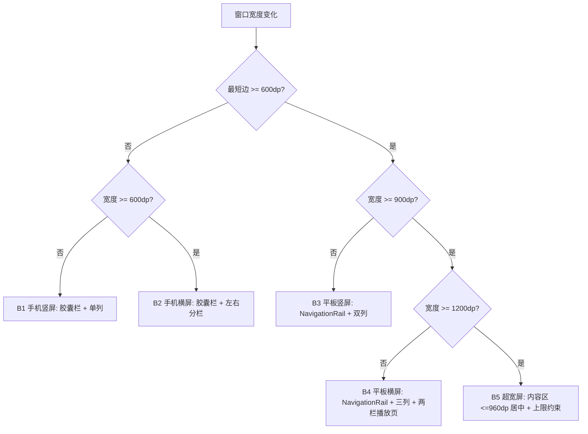
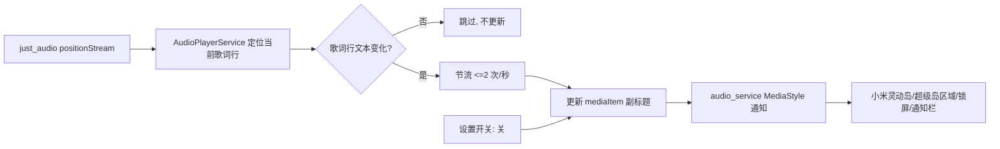

# SuchMusic 二改需求规格文档（PRD）

| 项目 | 内容 |
|---|---|
| 文档版本 | v1.0（二改） |
| 语言 | 简体中文 |
| 目标平台 | Android（手机 / 平板 / 折叠屏 / 自由窗口） |
| 代码基线 | `/workspace/suchmusic`，19 个 Dart 文件，约 8520 行 |
| 技术栈 | Flutter + `just_audio` + `audio_service` + `netease_music_api` |
| 交付物 | 可运行 Android APK（Debug/Release）+ 回归验证记录 |

---

## 1. 背景与目标

SuchMusic 是基于 Flutter 的网易云音乐第三方客户端，当前全部 UI 按**竖屏手机 430×932 设计稿硬编码**：`main.dart:159` 用 `屏宽*0.85-44` 算底部胶囊栏宽、`player_page.dart:289/795` 用 `屏宽-50` 算封面与进度条宽、`settings_page.dart:51` 与 `widgets/design_dialog.dart:17` 用 `屏宽/430` 作全局缩放系数、`profile_page.dart:153` 用 `屏高*0.533` 作渐变高度；经检索全仓库**不存在** `setPreferredOrientations` / `OrientationBuilder` / `LayoutBuilder` 任一适配手段，因此在横屏、平板（尤其小米平板横屏 ≈1600dp 逻辑宽）与小米无极缩放/自由窗口下会大面积溢出、错位、元素被拉伸。同时 `pubspec.yaml:43` 把 `netease_music_api` 依赖写成硬编码本地路径 `D:/laji/flutter-netease-music-api-master`，导致项目在其它机器上**无法构建**。本次二改目标：① 让 UI 在手机竖屏/横屏、平板竖屏/横屏、自由窗口任意尺寸下均不溢出且观感达标；② 支持在小米灵动岛/系统通知上显示歌词；③ 新增「酷狗概念版」音源，可用其 VIP 播放 VIP 歌曲；④ 修复构建缺陷并通过回归验证，确保不引入新 bug。

---

## 2. 范围与非目标

### 2.1 本版范围内（In Scope）

- UI 全量断点适配（手机竖屏/横屏、平板竖屏/横屏、折叠屏展开态、自由窗口无极缩放）。
- 字体/显示大小无极缩放（`textScaler`）下的不截断保障。
- 歌词输出到系统通知；在小米设备上以灵动岛/超级岛可用形态呈现，并提供开关与降级。
- 新增酷狗概念版音源：音源切换、搜索、播放、歌词、VIP 歌曲解锁。
- `pubspec.yaml` 依赖路径修复，保证跨机器 `flutter pub get` / 构建成功。
- 全链路回归验证（静态分析 + 多尺寸真机/模拟器走查）。

### 2.2 明确不做（Out of Scope，本版）

| 编号 | 非目标 | 说明 |
|---|---|---|
| NG-1 | iOS / macOS / Windows / Web 端适配与验证 | 仅保证 Android 达标；其它平台不承诺 |
| NG-2 | 上架小米应用商店 | 不做商店上架、不做小米开发者资质申请 |
| NG-3 | 接入「小米超级岛」官方审核通道 | 依赖上架+白名单，本版用通知栏副标题降级方案（见 REQ-06、Q1） |
| NG-4 | 支付、内购、会员售卖 | 不实现任何付费逻辑；VIP 权益完全依赖用户自有账号 |
| NG-5 | 破解/绕过版权限制、伪造 VIP 身份 | 仅透传用户自有合法凭证 |
| NG-6 | 网易云侧功能新增（推荐算法、评论、MV 等） | 仅做适配，不扩功能 |
| NG-7 | UI 视觉重设计 | 保持现有视觉风格与配色，仅做布局适配 |

---

## 3. 需求池

> 优先级：**P0 = 必须（Must）**，**P1 = 应当（Should）**，**P2 = 可选（Could）**。
> 验收前置环境见 §4.4 设备矩阵。

### 3.0 REQ-00 构建可复现（前置阻断项）

| 项 | 内容 |
|---|---|
| 优先级 | **P0** |
| 需求描述 | 移除 `pubspec.yaml` 中 `netease_music_api` 的硬编码绝对路径，改为可在任意机器解析的依赖来源。 |
| 用户故事 | 作为**二次开发者**，我要**在任意机器 clone 后直接 build**，以便**不依赖原作者 D 盘路径即可参与开发**。 |
| 验收标准 | 1) `pubspec.yaml` 中不存在 `D:/`、`C:/`、`/Users/` 等绝对路径；2) 全新环境执行 `flutter pub get` 成功（0 error）；3) `flutter analyze` 无 error；4) `flutter build apk --debug` 成功产出 APK。 |
| 边界与异常 | 若上游库无法发布到 pub.dev，则采用 git 依赖或 vendor 到 `third_party/` 并纳入版本管理；须在文档记录来源 commit 以便复现。 |

### 3.1 需求 1：横竖屏与平板完整适配

#### REQ-01 竖屏基线不回归

| 项 | 内容 |
|---|---|
| 优先级 | **P0** |
| 需求描述 | 改造断点布局后，430×932 竖屏（手机）下的视觉与交互**与改造前一致**。 |
| 用户故事 | 作为**现有手机用户**，我要**升级后界面不发生变化**，以便**不因适配改造产生陌生感或功能位移**。 |
| 验收标准 | 1) 在 360dp / 393dp / 430dp 宽竖屏下，首页、播放页、搜索页、个人页、设置页逐屏截图与改造前基线对比，布局结构与元素相对位置一致（允许 ≤2dp 误差）；2) 封面尺寸仍为 `屏宽-50` 观感、底部胶囊栏仍居中悬浮于底部。 |
| 边界与异常 | 极窄屏（<360dp，如 320dp）允许缩小字号与间距但**不得溢出**、不得出现红条。 |

#### REQ-02 手机横屏分栏布局

| 项 | 内容 |
|---|---|
| 优先级 | **P0** |
| 需求描述 | 手机横屏（短边<600dp 且宽>高）时，页面由单列改为分栏：播放页左栏（封面+歌名/歌手+控制条）/ 右栏（歌词）；首页与列表页内容宽度受约束并居中。 |
| 用户故事 | 作为**横屏看歌词的用户**，我要**封面与歌词并排显示**，以便**横屏时不浪费两侧空白、歌词可视行数更多**。 |
| 验收标准 | 1) 进入横屏后 300ms 内完成布局切换，无闪退；2) 播放页横屏为左右两栏，左栏宽度 = 右栏宽度（±5%），封面为**正方形**且边长 ≤ 左栏宽，控制条完整可见可点；3) 歌词区域可独立滚动，当前行高亮与自动滚动正常；4) 底部悬浮胶囊栏在横屏下不遮挡内容（内容底部预留高度 ≥ 胶囊栏高度+间距）；5) 全程无 `RenderFlex overflowed`。 |
| 边界与异常 | 横屏时系统键盘弹出（搜索页）→ 内容可滚动、输入框不被遮挡；横竖屏旋转过程中**播放不中断、进度不重置**。 |

#### REQ-03 平板布局（短边 ≥600dp）

| 项 | 内容 |
|---|---|
| 优先级 | **P0** |
| 需求描述 | 短边 ≥600dp 判定为平板：底部悬浮胶囊 Tab 栏改为**左侧竖向导航（NavigationRail）**；首页卡片/歌单由单列变**多列网格**（≥600dp 双列，≥840dp 三列）；播放页平板横屏采用左右两栏（封面区 + 歌词区）。 |
| 用户故事 | 作为**小米平板用户**，我要**界面利用大屏空间、导航符合平板习惯**，以便**不用眯眼找按钮、一屏看到更多内容**。 |
| 验收标准 | 1) 短边≥600dp 时出现左侧导航栏，宽度 72–96dp，图标+文字完整；2) 首页在平板上为 ≥2 列网格，切换列数时无内容裁切；3) 播放页平板横屏左栏（封面+信息+控制）与右栏（歌词）并列，两栏均无横向溢出；4) 所有可点击控件热区 ≥48×48dp；5) 无 `RenderFlex overflowed`、无元素超出屏幕边界。 |
| 边界与异常 | 折叠屏展开/折叠切换（如 6 vs 12 系列）→ 以**窗口宽度**而非设备型号判定形态，切换过程不崩溃；平板竖屏宽度 600–840dp 时按「双列」而非「三列」处理。 |

#### REQ-04 超宽屏上限约束（小米平板横屏）

| 项 | 内容 |
|---|---|
| 优先级 | **P1** |
| 需求描述 | 内容区设**最大宽度上限**（建议 840–1000dp），超出后居中留白；封面/卡片/歌词块设最大尺寸，避免在 14 寸小米平板横屏（≈1600dp 逻辑宽）下被放大到失衡。 |
| 用户故事 | 作为**小米平板 6 Max 类大屏用户**，我要**内容不被无限拉伸**，以便**观感与阅读舒适度接近桌面级播放器**。 |
| 验收标准 | 1) 窗口宽 ≥1200dp 时，主内容区宽度 ≤ 设定上限且水平居中；2) 播放页封面边长 ≤ 上限（建议 ≤420dp），不随窗口无限增大；3) 歌词字号不随窗口宽度线性放大（设上限）；4) 1600dp 宽下无空白异常、无元素贴边。 |
| 边界与异常 | 上限取值需可配置（常量或主题变量）；分屏模式下窗口宽介于 1000–1200dp 时不得跳变闪烁。 |

#### REQ-05 无极缩放 / 自由窗口任意尺寸不溢出

| 项 | 内容 |
|---|---|
| 优先级 | **P0** |
| 需求描述 | 适配小米「自由窗口无极调节」与系统「显示大小/字体大小」无极缩放：布局宽度从 320dp 连续变化到 1920dp、`textScaler` 从 0.85 到 1.3+，均不得出现溢出红条、文字截断、控件丢失。 |
| 用户故事 | 作为**使用小米自由窗口/调整显示大小的用户**，我要**任意拖拽窗口或调整缩放后界面都正常**，以便**不出现「半截按钮」或输入框被吞**。 |
| 验收标准 | 1) 在自由窗口下连续拖拽改变尺寸（至少覆盖 320 / 480 / 600 / 840 / 1200 / 1600dp 六个宽度）各停留 5s，Debug 模式下**无任何 `RenderFlex overflowed` / `A RenderFlex` 异常输出**；2) `textScaler=1.3` 时关键文案（歌名、歌词、按钮标签、时间）不截断成「…」以外的不完整态；3) 固定比例元素（如开关、圆形按钮）在任意尺寸下保持正圆/正方形不变形。 |
| 边界与异常 | 极端宽度 <320dp（窗口最小化）时允许滚动或隐藏次要元素，但**不允许崩溃**；窗口高度极小（<300dp）时内容可滚动访问。 |

### 3.2 需求 2：小米无极缩放 + 灵动岛歌词

#### REQ-06 灵动岛 / 通知栏显示歌词（含开关与降级）

| 项 | 内容 |
|---|---|
| 优先级 | **P0**（降级方案的接受度见 Q1） |
| 需求描述 | 新增「通知栏/灵动岛显示歌词」开关（默认开）。开启时，将当前播放歌词行通过 `audio_service` 的 `MediaItem` 副标题/描述输出到系统媒体通知，使小米灵动岛（超级岛）区域、锁屏及通知栏可显示实时歌词；小米超级岛官方通道（需上架+审核）暂不接入。 |
| 用户故事 | 作为**小米手机用户**，我要**在灵动岛/通知栏直接看到当前歌词**，以便**不打开 App 也能跟唱、快速确认播放进度**。 |
| 验收标准 | 1) 设置页存在开关项，状态持久化（`shared_preferences`），重启后保留；2) 开启后播放歌曲，系统媒体通知的**副标题区**随歌词逐行更新，切歌后同步更新；3) 在小米 HyperOS 设备上，灵动岛/状态胶囊区域可呈现上述歌词文本；4) 关闭开关后歌词不再写入通知，仅显示歌名/歌手；5) 开关切换**不打断播放**、不重启音频服务。 |
| 边界与异常 | a) 无歌词（纯音乐/接口失败）→ 副标题回退显示「歌手 - 专辑」或留空，不显示空行；b) 通知权限被拒绝（`POST_NOTIFICATIONS`）→ 功能静默禁用并在设置页提示「需开启通知权限」，**不影响播放**；c) 歌词行含空行或纯时间戳 → 跳过空行，沿用上一有效行；d) 系统不支持灵动岛/超级岛（非小米或旧系统）→ 自动降级为普通媒体通知，不报错；e) 歌词更新频率过高导致耗电 → 更新节流（建议 ≤2 次/秒，且仅在歌词行文本变化时更新）。 |

### 3.3 需求 3：酷狗概念版音源支持

#### REQ-07 音源切换

| 项 | 内容 |
|---|---|
| 优先级 | **P0** |
| 需求描述 | 新增音源抽象层，支持「网易云」「酷狗概念版」两个音源；设置页提供音源选择与「失败自动回退」开关；首页/搜索页顶栏展示当前音源标识。 |
| 用户故事 | 作为**双平台用户**，我要**一键切换音源**，以便**在网易云无版权时用酷狗概念版听歌**。 |
| 验收标准 | 1) 设置页可选择音源，状态持久化，重启后保留；2) 切换后首页、搜索、播放、歌词全部走新音源（可验证：请求 URL/返回 id 归属对应平台）；3) 顶栏音源标识与实际生效音源一致；4) 切换音源**不清空当前播放列表**（保留队列，仅影响后续请求），或明确提示后清空——二者择一且行为一致。 |
| 边界与异常 | 未配置酷狗凭证时选择酷狗 → 引导至凭证配置页并给出明确提示，不清空网易云登录态；音源初始化失败 → 自动回退到网易云并提示。 |

#### REQ-08 酷狗音源搜索

| 项 | 内容 |
|---|---|
| 优先级 | **P0** |
| 需求描述 | 在酷狗音源下支持关键词搜索歌曲，返回结果字段（歌名、歌手、专辑、时长、封面）与网易云统一为 `SongModel`。 |
| 用户故事 | 作为**酷狗用户**，我要**用同一搜索框搜到酷狗曲库**，以便**不切换 App 就能找歌**。 |
| 验收标准 | 1) 酷狗音源下搜索「周杰伦」返回 ≥10 条结果且字段完整（歌名/歌手非空）；2) 结果可直接点击播放并进入播放页；3) 热门搜索、搜索历史在酷狗音源下可用（数据来源见 Q4）；4) 空关键词不发请求，无结果展示「未找到相关歌曲」。 |
| 边界与异常 | 接口超时（>10s）→ 展示「搜索失败，请重试」且 UI 可恢复；接口返回结构变更 → 不崩溃，记日志并降级为空结果。 |

#### REQ-09 酷狗音源播放（含 VIP 歌曲）

| 项 | 内容 |
|---|---|
| 优先级 | **P0** |
| 需求描述 | 酷狗音源下可获取播放地址并播放，包含需要 VIP 才能播放的歌曲：使用用户自有酷狗概念版 VIP 凭证（`token`/`userid` 等）请求高阶音质播放地址。 |
| 用户故事 | 作为**持有酷狗概念版 VIP 的用户**，我要**用我的 VIP 权益播放灰色/VIP 歌曲**，以便**不必在客户端与酷狗 App 间来回切换**。 |
| 验收标准 | 1) 非 VIP 歌曲可正常播放（含暂停/上一首/下一首/进度拖动）；2) 配置有效 VIP 凭证后，VIP 歌曲可返回可播放 URL（HTTP/HTTPS，非 403）；3) 播放页封面、歌名、时长正确；4) 后台播放与通知栏控制（`audio_service`）在酷狗音源下同样生效；5) 播放失败时给出明确原因（无版权 / 需 VIP / 凭证失效 / 网络异常）并可回退网易云。 |
| 边界与异常 | a) 凭证过期/无效 → 提示「酷狗凭证已失效，请重新配置」，不崩溃；b) 无 VIP 点播 VIP 歌曲 → 明确提示「该歌曲需酷狗概念版 VIP」而非静默失败；c) 播放地址为临时直链且带时效 → 播放前实时获取、不长期缓存；d) 高频切歌连续请求 → 需做请求竞态保护（只认最后一次请求结果），避免旧结果覆盖当前播放。 |

#### REQ-10 酷狗音源歌词

| 项 | 内容 |
|---|---|
| 优先级 | **P1** |
| 需求描述 | 酷狗音源下获取并解析歌词（酷狗歌词格式若为加密 KRC 需解密），复用现有 `LyricLine` / `_parseLrc` 与歌词滚动逻辑。 |
| 用户故事 | 作为**酷狗用户**，我要**看到逐行同步歌词**，以便**跟唱与欣赏**。 |
| 验收标准 | 1) 酷狗歌曲播放时歌词逐行滚动、当前行高亮、点击行可跳转播放位置；2) 有翻译歌词时按现有网易云策略展示（若无翻译接口则仅原文）；3) 歌词解析失败 → 不显示歌词区，不影响播放（与现有 `_lyrics.isEmpty` 行为一致）。 |
| 边界与异常 | 加密歌词解密失败 → 降级尝试普通 LRC；纯音乐/无歌词 → 歌词区不占位、不报错。 |

#### REQ-11 酷狗凭证配置与用户可见状态

| 项 | 内容 |
|---|---|
| 优先级 | **P1** |
| 需求描述 | 提供酷狗凭证配置入口（手动填写 token/userid，或扫码/授权登录，方式见 Q2），并展示登录状态与 VIP 状态。 |
| 用户故事 | 作为**酷狗用户**，我要**安全地录入并管理我的凭证**，以便**随时启用/停用酷狗音源**。 |
| 验收标准 | 1) 设置页可录入、清除凭证，录入后展示昵称/VIP 标识；2) 凭证与网易云 `user_cache.json` 分开存储，互不影响；3) 清除凭证后音源自动回退网易云；4) 日志与 UI 中**不得完整打印 token**（脱敏）。 |
| 边界与异常 | 录入格式非法（含空格/前缀）→ 自动清洗并提示；网络异常 → 保留本地凭证，提示校验失败。 |

### 3.4 需求 4：无 Bug 保障

#### REQ-12 回归验证与缺陷清零

| 项 | 内容 |
|---|---|
| 优先级 | **P0** |
| 需求描述 | 二改后完成静态分析与跨尺寸回归，确保既有功能不被破坏。 |
| 用户故事 | 作为**项目维护者**，我要**确认改造没有引入回归缺陷**，以便**放心发版**。 |
| 验收标准 | 1) `flutter analyze` 0 error（warning 不新增超过改造前基线）；2) Debug 模式全流程走查（登录→搜索→播放→切歌→FM→歌单→设置→清理缓存→检查更新）**无异常断言**、无溢出红条；3) 在 §4.4 矩阵中每一种形态至少跑通一次核心用例（搜索→播放→横竖屏切换→后台播放→通知栏歌词）；4) 冷启动 3 次均正常，无白屏/卡死；5) 播放内存不随切歌持续增长（切 30 首后无持续上涨趋势）。 |
| 边界与异常 | 极弱网/断网 → 各页面有明确失败提示且可重试，不卡死；快速连续操作（狂点播放/切歌）→ 不崩溃、不重复叠加播放。 |

---

## 4. 交互与 UI 规格

### 4.1 断点定义（JSON）

```json
{
  "breakpoints": [
    { "id": "B1", "name": "手机竖屏",   "minWidth": 320,  "maxWidth": 599,  "orientation": "portrait"  },
    { "id": "B2", "name": "手机横屏",   "minWidth": 600,  "maxWidth": 839,  "orientation": "landscape" },
    { "id": "B3", "name": "平板竖屏",   "minWidth": 600,  "maxWidth": 899,  "orientation": "portrait"  },
    { "id": "B4", "name": "平板横屏",   "minWidth": 900,  "maxWidth": 1199, "orientation": "landscape" },
    { "id": "B5", "name": "超宽屏/自由窗口", "minWidth": 1200, "maxWidth": null, "orientation": "any" }
  ],
  "rules": {
    "deviceClass": "以最短边 >= 600dp 判定为平板形态，而非设备型号",
    "contentMaxWidth": 960,
    "coverMaxSide": 420,
    "lyricFontMax": 34,
    "minTouchTarget": 48
  }
}
```

### 4.2 各断点布局形态

| 断点 | 判定依据 | 底部导航 | 播放页 | 首页 / 列表页 | 关键约束 |
|---|---|---|---|---|---|
| **B1 手机竖屏** | 宽 320–599dp 且 高>宽 | 悬浮胶囊栏（居中，`min(屏宽*0.85-44, 上限)`） | 单列：封面(屏宽-50) → 歌名歌手 → 歌词 → 进度条 → 控制条 | 单列列表 + 横向滑动卡片 | 保持改造前基线外观 |
| **B2 手机横屏** | 宽 600–839dp 且 宽>高 | 悬浮胶囊栏（宽度设上限，居中） | **左右分栏**：左=封面+信息+控制，右=歌词滚动 | 单列/双列，内容居中留白 | 封面正方形且 ≤ 左栏宽；胶囊栏不遮挡 |
| **B3 平板竖屏** | 最短边≥600dp，宽 600–899dp，竖 | **左侧 NavigationRail（72–96dp）** | 列布局：上方封面+信息+控制，下方歌词 | **双列网格** | 热区 ≥48dp；内容居中 |
| **B4 平板横屏** | 最短边≥600dp，宽 900–1199dp，横 | 左侧 NavigationRail | **左右两栏**：左=封面+信息+控制，右=歌词 | **三列网格** | 两栏等比；歌词字号设上限 |
| **B5 超宽屏/自由窗口** | 宽 ≥1200dp | 左侧 NavigationRail（固定宽度） | 两/三栏，内容区 ≤960dp 居中 | 三列网格，内容区 ≤960dp 居中 | 封面 ≤420dp；字号不随宽度线性放大 |

> 布局决策示意：



### 4.3 「灵动岛歌词」数据链路



### 4.4 验收设备/尺寸矩阵

| 形态 | 代表设备 / 窗口 | 目标宽度(dp) | 必测用例 |
|---|---|---|---|
| 手机竖屏 | 常规 6.1–6.7 寸 | 393 | 搜索→播放→歌词滚动→胶囊栏 |
| 手机横屏 | 同上旋转 | 852×393 | 分栏渲染、旋转不中断播放 |
| 平板竖屏 | 小米平板 7 | 800 | NavigationRail、双列网格 |
| 平板横屏 | 小米平板 6 / 6 Pro | 1280×800 | 两栏播放页、无溢出 |
| 超宽屏 | 小米平板 6 Max(14") | ≈1600 | 上限约束、居中留白 |
| 自由窗口 | 小米 HyperOS 无极拖拽 | 320→1920 连续 | 无 overflow、无截断 |
| 缩放 | 系统显示大小 0.85–1.3 | — | 文案不截断、控件不变形 |

---

## 5. 待确认问题（需用户拍板）

| 编号 | 问题 | 选项 | 建议/影响 |
|---|---|---|---|
| **Q1** | 「灵动岛歌词」是否接受**「用系统媒体通知副标题显示歌词」**这一**无需小米审核、立即可生效**的方案作为本版交付？ | A. 接受降级方案（推荐）<br>B. 必须走小米超级岛官方通道（需先上架小米应用商店 + 官方白名单审核，周期与不确定性高） | 选 B 则与 NG-2/NG-3 冲突，本版无法承诺；选 A 可在任意 Android 生效，小米设备上以灵动岛/状态胶囊形态呈现 |
| **Q2** | 酷狗概念版凭证获取方式？ | A. 用户手动填写 `token`/`userid`（最快落地，推荐）<br>B. 扫码/授权登录（体验好，需逆向登录流程）<br>C. 两者都要 | 直接影响 REQ-11 工作量；无论哪种都需在 UI 提示合规与失效风险 |
| **Q3** | 音源默认值与回退策略？ | A. 默认网易云，失败自动回退酷狗<br>B. 默认酷狗（VIP 优先）<br>C. 每次手动选择，不回退 | 影响 REQ-07 验收口径与用户预期 |
| **Q4** | 酷狗音源下「热门搜索 / 搜索历史」数据源？ | A. 走酷狗热门搜索接口<br>B. 复用网易云热门搜索<br>C. 隐藏热门搜索 | 影响 REQ-08 验收项 |
| **Q5** | 超宽屏内容最大宽度上限取值？ | 840 / 960 / 1000dp | 建议 960dp；影响 REQ-04 观感判定 |
| **Q6** | 横屏与平板下是否保留「点击封面收起为大歌词」交互？ | A. 保留<br>B. 分栏形态下移除（封面固定可见） | 建议 B，避免分栏下语义混乱 |
| **Q7** | 是否需要支持「音质选择」（标准/高品/无损）？ | A. 不需要（本版固定最高可用）<br>B. 需要（设置项） | 属范围外扩，需确认是否纳入 |
| **Q8** | 酷狗逆向接口的**合规与责任**如何界定？ | A. 由使用者自行承担，App 内免责声明<br>B. 不做酷狗功能 | 建议 A 并在「关于」页补充声明 |

---

## 6. 风险

| 编号 | 风险 | 类别 | 概率 | 影响 | 应对措施 |
|---|---|---|---|---|---|
| **R-1** | 酷狗接口为**逆向接口**，随时可能变更或封禁（签名算法、字段结构、风控） | 外部依赖 | 高 | 高 | 音源抽象层解耦；接口失败自动回退网易云；关键映射集中配置便于热修；灰度开关可远程关闭酷狗（若条件允许） |
| **R-2** | 小米「超级岛」需**官方审核授权**且通常要求应用上架小米应用商店 | 平台政策 | 高 | 中 | 本版走通知副标题降级方案（Q1），不阻塞交付；官方通道列为后续独立需求 |
| **R-3** | 自由窗口/无极缩放下仍有未覆盖的极端尺寸导致溢出 | 技术 | 中 | 中 | 以 Debug 溢出断言为强制门禁；矩阵覆盖 320→1920dp；关键页用 `SingleChildScrollView` 兜底 |
| **R-4** | 通知栏/灵动岛歌词高频更新引起耗电与发热 | 性能 | 中 | 中 | 仅在歌词行文本变化时更新 + 节流 ≤2 次/秒 + 提供开关 |
| **R-5** | 版权与合规风险（VIP 歌曲播放、凭证存储） | 合规 | 中 | 高 | 仅透传用户自有合法凭证，不破解；凭证本地加密存储、日志脱敏；关于页免责声明 |
| **R-6** | 适配改造范围大（19 文件、多处硬编码），回归成本高、易漏改 | 工程 | 中 | 高 | 建立「硬编码尺寸清单」逐项清零（`main.dart:159`、`player_page.dart:289/795`、`settings_page.dart:51`、`design_dialog.dart:17`、`profile_page.dart:153`、`home_page.dart:307/309/471`、`about_page.dart:143/158`）；提取统一 `ResponsiveUtils` 单一真源 |
| **R-7** | `netease_music_api` 为私有/本地包，去除硬编码路径后仍需可解析来源 | 依赖 | 中 | 中 | git 依赖或 vendor 到仓库内并锁定 commit（REQ-00 边界） |
| **R-8** | 音源切换造成播放列表/播放状态不一致，出现「列表是网易云、播放取酷狗」错配 | 技术 | 中 | 中 | 为 `SongModel` 增加来源标识；播放前校验歌曲归属音源与当前音源一致；不一致时按当前音源解析或提示 |
| **R-9** | 接口竞态：快速切歌时旧请求结果覆盖新播放 | 技术 | 中 | 中 | 请求带序号/取消令牌，仅接受最新请求结果（REQ-09 边界 d） |
| **R-10** | 平板 UI 改动引发手机端视觉回归 | 技术 | 中 | 中 | REQ-01 基线截图对比作为强制门禁 |

---

## 附：需求追溯一览

| 编号 | 标题 | 优先级 | 关联用户需求 |
|---|---|---|---|
| REQ-00 | 构建可复现（pubspec 路径修复） | P0 | 需求 4 |
| REQ-01 | 竖屏基线不回归 | P0 | 需求 1 |
| REQ-02 | 手机横屏分栏布局 | P0 | 需求 1 |
| REQ-03 | 平板布局（≥600dp） | P0 | 需求 1 |
| REQ-04 | 超宽屏上限约束 | P1 | 需求 1 |
| REQ-05 | 无极缩放/自由窗口不溢出 | P0 | 需求 1、2 |
| REQ-06 | 灵动岛/通知栏歌词（开关+降级） | P0 | 需求 2 |
| REQ-07 | 音源切换 | P0 | 需求 3 |
| REQ-08 | 酷狗搜索 | P0 | 需求 3 |
| REQ-09 | 酷狗播放（含 VIP） | P0 | 需求 3 |
| REQ-10 | 酷狗歌词 | P1 | 需求 3 |
| REQ-11 | 酷狗凭证配置 | P1 | 需求 3 |
| REQ-12 | 回归验证与缺陷清零 | P0 | 需求 4 |
